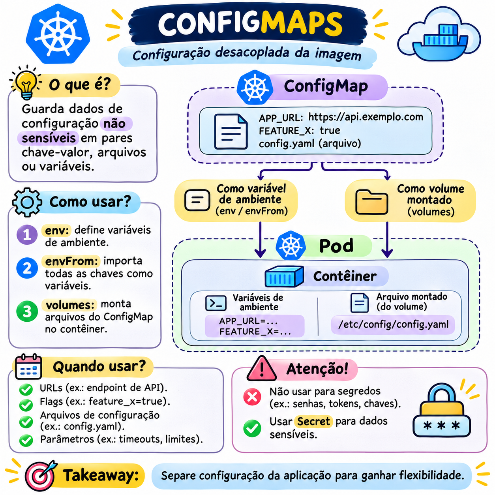

# 01.10 · ConfigMaps

[↑ Camada 01](../README.md) · [📚 Catálogo](../../../docs/catalogo.md)

## 🎨 Infográfico



## 📖 Aula teórica

**Em preparação.** Um ConfigMap permite separar dados de configuração não sensíveis da imagem da aplicação. Pods podem consumir esses valores como variáveis de ambiente ou arquivos montados.

Não utilize ConfigMaps para senhas e credenciais; consulte a [aula de Secrets](../secrets/README.md).

[Referência oficial — ConfigMap](https://kubernetes.io/docs/concepts/configuration/configmap/)

## 🧪 Prática e observação

Experimento inicial sugerido (ainda não validado como laboratório completo):

```bash
kubectl config current-context
kubectl create configmap aula-config --from-literal=APP_MODE=demo
kubectl get configmap aula-config -o yaml
kubectl delete configmap aula-config
```

> Confirme o contexto e namespace antes de executar. Não utilize dados sensíveis neste exercício.

## 🔎 Diagnóstico e conclusão

Compare a configuração armazenada com o modo como um Pod a consome. O lab de consumo via `envFrom` e volume ainda será desenvolvido.

---

[← Services](../services/README.md) · [↑ Camada 01](../README.md) · [Próxima: Secrets →](../secrets/README.md)
