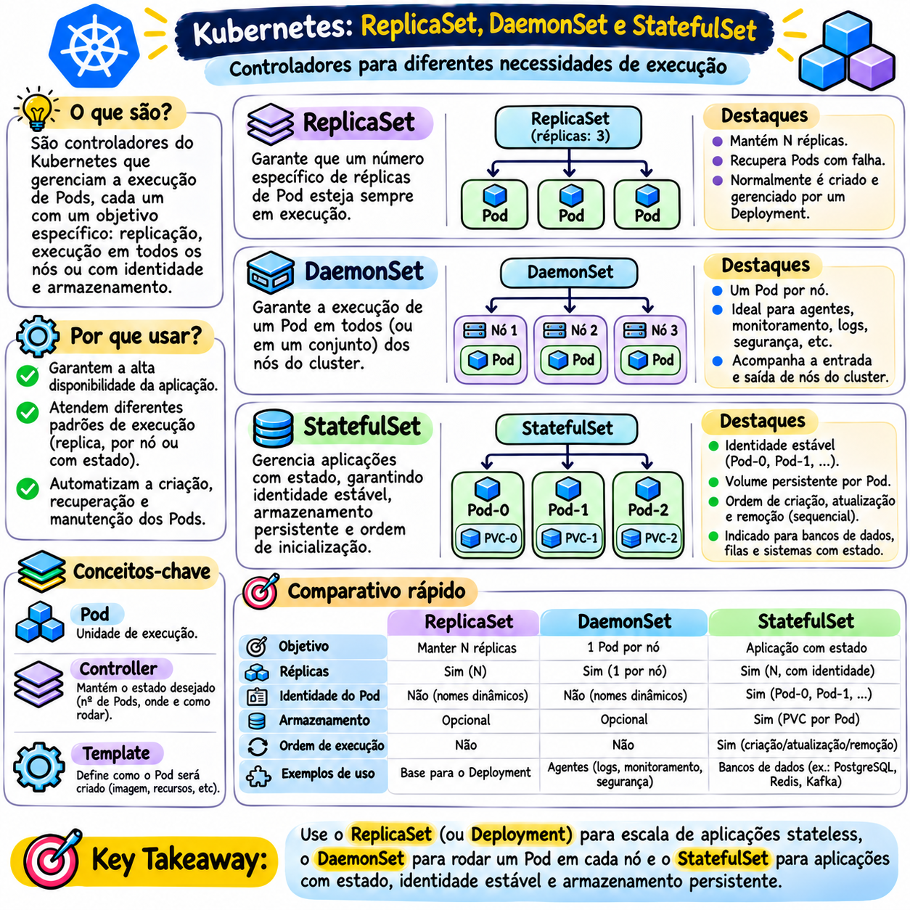

# 01.04 · ReplicaSet, DaemonSet e StatefulSet

[⌂ Início](../../../README.md) · [↑ Camada 01](../README.md) · [📚 Catálogo](../../../docs/catalogo.md)

> **Objetivo:** compreender o conceito, interpretar seu comportamento no cluster e conectar a teoria à prática.

## 🎨 Infográfico



## 📖 Aula teórica

## Por que existem controladores diferentes?

Todos reconciliam Pods, mas **a intenção de cada workload é diferente**. Escolher o controlador adequado evita tratar aplicações com estado, agentes por nó e réplicas intercambiáveis como se fossem o mesmo problema.

| Recurso | O que garante | Uso típico |
| --- | --- | --- |
| **ReplicaSet** | Número especificado de Pods que correspondem ao seletor | Quase sempre gerenciado por Deployment |
| **DaemonSet** | Um Pod em cada nó elegível, sujeito a regras de agendamento | Agentes de logging, monitoramento ou rede |
| **StatefulSet** | Identidade estável, ordinal e comportamento ordenado | Serviços stateful e clusters distribuídos |

## ReplicaSet

Um ReplicaSet observa o conjunto de Pods selecionados e cria ou remove instâncias para atender `replicas`. Em aplicações comuns, trabalhe com **Deployment**, que gerencia revisões e ReplicaSets de forma mais conveniente.

## DaemonSet

Um DaemonSet acompanha os nós elegíveis; quando um novo nó compatível aparece, o controller procura executar nele o Pod do agente. Isso não significa obrigatoriamente um Pod em *todos* os nós: taints, selectors, affinity e regras podem limitar o conjunto.

## StatefulSet

Um StatefulSet utiliza nomes estáveis como `db-0`, `db-1` e `db-2` e pode criar PVCs exclusivos com `volumeClaimTemplates`. Ele não transforma automaticamente um banco em altamente disponível nem garante replicação de dados: isso continua sendo responsabilidade da aplicação e de sua arquitetura.

É comum associá-lo a um **Headless Service**, para descoberta DNS por identidade estável. A exclusão do StatefulSet não implica necessariamente a remoção dos PVCs.

## Comparação no cluster

```bash
kubectl get deployments,replicasets,statefulsets,daemonsets -A
kubectl get pods -A -o wide
kubectl get pvc -A
```

Verifique quantos Pods cada controlador deseja, onde executam e quais são suas dependências. **Pergunta:** por que um DaemonSet de agente e um Deployment de aplicação precisam de estratégias de escala diferentes?

## 🧪 Aplicação prática

**Atividade de observação:** utilize os comandos e exemplos acima em um cluster de estudos. Não há lab independente validado para este tópico.

**Anotações e exemplos complementares:** [consultar material já existente](../../../4-replicaSet-daemonSet-statefulSet/README.md). Os conteúdos anteriores foram preservados.

## ✅ Revisão do aprendizado

- Qual problema este conceito resolve?
- Que campos ou estados da API permitem verificar o comportamento real?
- Que erro ou decisão equivocada você conseguiria diagnosticar após esta aula?

## 🔗 Referência oficial

[Documentação Kubernetes — ReplicaSet, DaemonSet e StatefulSet](https://kubernetes.io/docs/concepts/workloads/controllers/)

---

[↑ Índice da camada](../README.md) · [Próxima: Services →](../services/README.md)
