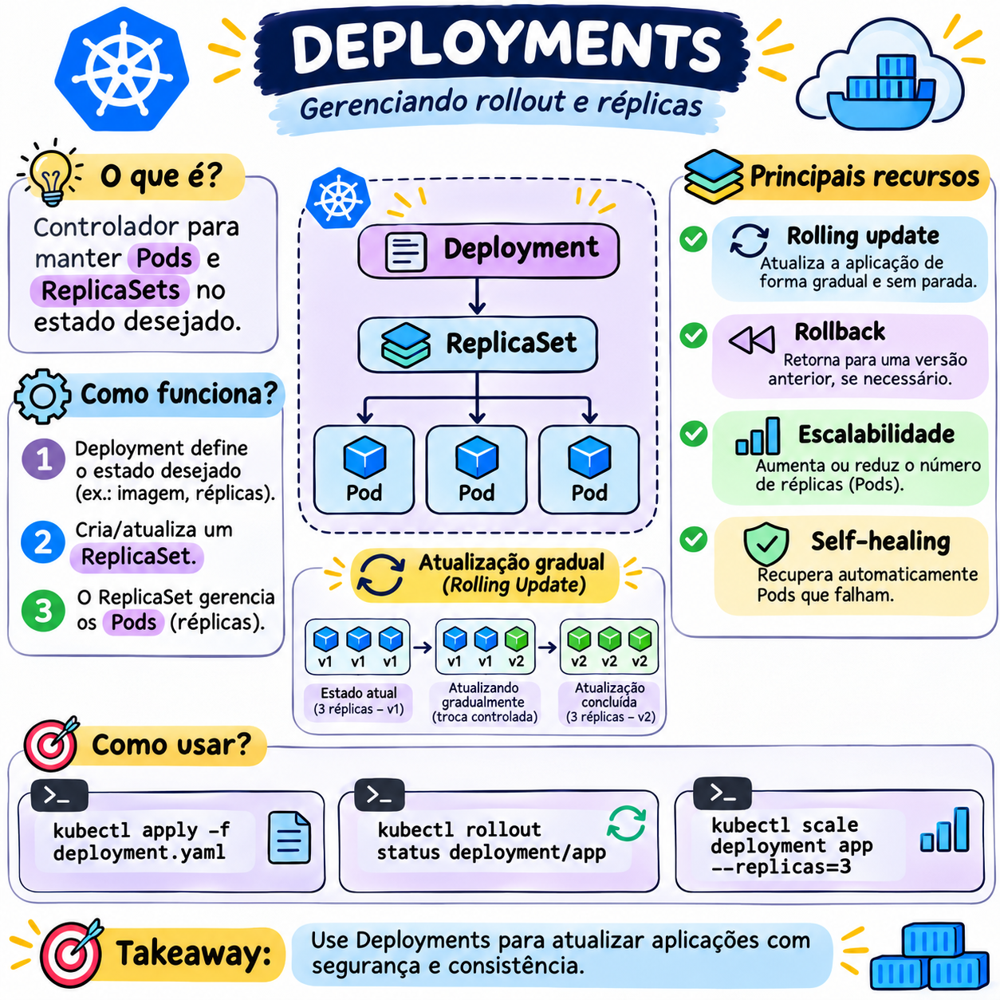

# 01.03 · Deployments

[⌂ Início](../../../README.md) · [↑ Camada 01](../README.md) · [📚 Catálogo](../../../docs/catalogo.md)

> **Ao concluir esta aula, você será capaz de:** Explicar como Deployments gerenciam ReplicaSets e réplicas de Pods e como observar a disponibilidade declarada.

## 🎨 Infográfico



## 📖 Aula teórica

## Controle declarativo de aplicações sem estado

O **Deployment** gerencia a implantação e atualização de aplicações por meio de **ReplicaSets**. Você declara a quantidade de réplicas e um template de Pod; o controller compara o estado observado e cria, escala ou substitui ReplicaSets até aproximar-se da especificação.

A relação mais importante é:

```text
Deployment (estratégia e template)
    └── ReplicaSet (quantidade desejada)
          ├── Pod
          ├── Pod
          └── Pod
```

Excluir manualmente um Pod gerenciado normalmente faz o controller providenciar outro. Já excluir o **Deployment** tem implicações diferentes para os recursos dependentes, conforme a política de propagação da exclusão.

## Exemplo interpretado

```yaml
apiVersion: apps/v1
kind: Deployment
metadata:
  name: web-demo
spec:
  replicas: 3
  selector:
    matchLabels:
      app: web-demo
  template:
    metadata:
      labels:
        app: web-demo
    spec:
      containers:
        - name: web
          image: nginx:stable
          ports:
            - containerPort: 80
```

`selector.matchLabels` precisa corresponder às labels do template. `replicas: 3` representa o estado desejado, não a garantia de três Pods prontos imediatamente.

## Atualização, rollout e rollback

A estratégia padrão **RollingUpdate** substitui Pods de forma gradual; `maxSurge` e `maxUnavailable` controlam capacidade adicional e indisponibilidade durante a troca. `Recreate` termina os Pods antigos antes de criar os novos.

```bash
kubectl get deployments,replicasets,pods
kubectl rollout status deployment/web-demo
kubectl rollout history deployment/web-demo
kubectl describe deployment web-demo
```

Os comandos acima pressupõem que o Deployment exista. Uma mudança de imagem no template cria uma nova revisão; **rollback** requer uma revisão anterior válida.

## O que monitorar?

Compare `desired`, `updated`, `ready` e `available`. Quando o rollout trava, investigue readiness, imagem, recursos disponíveis e eventos; a aceitação do YAML pela API não garante uma atualização concluída.

## 🧪 Aplicação prática

**🧪 Lab 01.03:** [🧪 Lab 01.03](../labs/deployments-basico/README.md). Execute as etapas no seu Kind, observe os eventos e registre sua hipótese antes do experimento.

**Complementar opcional:** [Consultar material complementar](../../../3-deployment/README.md). Referência adicional para consulta após a aula e o lab.

## ✅ Revisão do aprendizado

- Qual a relação entre Deployment, ReplicaSet e Pods gerenciados?
- O que acontece com o número de réplicas quando um Pod do Deployment é excluído?
- Que diferença existe entre `replicas`, `readyReplicas` e `updatedReplicas`?

## 🔗 Referência oficial

[Documentação Kubernetes — Deployments](https://kubernetes.io/docs/concepts/workloads/controllers/deployment/)

---

[← Aula 01.02 — Pods](../pods/README.md) · [↑ Camada 01](../README.md) · [🧪 Lab 01.03](../labs/deployments-basico/README.md) · [Próxima: Aula 01.04 — ReplicaSet, DaemonSet e StatefulSet →](../controladores/README.md)
