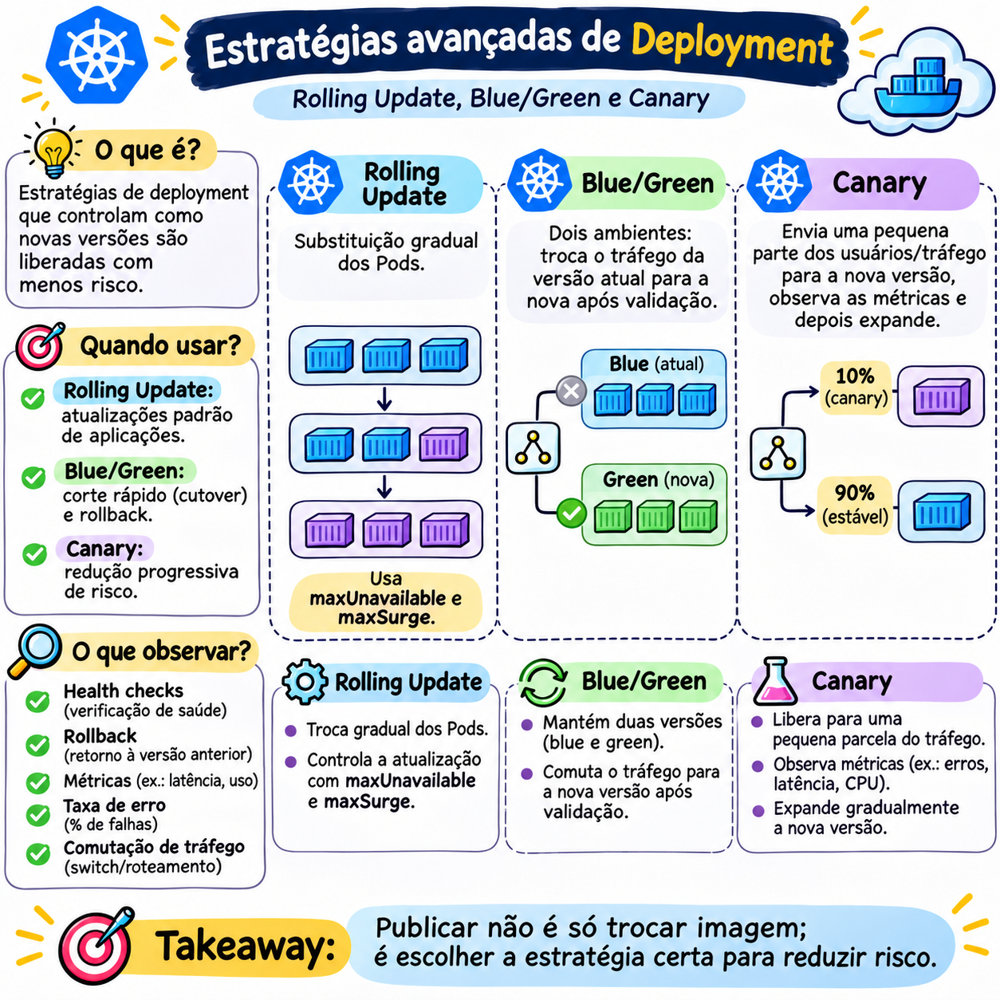

# 01.08 · Estratégias avançadas de Deployment

[⌂ Início](../../../README.md) · [↑ Camada 01](../README.md) · [📚 Catálogo](../../../docs/catalogo.md)

> **Objetivo:** compreender o conceito, interpretar seu comportamento no cluster e conectar a teoria à prática.

## 🎨 Infográfico



## 📖 Aula teórica

## Atualizar versões é administrar risco

Um deploy precisa considerar disponibilidade, rollback, compatibilidade entre versões, métricas e como o tráfego chega ao novo código. **Rolling Update**, **Blue/Green** e **Canary** diferem especialmente em *como novas versões entram em operação*.

| Estratégia | Funcionamento | Trade-off |
| --- | --- | --- |
| **Rolling Update** | Substituição gradual das réplicas de um Deployment | Simples, mas mistura versões durante a transição |
| **Blue/Green** | Dois grupos completos; troca-se o roteamento para o novo grupo | Cutover rápido, mas demanda capacidade duplicada |
| **Canary** | Pequena parcela da carga ou dos usuários recebe a versão nova | Requer observabilidade e mecanismo de roteamento/progressão |

**Importante:** o recurso Kubernetes `Deployment` implementa nativamente `RollingUpdate` e `Recreate`. Blue/Green e Canary exigem uma composição adicional, por exemplo com Services, Gateway/Ingress, service mesh ou controladores de rollout.

## Parâmetros do RollingUpdate

```yaml
strategy:
  type: RollingUpdate
  rollingUpdate:
    maxSurge: 1
    maxUnavailable: 0
```

Este trecho é um fragmento de `spec` de um Deployment. O exemplo permite criar temporariamente uma réplica extra e procura manter todas as réplicas desejadas disponíveis, condicionado a capacidade do cluster e prontidão dos Pods.

## O que pode dar errado?

- Uma versão nova pode iniciar, mas falhar quando recebe tráfego real.
- Mudar o schema do banco de modo incompatível pode inviabilizar rollback da aplicação.
- A readiness pode passar cedo demais ou não representar dependências essenciais.
- Canary com divisão de tráfego sem métricas e critério de promoção não reduz risco de forma confiável.

## Como avaliar uma estratégia?

Defina antecipadamente sinais como taxa de erro, latência, saturação, sucesso de probes e tempo de rollback. Confirme se há capacidade para a coexistência de versões.

```bash
kubectl get deployment -o wide
kubectl rollout status deployment/<nome>
kubectl rollout history deployment/<nome>
```

Os comandos pressupõem um Deployment existente. O laboratório de blue/green ou canary **não foi implementado** nesta etapa.

## 🧪 Aplicação prática

**Atividade de observação:** utilize os comandos e exemplos acima em um cluster de estudos. Não há lab independente validado para este tópico.

## ✅ Revisão do aprendizado

- Qual problema este conceito resolve?
- Que campos ou estados da API permitem verificar o comportamento real?
- Que erro ou decisão equivocada você conseguiria diagnosticar após esta aula?

## 🔗 Referência oficial

[Documentação Kubernetes — Estratégias avançadas de Deployment](https://kubernetes.io/docs/concepts/workloads/controllers/deployment/#strategy)

---

[↑ Índice da camada](../README.md) · [Próxima: Services →](../services/README.md)
