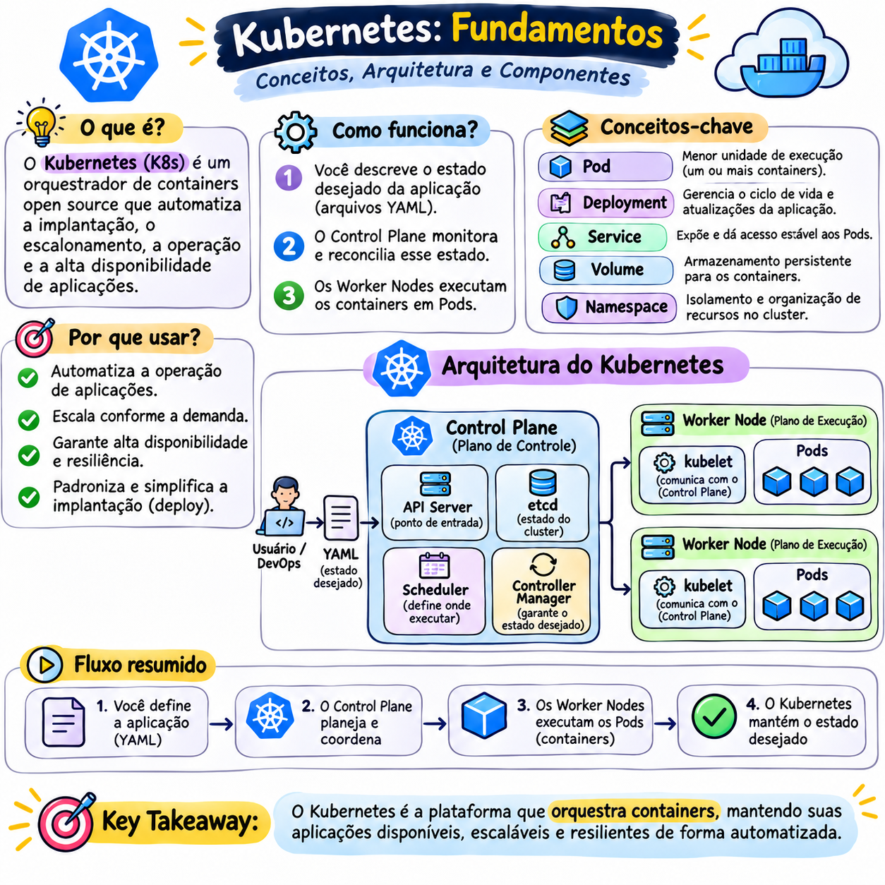

# Fundamentos

[← Camada 01](../README.md) · [Roadmap](../../../docs/roadmap.md) · [Início](../../../README.md)

> **Material de apoio:** este guia organiza o estudo do conceito. Veja também as anotações, os comandos e os exercícios em [material complementar](../../../1-fundamentos/README.md).

## 🎨 Infográfico



> **Revisão editorial:** o infográfico está disponível no repositório; confirme os detalhes técnicos com a documentação da aula.


## Objetivo

Conhecer containers, kubectl, o cluster Kubernetes e os primeiros objetos.

## Ao concluir, você deverá conseguir

- Identificar Control Plane e Worker Nodes
- Criar e inspecionar recursos com kubectl
- Preparar o Kind para os próximos exercícios

## Estude o conceito

Consulte as [anotações e exemplos práticos](../../../1-fundamentos/README.md), com explicações, exemplos e comandos para aprofundar o conceito.


## Laboratório e observação

**Pré-requisito:** [Kind configurado](../../../install-kind.md) e contexto correto selecionado. Confira `kubectl config current-context` antes de executar comandos que alterem o cluster.

Utilize os manifests e exemplos das [anotações e exemplos práticos](../../../1-fundamentos/README.md). Para observar o cluster:

```bash
kubectl config current-context
kubectl get nodes -o wide
kubectl get namespaces
kubectl get pods -A
```

> Substitua os valores entre `<...>` pelos recursos realmente criados. Os comandos acima são referências para estudo; a execução não foi testada neste PR.

Os exercícios com falhas intencionais e critérios de aceitação serão padronizados nas próximas etapas.

## Documentação oficial

- [Kubernetes — Fundamentos](https://kubernetes.io/docs/tutorials/kubernetes-basics/)

**Próximo tópico:** [Pods](../pods/README.md).


---

### Navegação

← Primeiro tópico · [↑ Voltar à camada](../README.md) · [Próximo →](../pods/README.md)
