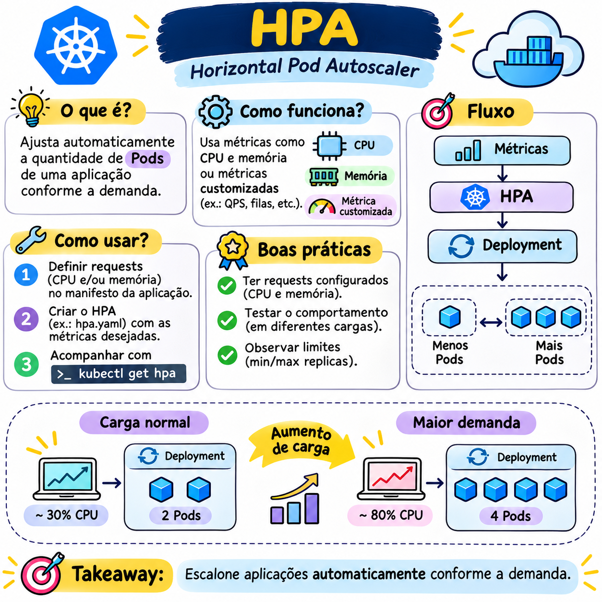

# 01.14 · Horizontal Pod Autoscaler (HPA)

[⌂ Início](../../../README.md) · [↑ Camada 01](../README.md) · [📚 Catálogo](../../../docs/catalogo.md)

> **Objetivo:** compreender o conceito, interpretar seu comportamento no cluster e conectar a teoria à prática.

## 🎨 Infográfico



## 📖 Aula teórica

## Escalar a quantidade de réplicas automaticamente

O **Horizontal Pod Autoscaler (HPA)** é um controlador que ajusta o número desejado de réplicas de recursos compatíveis, como Deployments, com base em métricas observadas.

Ele **não provisiona nós** e não aumenta recursos individuais de um container. O HPA altera a **quantidade de Pods**; já o autoscaling de nós, quando disponível, garante capacidade para acomodar Pods novos.

## Fluxo de decisão

```text
Fonte de métricas → HPA → campo replicas do workload → Controller → Pods
```

Para CPU/memória, normalmente o HPA usa a Metrics API, muitas vezes implementada pelo metrics-server. Métricas customizadas ou externas exigem integrações adequadas. Utilização percentual de CPU compara o consumo à **request de CPU** dos containers relevantes.

## Exemplo de HPA com CPU

```yaml
apiVersion: autoscaling/v2
kind: HorizontalPodAutoscaler
metadata:
  name: web-hpa
spec:
  scaleTargetRef:
    apiVersion: apps/v1
    kind: Deployment
    name: web-demo
  minReplicas: 2
  maxReplicas: 6
  metrics:
    - type: Resource
      resource:
        name: cpu
        target:
          type: Utilization
          averageUtilization: 70
```

O exemplo pressupõe um Deployment `web-demo` existente e métricas de CPU disponíveis. O controlador tenta aproximar a utilização média de CPU de 70% das **requests**; não representa 70% da capacidade total dos nós.

## Armadilhas e boas práticas

- **Sem métricas:** HPA pode mostrar condição ou erro e não escalar como esperado.
- **Sem requests de CPU:** cálculo percentual fica incompleto para os Pods envolvidos.
- **Sem capacidade no cluster:** réplicas adicionais podem permanecer `Pending` mesmo após o HPA solicitar aumento.
- **Oscilação:** mudanças rápidas de carga podem exigir estabilização e configuração apropriada de `behavior`.

```bash
kubectl get hpa -A
kubectl top pods -A
kubectl describe hpa web-hpa
```

Os comandos de métricas exigem um coletor configurado; o último pressupõe que `web-hpa` exista.

## Diagnóstico

Compare métricas observadas, valores-alvo, `desiredReplicas`, `currentReplicas` e eventos; a causa pode estar na coleta, na configuração dos requests ou no agendamento dos novos Pods. O lab de geração de carga será adicionado separadamente.

## 🧪 Aplicação prática

**Atividade de observação:** utilize os comandos e exemplos acima em um cluster de estudos. Não há lab independente validado para este tópico.

## ✅ Revisão do aprendizado

- Qual problema este conceito resolve?
- Que campos ou estados da API permitem verificar o comportamento real?
- Que erro ou decisão equivocada você conseguiria diagnosticar após esta aula?

## 🔗 Referência oficial

[Documentação Kubernetes — Horizontal Pod Autoscaler (HPA)](https://kubernetes.io/docs/tasks/run-application/horizontal-pod-autoscale/)

---

[↑ Índice da camada](../README.md) · [Próxima camada: Operação e Segurança →](../../02-operacao-seguranca/README.md)
