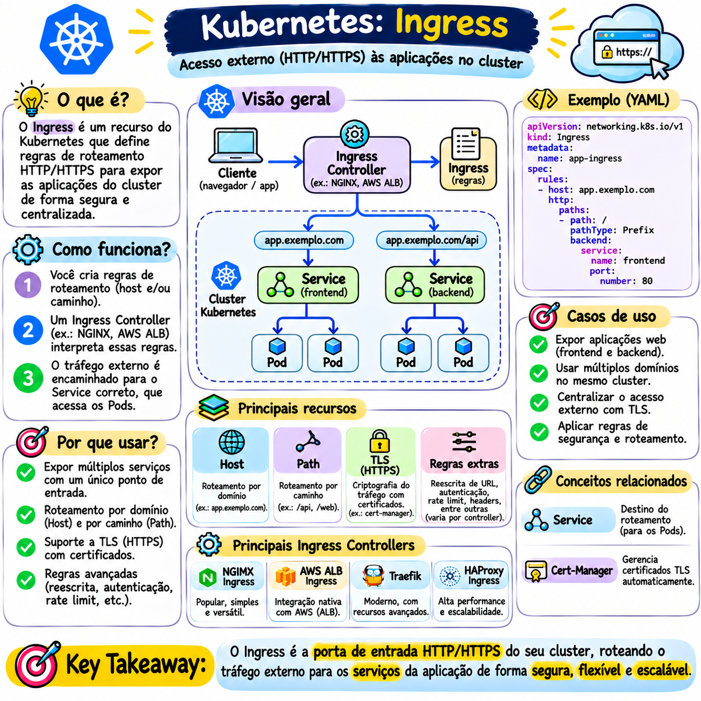

# 01.13 · Ingress

[⌂ Início](../../../README.md) · [↑ Camada 01](../README.md) · [📚 Catálogo](../../../docs/catalogo.md)

> **Objetivo:** compreender o conceito, interpretar seu comportamento no cluster e conectar a teoria à prática.

## 🎨 Infográfico



## 📖 Aula teórica

## HTTP externo sem expor cada aplicação diretamente

**Ingress** é um recurso da API Kubernetes que descreve regras de entrada **HTTP/HTTPS** para rotear requisições a Services do cluster. Ele pode selecionar backends por nome de host e por caminho de URL.

**Ingress não funciona sozinho:** é necessário instalar um **Ingress Controller** compatível, que observe esses recursos e configure um proxy ou load balancer. Criar um YAML `Ingress` sem controller não entrega roteamento funcional.

## Fluxo de uma requisição

```text
Cliente → IP/Load Balancer → Ingress Controller → Service → Pod
```

O Ingress aponta para **Services**, e não diretamente para um Deployment. O controlador implementa regras de host/path e pode realizar terminação TLS quando configurado com certificado apropriado.

## Exemplo de regra

```yaml
apiVersion: networking.k8s.io/v1
kind: Ingress
metadata:
  name: app-ingress
spec:
  rules:
    - host: app.example.invalid
      http:
        paths:
          - path: /
            pathType: Prefix
            backend:
              service:
                name: web-svc
                port:
                  number: 80
```

A regra pressupõe que `web-svc` exista no mesmo namespace do Ingress e que um controller gerencie a configuração. Em clusters com múltiplos controllers, costuma ser necessário definir `spec.ingressClassName` de acordo com a classe instalada.

## Ingress, Service e Gateway API

| Recurso | Função |
| --- | --- |
| **Service** | Endpoint e descoberta de um conjunto de Pods |
| **Ingress** | Regras HTTP/HTTPS de entrada implementadas por controller |
| **Gateway API** | Modelo mais expressivo para roteamento, políticas e separação de responsabilidades |

Ingress é uma API estável, mas com evolução funcional limitada; o ecossistema também utiliza a Gateway API para casos de roteamento mais complexos.

## Diagnóstico básico

```bash
kubectl get ingress -A
kubectl get ingressclass
kubectl describe ingress <nome> -n <namespace>
kubectl get services -A
```

Se o endereço externo não foi atribuído, verifique controller, classe, Service do backend, DNS e certificados. **No Kind, não pressuponha que exista um ingress controller instalado**; o laboratório depende desse componente adicional.

## 🧪 Aplicação prática

**🧪 Lab 01.13:** [🧪 Lab 01.13](../labs/ingress-basico/README.md). Aplique em Kind, observe o comportamento e execute o experimento com as orientações do roteiro.

## ✅ Revisão do aprendizado

- Qual problema este conceito resolve?
- Que campos ou estados da API permitem verificar o comportamento real?
- Que erro ou decisão equivocada você conseguiria diagnosticar após esta aula?

## 🔗 Referência oficial

[Documentação Kubernetes — Ingress](https://kubernetes.io/docs/concepts/services-networking/ingress/)

---

[← Aula 01.12 — Estratégias avançadas de Deployment](../estrategias-deployment/README.md) · [↑ Camada 01](../README.md) · [🧪 Lab 01.13](../labs/ingress-basico/README.md) · [Próxima: Aula 01.14 — Horizontal Pod Autoscaler (HPA) →](../hpa/README.md)
