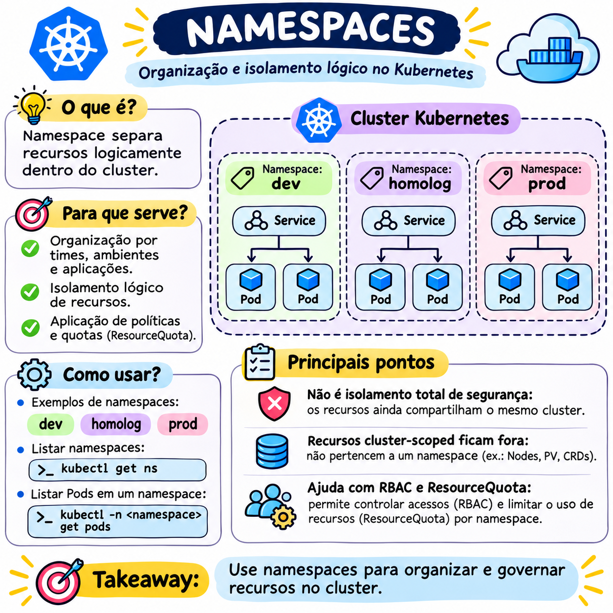

# 01.02 · Namespaces

[↑ Camada 01](../README.md) · [📚 Catálogo](../../../docs/catalogo.md)

## 🎨 Infográfico



## 📖 Aula teórica

**Em preparação.** Namespaces permitem organizar recursos com escopo de namespace dentro do mesmo cluster. Não representam, por si só, isolamento completo de segurança; permissões e políticas precisam ser configuradas separadamente.

[Referência oficial — Namespaces](https://kubernetes.io/docs/concepts/overview/working-with-objects/namespaces/)

## 🧪 Prática e observação

Experimento inicial sugerido (ainda não validado como laboratório completo):

```bash
kubectl get namespaces
kubectl create namespace aula-namespaces
kubectl get pods -n aula-namespaces
kubectl delete namespace aula-namespaces
```

> Antes de executar, confirme `kubectl config current-context`; a exclusão remove os recursos existentes no namespace. Use somente o namespace criado por este exercício.

## 🔎 Diagnóstico e conclusão

Observe o escopo dos recursos e identifique quais são globais ao cluster. Os critérios de aceitação e o lab completo serão publicados futuramente.

---

[← Fundamentos](../fundamentos/README.md) · [↑ Camada 01](../README.md) · [Próxima: Pods →](../pods/README.md)
