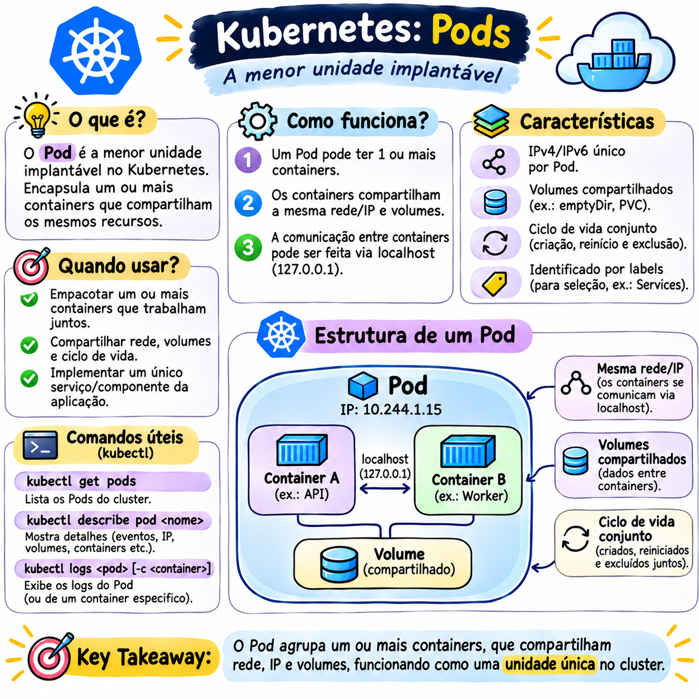

# 01.03 · Pods

[⌂ Início](../../../README.md) · [↑ Camada 01](../README.md) · [📚 Catálogo](../../../docs/catalogo.md)

> **Objetivo:** compreender o conceito, interpretar seu comportamento no cluster e conectar a teoria à prática.

## 🎨 Infográfico



## 📖 Aula teórica

## O que é um Pod?

**Pod** é a menor unidade de workload criada e agendada no Kubernetes. Ele agrupa um ou mais containers que compartilham o mesmo endereço IP, o namespace de rede e volumes declarados. Containers dentro do mesmo Pod podem comunicar-se por `localhost`.

O padrão é um container principal por Pod. Múltiplos containers fazem sentido quando têm **ciclo de vida e contexto operacional estreitamente relacionados**, como um sidecar que auxilia a aplicação.

## Pod não é Deployment

Um Pod criado diretamente não é recriado automaticamente por um Deployment se for excluído: **não existe um controlador proprietário** garantindo réplicas. Deployments e outros controladores gerenciam templates de Pods e permitem recuperação, atualizações e escalabilidade.

| Elemento | O que observar |
| --- | --- |
| `metadata.labels` | Identificação e seleção por outros recursos |
| `spec.containers` | Imagem, comandos, portas, recursos e volumes |
| `spec.nodeName` | Nó escolhido pelo scheduler após agendamento |
| `status.phase` | Fase geral do Pod: Pending, Running, Succeeded ou Failed |
| `containerStatuses` | Estado de cada container, reinícios e motivos de espera |

`CrashLoopBackOff` e `ImagePullBackOff` são motivos exibidos para containers aguardando, não fases de Pod.

## Exemplo interpretado

```yaml
apiVersion: v1
kind: Pod
metadata:
  name: app-demo
  labels:
    app: demo
spec:
  containers:
    - name: web
      image: nginx:stable
      ports:
        - containerPort: 80
```

A porta declarada informa a porta usada pela aplicação, mas **não expõe** o Pod fora do cluster. Isso será feito depois por um Service e, conforme o caso, Ingress/Gateway.

```bash
kubectl get pods -o wide
kubectl describe pod app-demo
kubectl logs app-demo
kubectl get pod app-demo -o yaml
```

Os últimos comandos pressupõem que `app-demo` exista; use o lab ou o manifesto de estudo antes de executá-los.

## O que investigar?

Quando um Pod não inicia, siga a sequência: **fase → eventos → status dos containers → logs → imagem, volumes e recursos**. Não confunda um Pod `Running` com uma aplicação pronta para receber tráfego: isso depende de condições e probes.

## 🧪 Aplicação prática

**Lab existente:** [abrir laboratório integrado](../labs/primeira-aplicacao/README.md). Os manifests e o roteiro estão disponíveis; a execução ponta a ponta ainda requer validação em Kind.

**Anotações e exemplos complementares:** [consultar material já existente](../../../2-pod/README.md). Os conteúdos anteriores foram preservados.

## ✅ Revisão do aprendizado

- Qual problema este conceito resolve?
- Que campos ou estados da API permitem verificar o comportamento real?
- Que erro ou decisão equivocada você conseguiria diagnosticar após esta aula?

## 🔗 Referência oficial

[Documentação Kubernetes — Pods](https://kubernetes.io/docs/concepts/workloads/pods/)

---

[↑ Índice da camada](../README.md) · [Próxima: Requests e Limits →](../requests-limits/README.md)
