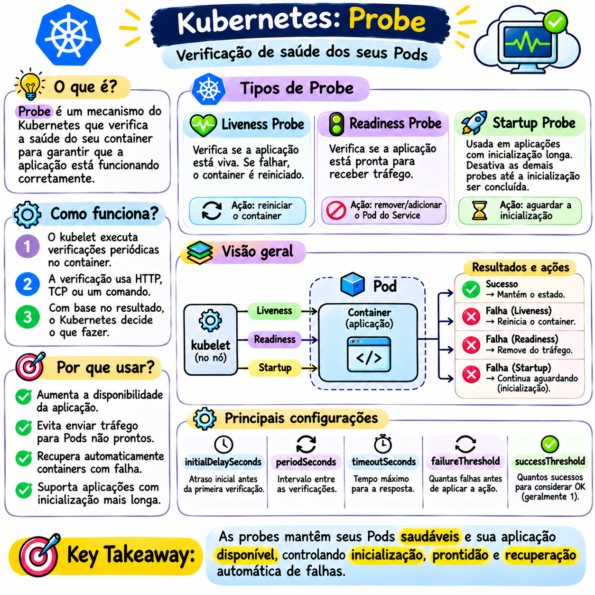

# 01.10 · Probes — Liveness, Readiness e Startup

[⌂ Início](../../../README.md) · [↑ Camada 01](../README.md) · [📚 Catálogo](../../../docs/catalogo.md)

> **Objetivo:** compreender o conceito, interpretar seu comportamento no cluster e conectar a teoria à prática.

## 🎨 Infográfico



## 📖 Aula teórica

## Saúde do processo não é prontidão da aplicação

As probes são verificações executadas pelo **kubelet** para responder a perguntas diferentes. Um processo pode estar vivo, mas ainda não conseguir atender requisições; uma aplicação pode precisar de tempo para iniciar antes de ser testada.

| Probe | Pergunta | Efeito quando falha repetidamente |
| --- | --- | --- |
| `livenessProbe` | O processo continua saudável? | O kubelet reinicia o container |
| `readinessProbe` | Pode receber tráfego agora? | O Pod deixa de ser considerado pronto para o Service |
| `startupProbe` | A inicialização terminou? | Protege liveness/readiness até ter sucesso; se exceder o limite de falhas, reinicia o container |

O kubelet pode verificar com `httpGet`, `tcpSocket`, `exec` e, conforme a versão/configuração, gRPC. Escolha um teste que reflita **a propriedade que deseja medir**.

## Exemplo de comportamento

```yaml
readinessProbe:
  httpGet:
    path: /ready
    port: 8080
  initialDelaySeconds: 2
  periodSeconds: 5
  timeoutSeconds: 2
  failureThreshold: 3
```

Este trecho pertence a um container e pressupõe que o aplicativo responda corretamente em `/ready`. Uma readiness falhando pode deixar o Pod `Running` e `Ready=False`, sem causar restart.

## Anti-padrões comuns

- Usar **liveness** para validar dependências externas instáveis pode criar loops de reinicialização.
- Apontar uma probe a um endpoint inexistente causa falha mesmo que o processo esteja saudável.
- Configurar tempos agressivos para startup lento gera reinícios prematuros.
- Desabilitar readiness em uma aplicação que precisa de warm-up pode encaminhar tráfego cedo demais.

## O que observar

```bash
kubectl get pods
kubectl describe pod <pod>
kubectl get endpointslices
```

Confira `Ready`, contagem de restarts, eventos `Unhealthy` e a prontidão dos endpoints. **Experimento mental:** se um Pod atende liveness mas falha readiness, ele deve continuar executando? Sim; apenas deixa de estar pronto para receber tráfego através dos Services que respeitam essa condição.

## 🧪 Aplicação prática

**🧪 Lab 01.10:** [🧪 Lab 01.10](../labs/probes-basico/README.md). Aplique em Kind, observe o comportamento e execute o experimento com as orientações do roteiro.

**Complementar opcional:** [Consultar material complementar](../../../5-probes/README.md). Referência adicional para consulta após a aula e o lab.

## ✅ Revisão do aprendizado

- Qual problema este conceito resolve?
- Que campos ou estados da API permitem verificar o comportamento real?
- Que erro ou decisão equivocada você conseguiria diagnosticar após esta aula?

## 🔗 Referência oficial

[Documentação Kubernetes — Probes — Liveness, Readiness e Startup](https://kubernetes.io/docs/concepts/configuration/liveness-readiness-startup-probes/)

---

[← Aula 01.09 — Requests e Limits](../requests-limits/README.md) · [↑ Camada 01](../README.md) · [🧪 Lab 01.10](../labs/probes-basico/README.md) · [Próxima: Aula 01.11 — Volumes →](../volumes/README.md)
