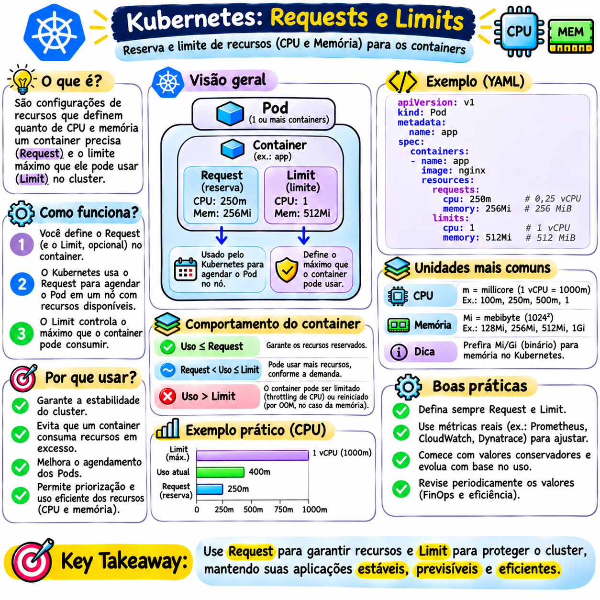

# 01.09 · Requests e Limits

[⌂ Início](../../../README.md) · [↑ Camada 01](../README.md) · [📚 Catálogo](../../../docs/catalogo.md)

> **Ao concluir esta aula, você será capaz de:** Distinguir requests e limits de CPU e memória e interpretar decisões de agendamento e falhas de recursos.

## 🎨 Infográfico



## 📖 Aula teórica

## Por que declarar recursos?

O scheduler precisa conhecer a demanda de recursos dos Pods para decidir onde executá-los. Em `resources`, **requests** descrevem a quantidade solicitada para o agendamento; **limits** estabelecem limites de consumo aplicados em tempo de execução quando suportados pelo recurso e runtime.

Não são sinônimos de reserva física rígida. O scheduler considera requests; o consumo real pode variar. Para CPU, atingir um limite costuma resultar em **throttling**. Para memória, exceder o limite pode levar à finalização do processo (**OOMKilled**) e reinicialização conforme a política do Pod.

## CPU e memória têm unidades diferentes

| Exemplo | Interpretação |
| --- | --- |
| `cpu: 250m` | 0,25 CPU |
| `cpu: "1"` | 1 CPU |
| `memory: 128Mi` | 128 mebibytes |
| `memory: 1Gi` | 1 gibibyte |

Em geral, configure requests a partir de medições realistas; um limite de CPU muito restritivo pode afetar latência, e um limite de memória abaixo do pico pode causar reinícios.

## Exemplo explicado

```yaml
resources:
  requests:
    cpu: 100m
    memory: 128Mi
  limits:
    cpu: 500m
    memory: 256Mi
```

Este trecho pertence a um item de `spec.containers[]`, não ao nível superior do Pod. O scheduler considera o request e o runtime aplica os limites correspondentes.

## Efeitos no comportamento do cluster

- **Pod Pending:** pode indicar falta de capacidade para atender requests, mas também envolve affinity, taints, quotas e outros motivos.
- **OOMKilled:** indica encerramento de container por uso de memória; confirme pelo estado anterior.
- **QoS:** a combinação de requests/limits influencia a classe `Guaranteed`, `Burstable` ou `BestEffort`, explorada em Operação.
- **HPA:** para utilização percentual de CPU, requests adequados são essenciais ao cálculo do alvo.

```bash
kubectl describe nodes
kubectl get resourcequota -A
kubectl top pods -A
```

`kubectl top` requer métricas disponíveis no cluster. **Pergunta de revisão:** por que aumentar o limit de memória não aumenta automaticamente a capacidade do nó?

## 🧪 Aplicação prática

**🧪 Lab 01.09:** [🧪 Lab 01.09](../labs/requests-limits-basico/README.md). Aplique em Kind, observe o comportamento e execute o experimento com as orientações do roteiro.


## ✅ Revisão do aprendizado

- Como o scheduler utiliza `requests` para decidir se um Pod cabe em um nó?
- Por que exceder o limite de memória costuma ter consequência diferente de exceder o limite de CPU?
- Por que o HPA de utilização de CPU depende de `requests.cpu`?

## 🔗 Referência oficial

[Documentação Kubernetes — Requests e Limits](https://kubernetes.io/docs/concepts/configuration/manage-resources-containers/)

---

[← Aula 01.08 — Secrets](../secrets/README.md) · [↑ Camada 01](../README.md) · [🧪 Lab 01.09](../labs/requests-limits-basico/README.md) · [Próxima: Aula 01.10 — Probes — Liveness, Readiness e Startup →](../probes/README.md)
