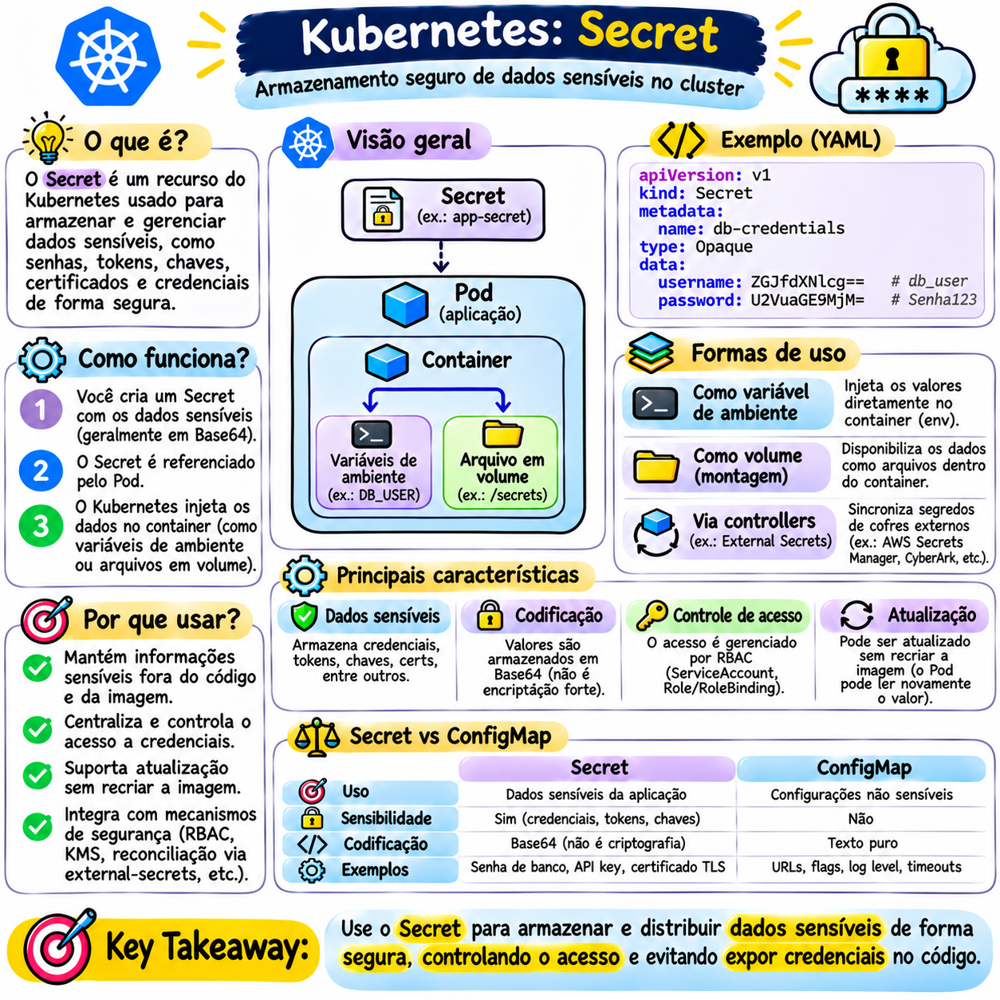

# 01.08 · Secrets

[⌂ Início](../../../README.md) · [↑ Camada 01](../README.md) · [📚 Catálogo](../../../docs/catalogo.md)

> **Objetivo:** compreender o conceito, interpretar seu comportamento no cluster e conectar a teoria à prática.

## 🎨 Infográfico



## 📖 Aula teórica

## Segredos não são configurações comuns

**Secret** é um recurso da API Kubernetes destinado a armazenar pequenas quantidades de dados sensíveis, como credenciais e tokens. Pods podem consumi-lo como variáveis de ambiente ou por volumes; a aplicação continua responsável por usar esses valores com segurança.

**Base64 não é criptografia.** O campo `data` de um Secret usa base64 para representar bytes, mas um leitor autorizado pode decodificá-los. Proteja Secrets com RBAC de menor privilégio, criptografia em repouso configurada no cluster, restrição de acesso à API e práticas adequadas de rotação.

## Tipos e consumo

| Tipo / recurso | Uso |
| --- | --- |
| `Opaque` | Pares genéricos de dados sensíveis |
| `kubernetes.io/tls` | Certificado e chave para TLS |
| `kubernetes.io/dockerconfigjson` | Credencial para registro de imagens, quando necessária |
| `secretKeyRef` / volume | Formas de consumo por containers |

O Kubernetes oferece APIs para Secrets, mas **não é um cofre dedicado completo**: integração com serviços externos como AWS Secrets Manager pode exigir soluções específicas.

## Exemplo sem credencial real

```yaml
apiVersion: v1
kind: Secret
metadata:
  name: exemplo-sem-credencial
type: Opaque
stringData:
  DEMO_VALUE: "apenas-para-estudo"
```

`stringData` permite informar strings em texto durante a criação, mas esses valores continuam sensíveis no manifesto e não devem ser commitados quando forem credenciais reais. O exemplo contém somente dado fictício.

## Atualização e riscos

Secrets montados como volumes podem ser atualizados eventualmente pelo kubelet; valores injetados como variáveis de ambiente não mudam em processos já iniciados. Uma aplicação pode precisar recarregar ou reiniciar para usar dados novos.

```bash
kubectl get secrets
kubectl describe secret exemplo-sem-credencial
```

`describe` mostra metadados e chaves, não deve ser tratado como mecanismo de auditoria de conteúdo. **Nunca publique a saída de `kubectl get secret -o yaml` de ambientes reais**, pois dados codificados ainda são recuperáveis.

**Pergunta:** quem consegue ler o Secret por meio de RBAC? E que outro mecanismo impede a extração das credenciais fora da aplicação?

## 🧪 Aplicação prática

**🧪 Lab 01.08:** [🧪 Lab 01.08](../labs/secrets-basico/README.md). Execute as etapas no seu Kind, observe os eventos e registre sua hipótese antes do experimento.

## ✅ Revisão do aprendizado

- Qual problema este conceito resolve?
- Que campos ou estados da API permitem verificar o comportamento real?
- Que erro ou decisão equivocada você conseguiria diagnosticar após esta aula?

## 🔗 Referência oficial

[Documentação Kubernetes — Secrets](https://kubernetes.io/docs/concepts/configuration/secret/)

---

[← Aula 01.07 — ConfigMaps](../configmaps/README.md) · [↑ Camada 01](../README.md) · [🧪 Lab 01.08](../labs/secrets-basico/README.md) · [Próxima: Aula 01.09 — Requests e Limits →](../requests-limits/README.md)
