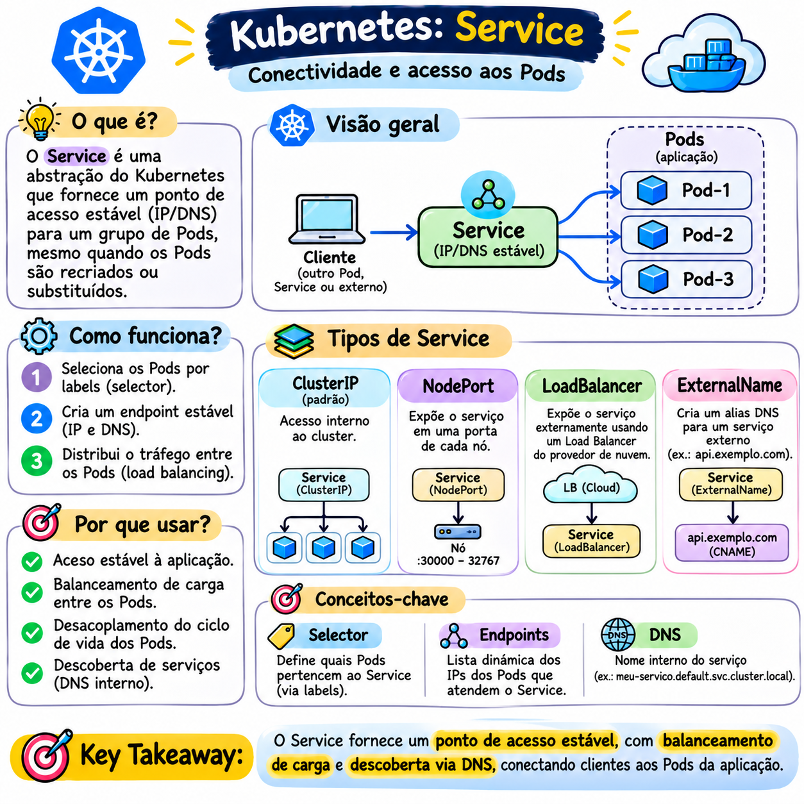

# 01.05 · Services

[⌂ Início](../../../README.md) · [↑ Camada 01](../README.md) · [📚 Catálogo](../../../docs/catalogo.md)

> **Objetivo:** compreender o conceito, interpretar seu comportamento no cluster e conectar a teoria à prática.

## 🎨 Infográfico



## 📖 Aula teórica

## O problema da identidade de rede dos Pods

Pods são efêmeros: quando substituídos, seus endereços IP podem mudar. Um **Service** oferece um ponto de acesso lógico e estável para um conjunto de backends; normalmente identifica Pods por **labels e selectors** e usa **EndpointSlices** para representar destinos elegíveis.

Um Service **não cria Pods** nem garante que estejam prontos. Se o seletor não corresponder às labels ou se os Pods não estiverem prontos, pode existir um Service sem destinos utilizáveis.

## Tipos de Service

| Tipo | Característica | Uso típico |
| --- | --- | --- |
| **ClusterIP** | Endereço virtual acessível internamente | Comunicação entre aplicações |
| **NodePort** | Expõe uma porta nos nós do cluster | Acesso externo simples ou integração |
| **LoadBalancer** | Solicita integração com load balancer externo quando suportado | Exposição por provedor cloud |
| **ExternalName** | Alias DNS para outro nome | Apontar para serviço externo |

O **Headless Service** (`clusterIP: None`) não cria um ClusterIP virtual, permitindo descoberta DNS de endpoints; costuma ser utilizado com StatefulSets. O comportamento de LoadBalancer depende do provedor: Kind puro não provisiona automaticamente um balanceador externo.

## Exemplo explicado

```yaml
apiVersion: v1
kind: Service
metadata:
  name: web-svc
spec:
  type: ClusterIP
  selector:
    app: web
  ports:
    - port: 80
      targetPort: 8080
```

`port` é a porta oferecida pelo Service; `targetPort` é a porta de destino no Pod. O Service seleciona Pods com `app=web`. O DNS costuma seguir o formato `web-svc.<namespace>.svc.cluster.local`.

## Fluxo de rede e diagnóstico

```text
Cliente → DNS/Service → dataplane de rede → Pod de destino
```

```bash
kubectl get services
kubectl get pods --show-labels
kubectl get endpointslices -l kubernetes.io/service-name=web-svc
kubectl describe service web-svc
```

Os comandos de `web-svc` exigem que o Service tenha sido criado. Se não houver endpoints, investigue labels, readiness e selectors antes de culpar DNS ou CNI.

## 🧪 Aplicação prática

**🧪 Lab 01.05:** [🧪 Lab 01.05](../labs/services-basico/README.md). Exercício independente, com Deployment apenas como backend de teste.

**Complementar opcional:** [Consultar material complementar](../../../7-services/README.md). Referência adicional para consulta após a aula e o lab.

## ✅ Revisão do aprendizado

- Qual problema este conceito resolve?
- Que campos ou estados da API permitem verificar o comportamento real?
- Que erro ou decisão equivocada você conseguiria diagnosticar após esta aula?

## 🔗 Referência oficial

[Documentação Kubernetes — Services](https://kubernetes.io/docs/concepts/services-networking/service/)

---

[← Aula 01.04 — ReplicaSet, DaemonSet e StatefulSet](../controladores/README.md) · [↑ Camada 01](../README.md) · [🧪 Lab 01.05](../labs/services-basico/README.md) · [Próxima: Aula 01.06 — Namespaces →](../namespaces/README.md)
