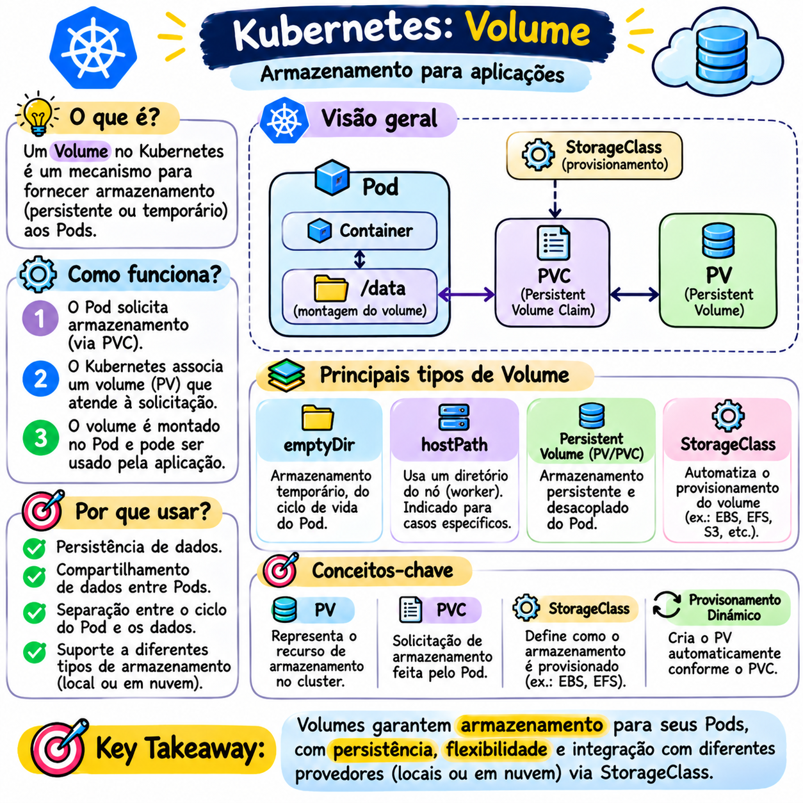

# 01.12 · Volumes

[⌂ Início](../../../README.md) · [↑ Camada 01](../README.md) · [📚 Catálogo](../../../docs/catalogo.md)

> **Objetivo:** compreender o conceito, interpretar seu comportamento no cluster e conectar a teoria à prática.

## 🎨 Infográfico



## 📖 Aula teórica

## O sistema de arquivos do container é suficiente?

O filesystem gravável de um container geralmente não é adequado para persistir dados quando ele é substituído. **Volumes** oferecem armazenamento montado em um ou mais containers do Pod. Mas nem todo volume é persistente: a durabilidade depende do **tipo de volume e do backend**.

## Efêmero e persistente

| Conceito | Papel |
| --- | --- |
| **emptyDir** | Espaço associado ao ciclo de vida do Pod; útil para cache ou troca temporária entre containers |
| **PersistentVolume (PV)** | Recurso que representa armazenamento disponível no cluster |
| **PersistentVolumeClaim (PVC)** | Pedido de armazenamento com tamanho e modo de acesso |
| **StorageClass** | Define características e provisionamento dinâmico, quando suportado pelo driver |
| **CSI** | Interface para integração de drivers de armazenamento |

Em `emptyDir`, a reinicialização de um container no **mesmo Pod** não implica necessariamente apagar os dados; a remoção do Pod encerra o ciclo de vida do volume. Já um PVC pode sobreviver ao Pod, condicionado à política e ao recurso.

## Exemplo de volume efêmero

```yaml
spec:
  containers:
    - name: web
      image: nginx:stable
      volumeMounts:
        - name: cache
          mountPath: /cache
  volumes:
    - name: cache
      emptyDir: {}
```

O trecho mostra partes de uma especificação de Pod: `volumeMounts` conecta o volume ao container; `volumes` define sua fonte. A pasta `/cache` ficará dentro do namespace de filesystem do container.

## Cuidados em cloud

Volumes persistentes podem depender de AZ, topologia, modos de acesso e driver CSI. Um PVC em `Pending` pode indicar falta de StorageClass, driver, capacidade ou restrição de topologia.

```bash
kubectl get storageclasses
kubectl get pv
kubectl get pvc -A
kubectl describe pvc <nome> -n <namespace>
```

A última linha pressupõe um PVC existente. A escolha entre cache, volume efêmero e persistência deve começar pela **necessidade de retenção de dados**, não pelo desejo de montar um diretório.

## 🧪 Aplicação prática

**Atividade de observação:** utilize os comandos e exemplos acima em um cluster de estudos. Não há lab independente validado para este tópico.

## ✅ Revisão do aprendizado

- Qual problema este conceito resolve?
- Que campos ou estados da API permitem verificar o comportamento real?
- Que erro ou decisão equivocada você conseguiria diagnosticar após esta aula?

## 🔗 Referência oficial

[Documentação Kubernetes — Volumes](https://kubernetes.io/docs/concepts/storage/volumes/)

---

[↑ Índice da camada](../README.md) · [Próxima: Ingress →](../ingress/README.md)
