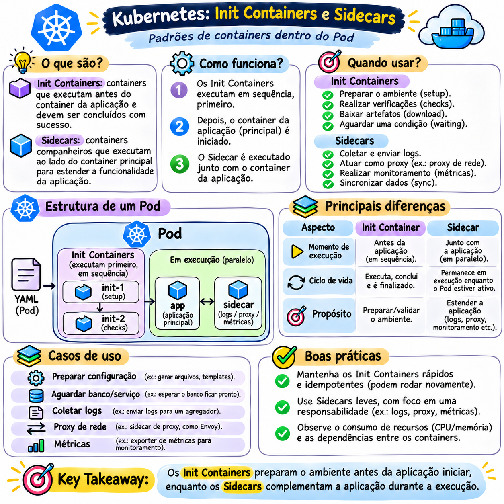

# Init Containers e Sidecars

[← Camada 02](../README.md) · [Roadmap](../../../docs/roadmap.md)

## 🎨 Infográfico

> **Revisão editorial:** o infográfico está disponível no repositório; confirme os detalhes técnicos com a documentação da aula.

## O que você vai aprender

Init containers convencionais concluem tarefas antes da aplicação. Sidecars nativos são definidos como init containers com restartPolicy Always e continuam ativos durante a execução da aplicação.

## Como funciona

Init prepara ambiente → aplicação inicia; sidecar auxilia com proxy, logs ou sincronização.

## Experimento recomendado

Compare um init container de preparação com um sidecar que permanece em execução e verifique os status de containers.

**Status do lab:** roteiro conceitual; manifests e validação prática serão adicionados em uma etapa posterior.

## O que observar

- Resultado e eventos dos recursos envolvidos.
- Diferença entre configuração desejada, decisão do Control Plane e resultado observado.
- Regras, condições e pré-requisitos particulares deste mecanismo.

## Referência oficial

- [Documentação Kubernetes — Init Containers e Sidecars](https://kubernetes.io/docs/concepts/workloads/pods/sidecar-containers/)

**Próxima etapa:** [índice completo da Camada 02](../README.md).

---

### Navegação

[← Anterior](../priorityclass-preemption/README.md) · [↑ Voltar à camada](../README.md) · Fim da camada ✓
