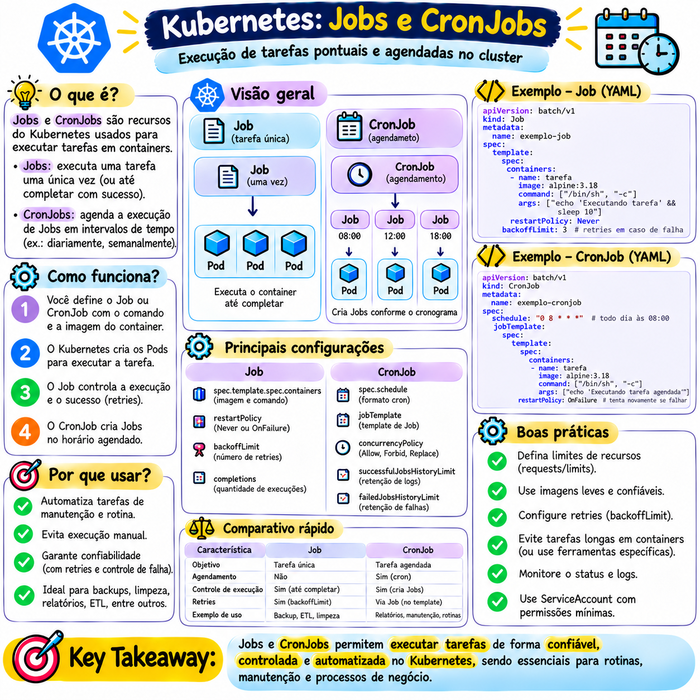

# 02.06 · Jobs e CronJobs

[⌂ Início](../../../README.md) · [↑ Camada 02](../README.md) · [📚 Catálogo](../../../docs/catalogo.md)

> **Ao concluir esta aula, você será capaz de:** Distinguir workloads finitos dos agendados e analisar sucesso, falhas e concorrência de Jobs.

## 🎨 Infográfico



## 📖 Aula teórica

### O problema que este recurso resolve

Deployment mantém serviços em execução; Job busca conclusão finita. CronJob cria Jobs a partir de um calendário e pode controlar concorrência e histórico. Um Job completo não precisa de Pods rodando continuamente.

### Como funciona no Kubernetes

`completions` e `parallelism` controlam tarefas de Job, `backoffLimit` limita tentativas; CronJob usa `schedule`, `concurrencyPolicy` e `startingDeadlineSeconds`. CronJob não é garantia de execução exatamente uma vez: os Jobs devem tolerar repetição.

### Exemplo interpretado (trecho)

Um Job pode executar um único Pod até completar; CronJob agenda criações futuras de Jobs.

```yaml
apiVersion: batch/v1
kind: CronJob
metadata:
  name: agendada
spec:
  schedule: "*/5 * * * *"
  concurrencyPolicy: Forbid
```

Este é um **trecho ilustrativo**, não um manifesto para aplicar isoladamente. A implementação completa será escrita pelo aluno no laboratório.

### Exemplo de inspeção

Os comandos abaixo são exemplos para um cluster de estudo. Substitua os nomes ilustrativos e confirme o contexto antes de executar.

```bash
kubectl config current-context
kubectl get jobs,cronjobs -n NAMESPACE
kubectl describe job tarefa -n NAMESPACE
kubectl logs job/tarefa -n NAMESPACE
```

**O que observar:** Observe `Complete` no Job e a relação ownerReferences de Job criado pelo CronJob. A criação depende da janela da expressão cron.

### Cuidados e limitações

Para teste determinístico, execute primeiro um Job sem esperar pela agenda do CronJob. Não use jobs não idempotentes sem controles.

## 🧪 Aplicação prática

**[🧪 Lab 02.06](../labs/jobs-cronjobs-basico/README.md):** escreva o YAML do exercício, execute no Kind, registre evidências e explique as divergências. O complementar não é pré-requisito.

## ✅ Revisão do aprendizado

- Quando usar Job em vez de Deployment?
- Por que um CronJob deve executar tarefas idempotentes?
- Qual diferença entre `parallelism`, `completions` e `concurrencyPolicy`?

## 🔗 Referências oficiais

- [Documentação oficial do conceito](https://kubernetes.io/docs/concepts/workloads/controllers/job/)
- [Documentação oficial do conceito](https://kubernetes.io/docs/concepts/workloads/controllers/cron-jobs/)

---

[← Aula 02.05 — Init Containers e Sidecars](../init-sidecars/README.md) · [↑ Camada 02](../README.md) · [🧪 Lab 02.06](../labs/jobs-cronjobs-basico/README.md) · [Próxima: Aula 02.07 — Taints, Tolerations e Node Affinity →](../taints-tolerations-affinity/README.md)
