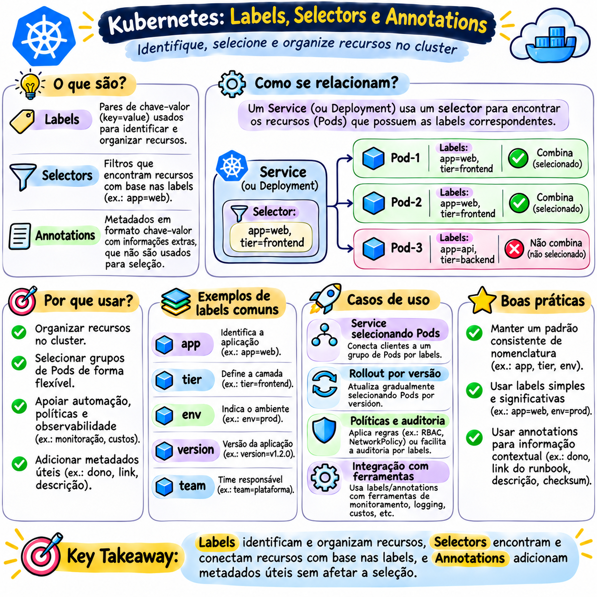

# Labels, Selectors e Annotations

[← Camada 02](../README.md) · [Roadmap](../../../docs/roadmap.md)

## 🎨 Infográfico

> Imagem disponível no repositório; confira detalhes técnicos na documentação da aula.

## O que você vai aprender

Labels identificam e agrupam recursos, Selectors filtram recursos com base nessas labels, Annotations adicionam metadados não destinados à seleção.

## Como funciona

Service seleciona Pods por app=web; metadados de auditoria podem ficar em annotations.

## Experimento recomendado

Use kubectl get pods -l app=web --show-labels e compare seletores que correspondem ou não.

**Status do lab:** roteiro conceitual; manifests e validação prática serão adicionados em uma etapa posterior.

## O que observar

- Resultado e eventos dos recursos envolvidos.
- Diferença entre configuração desejada, decisão do Control Plane e resultado observado.
- Regras, condições e pré-requisitos particulares deste mecanismo.

## Referência oficial

- [Documentação Kubernetes — Labels, Selectors e Annotations](https://kubernetes.io/docs/concepts/overview/working-with-objects/labels/)

**Próxima etapa:** [índice completo da Camada 02](../README.md).

---

### Navegação

[← Anterior](../networkpolicy/README.md) · [↑ Voltar à camada](../README.md) · [Próximo →](../taints-tolerations-affinity/README.md)
