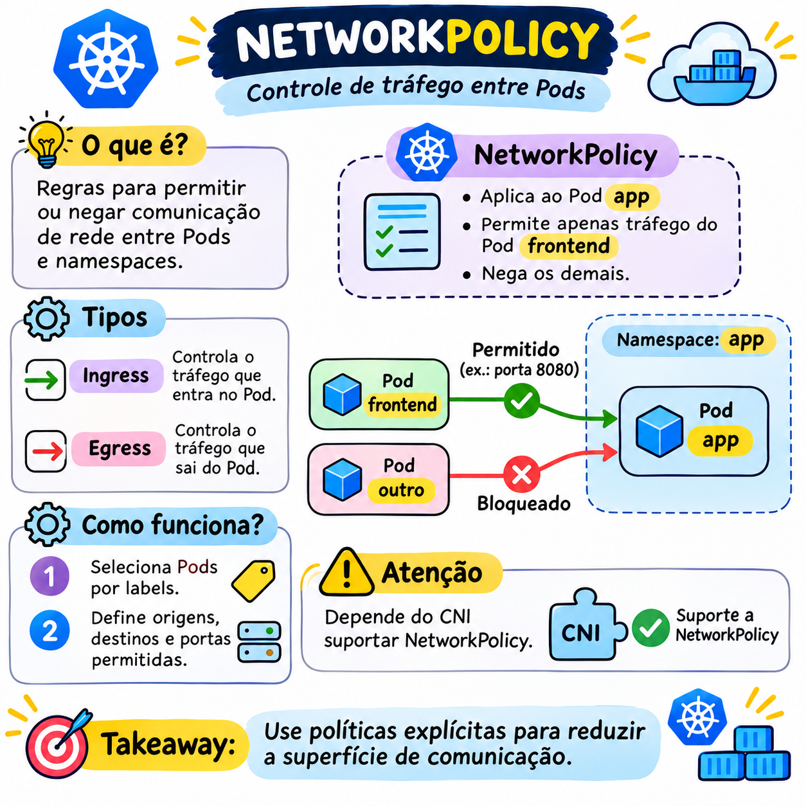

# NetworkPolicy

[← Camada 02](../README.md) · [Roadmap](../../../docs/roadmap.md)

## 🎨 Infográfico

> A imagem ilustra o conceito; consulte a documentação oficial para detalhes técnicos.

## O que você vai aprender

Define quais conexões de entrada e saída são permitidas para Pods selecionados. É aplicada pelo plugin de rede, não apenas pela existência do YAML.

## Como funciona

podSelector seleciona Pods; ingress/egress e policyTypes descrevem tráfego permitido; deny-by-default requer políticas de isolamento.

## Experimento recomendado

Compare conectividade antes/depois de política em cluster com CNI que implemente NetworkPolicy. O Kind padrão não garante enforcement.

**Status do lab:** roteiro conceitual; manifests e validação prática serão adicionados em uma etapa posterior.

## O que observar

- Resultado e eventos dos recursos envolvidos.
- Diferença entre configuração desejada, decisão do Control Plane e resultado observado.
- Regras, condições e pré-requisitos particulares deste mecanismo.

## Referência oficial

- [Documentação Kubernetes — NetworkPolicy](https://kubernetes.io/docs/concepts/services-networking/network-policies/)

**Próxima etapa:** [índice completo da Camada 02](../README.md).

---

### Navegação

[← Anterior](../jobs-cronjobs/README.md) · [↑ Voltar à camada](../README.md) · [Próximo →](../labels-selectors-annotations/README.md)
