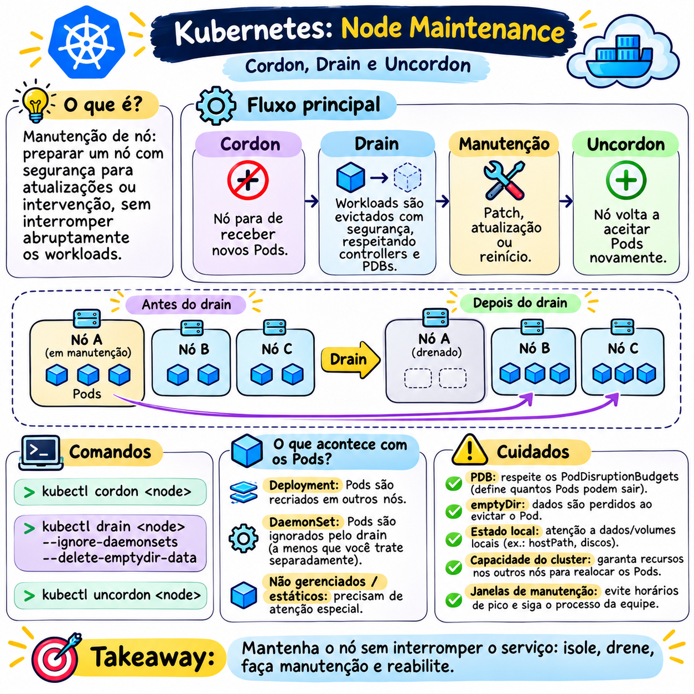

# 02.12 · Node Maintenance — Cordon, Drain e Uncordon

[⌂ Início](../../../README.md) · [↑ Camada 02](../README.md) · [📚 Catálogo](../../../docs/catalogo.md)

> **Ao concluir esta aula, você será capaz de:** Explicar manutenção segura de nós e distinguir impedir novos Pods de solicitar evictions dos Pods existentes.

## 🎨 Infográfico



## 📖 Aula teórica

### O problema que este recurso resolve

Manutenção planejada exige retirar workloads de nós sem interromper indiscriminadamente os serviços. Cordon impede novos agendamentos; drain solicita eviction/remoção dos Pods; uncordon permite novos agendamentos.

### Como funciona no Kubernetes

`kubectl cordon` define `spec.unschedulable` no nó; Pods existentes permanecem. `kubectl drain` considera DaemonSets, mirror Pods, PDBs e opções de exclusão. `uncordon` não move automaticamente Pods de volta.

### Exemplo de inspeção

Os comandos são ilustrativos. Substitua nomes e confirme o contexto do Kind antes de executar.

```bash
kubectl config current-context
kubectl get nodes
kubectl describe node NODE
kubectl get pods -A -o wide
```

**O que observar:** Após cordon, `SchedulingDisabled` aparece no nó. Drain exige planejamento e pode ser impedido por PDB ou Pods não controlados.

### Cuidados e limitações

Não execute drain/cordon no Control Plane ou em clusters compartilhados sem autorização. Em Kind descarte a sessão e garanta uncordon no final.

## 🧪 Aplicação prática

**[🧪 Lab 02.12](../labs/node-maintenance-basico/README.md):** escreva o YAML do desafio, compare resultados e investigue as condições de execução. O lab não exige leitura complementar.

## ✅ Revisão do aprendizado

- Por que cordon não exclui Pods existentes?
- Como PDB interfere na execução de drain?
- Por que uncordon não redistribui automaticamente Pods antigos?

## 🔗 Referências oficiais

- [Documentação Kubernetes](https://kubernetes.io/docs/tasks/administer-cluster/safely-drain-node/)

---

[← Aula 02.11](../pdb/README.md) · [↑ Camada 02](../README.md) · [Próxima: Aula 02.13 →](../networkpolicy/README.md)
