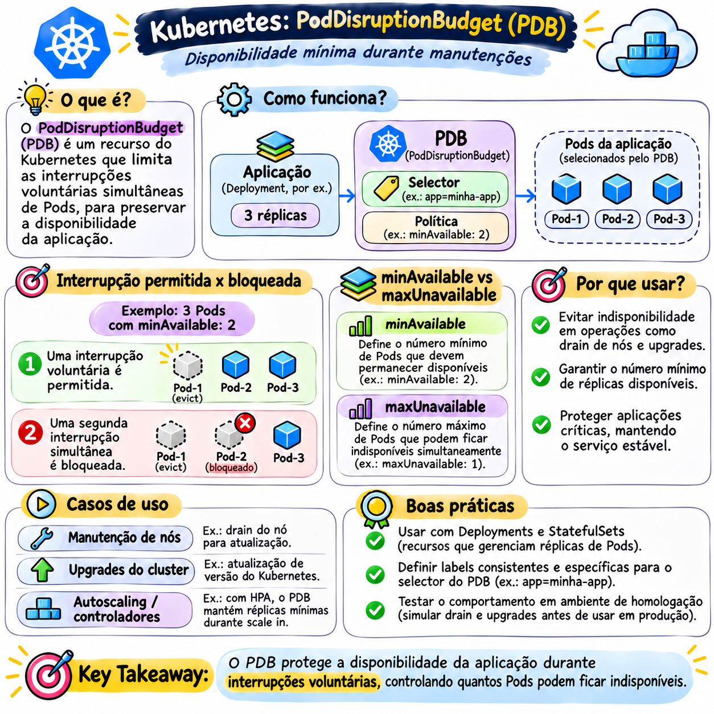

# PodDisruptionBudget (PDB)

[← Camada 02](../README.md) · [Roadmap](../../../docs/roadmap.md)

## 🎨 Infográfico

> Imagem disponível no repositório; confira detalhes técnicos na documentação da aula.

## O que você vai aprender

PDB limita quantos Pods podem ficar indisponíveis por interrupções voluntárias que usam a Eviction API, como um drain.

## Como funciona

selector identifica os Pods protegidos; minAvailable ou maxUnavailable determina a margem para eviction.

## Experimento recomendado

Use um Deployment com três réplicas e minAvailable: 2; consulte disruptionsAllowed antes de experimentar drenagem em ambiente descartável.

**Status do lab:** roteiro conceitual; manifests e validação prática serão adicionados em uma etapa posterior.

## O que observar

- Resultado e eventos dos recursos envolvidos.
- Diferença entre configuração desejada, decisão do Control Plane e resultado observado.
- Regras, condições e pré-requisitos particulares deste mecanismo.

## Referência oficial

- [Documentação Kubernetes — PodDisruptionBudget (PDB)](https://kubernetes.io/docs/concepts/workloads/pods/disruptions/)

**Próxima etapa:** [índice completo da Camada 02](../README.md).

---

### Navegação

[← Anterior](../resourcequota-limitrange/README.md) · [↑ Voltar à camada](../README.md) · [Próximo →](../priorityclass-preemption/README.md)
