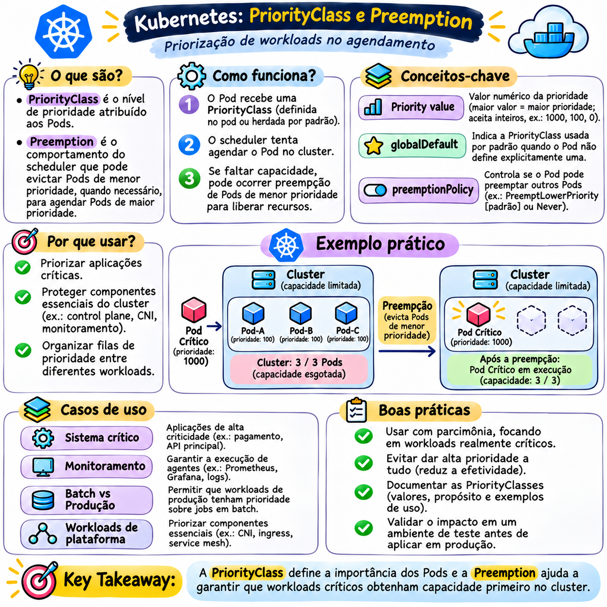

# 02.09 · PriorityClass e Preemption

[⌂ Início](../../../README.md) · [↑ Camada 02](../README.md) · [📚 Catálogo](../../../docs/catalogo.md)

> **Ao concluir esta aula, você será capaz de:** Distinguir prioridade de agendamento de preempção e interpretar riscos operacionais de classes de alta prioridade.

## 🎨 Infográfico



## 📖 Aula teórica

### O problema que este recurso resolve

Sob escassez de recursos, o scheduler prioriza Pods mais importantes. `PriorityClass` define um valor inteiro e pode participar da decisão de preemptar Pods de menor prioridade; isso não garante capacidade instantânea.

### Como funciona no Kubernetes

Um Pod pode referenciar `priorityClassName`. A política `preemptionPolicy: Never` permite prioridade de fila sem preempção iniciada por esse Pod. Preempção tenta abrir espaço respeitando restrições, mas não é garantia de agendamento ou disponibilidade imediata.

### Exemplo interpretado (trecho)

Uma PriorityClass com `preemptionPolicy: Never` participa da priorização sem iniciar preempção.

```yaml
apiVersion: scheduling.k8s.io/v1
kind: PriorityClass
metadata:
  name: baixa-prioridade
value: 1000
globalDefault: false
preemptionPolicy: Never
```

Este é um **trecho ilustrativo**, não um manifesto para aplicar isoladamente. A implementação completa será escrita pelo aluno no laboratório.

### Exemplo de inspeção

Os comandos são ilustrativos. Substitua nomes e confirme o contexto do Kind antes de executar.

```bash
kubectl config current-context
kubectl get priorityclasses
kubectl get pod POD -n NAMESPACE -o jsonpath='{.spec.priorityClassName}'
kubectl describe pod POD -n NAMESPACE
```

**O que observar:** A prioridade efetiva aparece no Pod. Para observar preempção real é preciso reproduzir escassez de recursos de forma controlada.

### Cuidados e limitações

PriorityClass é de escopo de cluster; valores muito altos e defaults impróprios podem prejudicar todo o ambiente. Experimentos de pressão são exclusivos de cluster descartável.

## 🧪 Aplicação prática

**[🧪 Lab 02.09](../labs/priorityclass-basico/README.md):** escreva o YAML do desafio, compare resultados e investigue as condições de execução. O lab não exige leitura complementar.

## ✅ Revisão do aprendizado

- Por que alta prioridade não garante agendamento?
- Qual o efeito de `preemptionPolicy: Never`?
- Como investigar um Pod de alta prioridade que permanece Pending?

## 🔗 Referências oficiais

- [Documentação Kubernetes](https://kubernetes.io/docs/concepts/scheduling-eviction/pod-priority-preemption/)

---

[← Aula 02.08](../topology-spread/README.md) · [↑ Camada 02](../README.md) · [Próxima: Aula 02.10 →](../qos-eviction/README.md)
