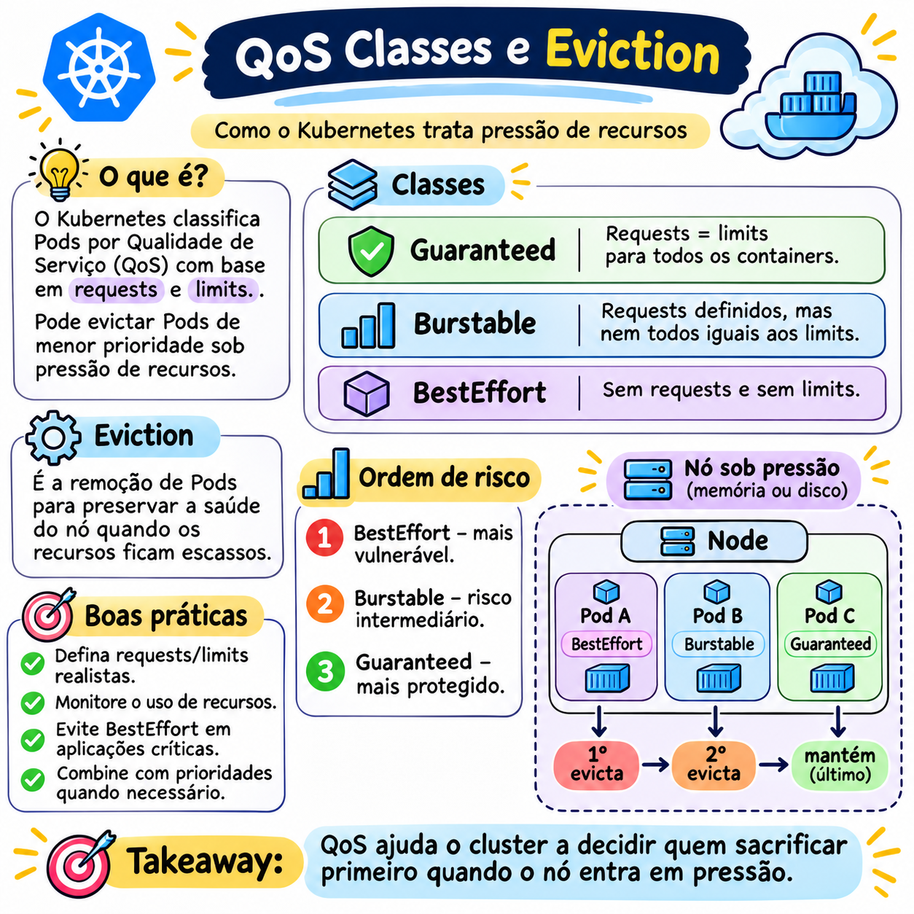

# 02.10 · QoS Classes e Eviction

[⌂ Início](../../../README.md) · [↑ Camada 02](../README.md) · [📚 Catálogo](../../../docs/catalogo.md)

> **Ao concluir esta aula, você será capaz de:** Classificar Pods em Guaranteed, Burstable e BestEffort e explicar como pressão de recursos influencia a eviction.

## 🎨 Infográfico



## 📖 Aula teórica

### O problema que este recurso resolve

A pressão de memória ou disco em um nó pode obrigar o kubelet a encerrar Pods para recuperar capacidade. Classes QoS derivam principalmente de requests e limits de CPU e memória e influenciam a seleção de vítimas, mas não são a única consideração.

### Como funciona no Kubernetes

Guaranteed exige que cada container tenha requests iguais aos limits de CPU e memória; BestEffort não define requests nem limits desses recursos; os demais normalmente são Burstable. O kubelet também avalia uso acima de requests, prioridade e condições do nó.

### Exemplo de inspeção

Os comandos são ilustrativos. Substitua nomes e confirme o contexto do Kind antes de executar.

```bash
kubectl config current-context
kubectl get pod POD -n NAMESPACE -o jsonpath='{.status.qosClass}'
kubectl describe node NODE
kubectl get events -n NAMESPACE --sort-by=.lastTimestamp
```

**O que observar:** Compare `status.qosClass` entre Pods de três perfis. Sem pressão real no nó, não haverá necessariamente eviction, e isso não significa falha do experimento de classificação.

### Cuidados e limitações

Não force OOM em cluster compartilhado. OOMKilled de um container e eviction de Pod por pressão no nó são mecanismos distintos.

## 🧪 Aplicação prática

**[🧪 Lab 02.10](../labs/qos-eviction-basico/README.md):** escreva o YAML do desafio, compare resultados e investigue as condições de execução. O lab não exige leitura complementar.

## ✅ Revisão do aprendizado

- O que é necessário para um Pod ser Guaranteed?
- Por que QoS não determina sozinho a ordem de eviction?
- Como diferenciar OOMKilled de Evicted ao investigar uma falha?

## 🔗 Referências oficiais

- [Documentação Kubernetes](https://kubernetes.io/docs/concepts/workloads/pods/pod-qos/)

---

[← Aula 02.09](../priorityclass-preemption/README.md) · [↑ Camada 02](../README.md) · [Próxima: Aula 02.11 →](../pdb/README.md)
