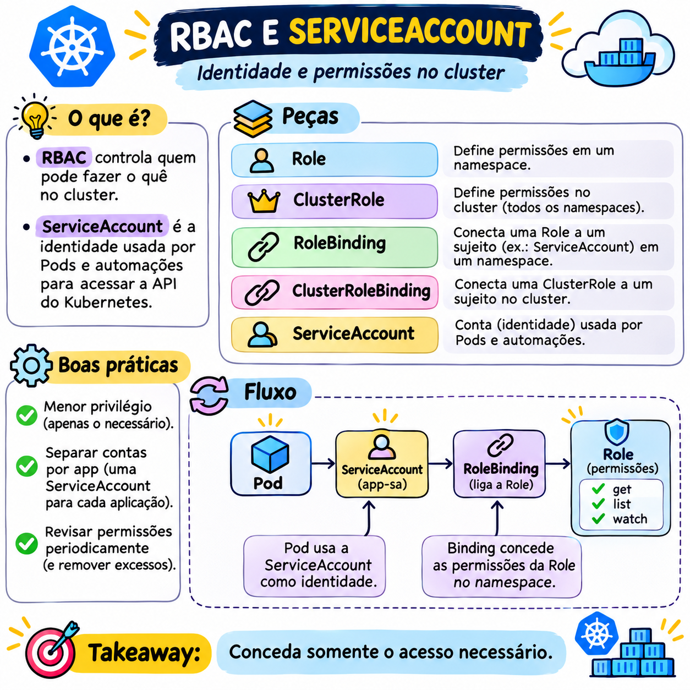

# RBAC e ServiceAccount

[← Camada 02](../README.md) · [Roadmap](../../../docs/roadmap.md)

## 🎨 Infográfico

> A imagem ilustra o conceito; consulte a documentação oficial para detalhes técnicos.

## O que você vai aprender

Autenticação identifica o sujeito; autorização RBAC define o que ele pode fazer. ServiceAccount fornece identidade a workloads.

## Como funciona

ServiceAccount → Role (regras) → RoleBinding (atribuição no namespace). ClusterRole/ClusterRoleBinding permitem escopo de cluster.

## Experimento recomendado

Crie ServiceAccount, Role e RoleBinding; compare get de Pods permitido com list de Secrets negado.

**Laboratório com manifests:** [Abrir lab](../labs/rbac-minimo/README.md).

## O que observar

- Resultado e eventos dos recursos envolvidos.
- Diferença entre configuração desejada, decisão do Control Plane e resultado observado.
- Regras, condições e pré-requisitos particulares deste mecanismo.

## Referência oficial

- [Documentação Kubernetes — RBAC e ServiceAccount](https://kubernetes.io/docs/reference/access-authn-authz/rbac/)

**Próxima etapa:** [índice completo da Camada 02](../README.md).

---

### Navegação

← Primeiro tópico · [↑ Voltar à camada](../README.md) · [Próximo →](../jobs-cronjobs/README.md)
