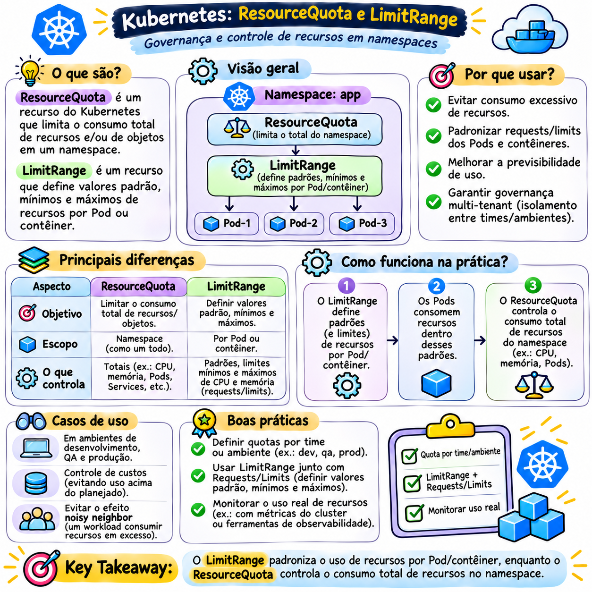

# ResourceQuota e LimitRange

[← Camada 02](../README.md) · [Roadmap](../../../docs/roadmap.md)

## 🎨 Infográfico

> Imagem disponível no repositório; confira detalhes técnicos na documentação da aula.

## O que você vai aprender

ResourceQuota limita consumo agregado por namespace. LimitRange define mínimos, máximos e defaults por container/Pod, quando configurados.

## Como funciona

Admissão avalia limites individuais e quotas agregadas ao criar recursos.

## Experimento recomendado

Aplique quota e defaults em namespace isolado; crie um Pod aceito e tente exceder a quota.

**Laboratório com manifests:** [Abrir lab](../labs/quota-namespace/README.md).

## O que observar

- Resultado e eventos dos recursos envolvidos.
- Diferença entre configuração desejada, decisão do Control Plane e resultado observado.
- Regras, condições e pré-requisitos particulares deste mecanismo.

## Referência oficial

- [Documentação Kubernetes — ResourceQuota e LimitRange](https://kubernetes.io/docs/concepts/policy/resource-quotas/)

**Próxima etapa:** [índice completo da Camada 02](../README.md).

---

### Navegação

[← Anterior](../taints-tolerations-affinity/README.md) · [↑ Voltar à camada](../README.md) · [Próximo →](../pdb/README.md)
