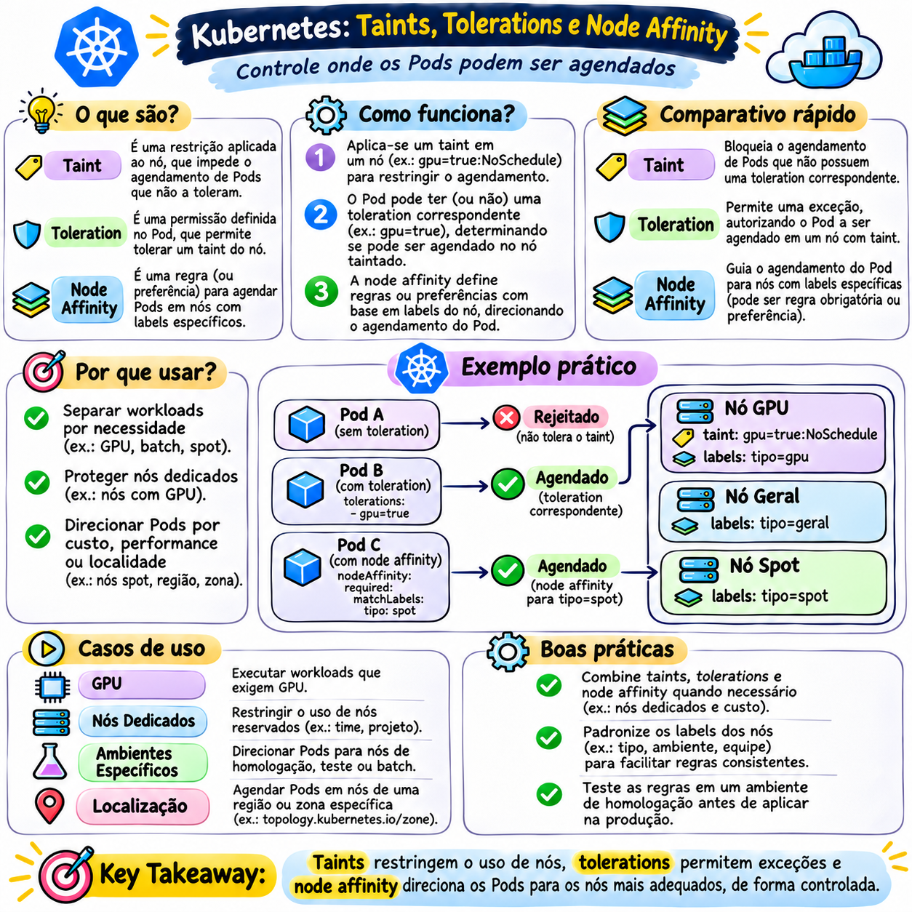

# 02.07 · Taints, Tolerations e Node Affinity

[⌂ Início](../../../README.md) · [↑ Camada 02](../README.md) · [📚 Catálogo](../../../docs/catalogo.md)

> **Ao concluir esta aula, você será capaz de:** Prever agendamento a partir de taints, tolerations e afinidade com nós e diagnosticar Pods Pending.

## 🎨 Infográfico



## 📖 Aula teórica

### O problema que este recurso resolve

Taints repelem Pods sem toleration correspondente. Toleration permite que um Pod seja considerado, mas não obriga o scheduler a escolher aquele nó. Node affinity expressa preferência ou exigência de labels do nó.

### Como funciona no Kubernetes

`NoSchedule` evita novos agendamentos sem toleration; `NoExecute` pode provocar remoção de Pods existentes. `requiredDuringSchedulingIgnoredDuringExecution` impõe restrição de agendamento e `preferred...` adiciona preferência. Recursos e condições dos nós continuam valendo.

### Exemplo de inspeção

Os comandos abaixo são exemplos para um cluster de estudo. Substitua os nomes ilustrativos e confirme o contexto antes de executar.

```bash
kubectl config current-context
kubectl get nodes --show-labels
kubectl describe node NODE
kubectl describe pod POD -n NAMESPACE
```

**O que observar:** Compare eventos `FailedScheduling` com labels/taints e a expressão de affinity no Pod. Uma toleration sozinha não força um node específico.

### Cuidados e limitações

Alterar taints de nós compartilhados é operacionalmente perigoso. Em laboratório, use somente workers do Kind e reverta todas as alterações.

## 🧪 Aplicação prática

**[🧪 Lab 02.07](../labs/scheduling-basico/README.md):** escreva o YAML do exercício, execute no Kind, registre evidências e explique as divergências. O complementar não é pré-requisito.

## ✅ Revisão do aprendizado

- Por que toleration não equivale a nodeSelector?
- O que significa `IgnoredDuringExecution` na node affinity?
- Que evento indica que nenhum nó satisfaz as restrições?

## 🔗 Referências oficiais

- [Documentação Kubernetes](https://kubernetes.io/docs/concepts/scheduling-eviction/taint-and-toleration/)
- [Documentação Kubernetes](https://kubernetes.io/docs/concepts/scheduling-eviction/assign-pod-node/)

---

[↑ Camada 02](../README.md) · [🧪 Lab 02.07](../labs/scheduling-basico/README.md) · [← Aula 02.06](../jobs-cronjobs/README.md) · [Próxima: 02.08 →](../topology-spread/README.md)
