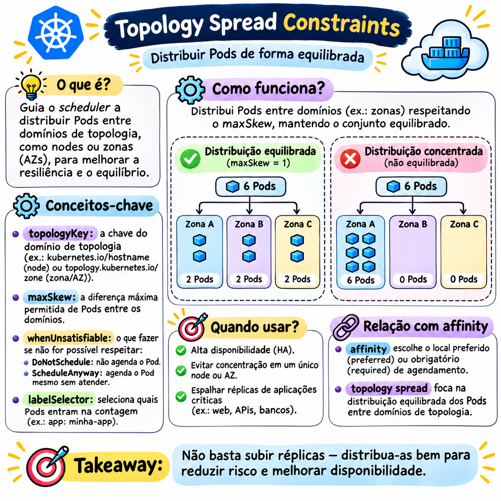

# 02.08 · Topology Spread Constraints

[⌂ Início](../../../README.md) · [↑ Camada 02](../README.md) · [📚 Catálogo](../../../docs/catalogo.md)

> **Ao concluir esta aula, você será capaz de:** Explicar como distribuir réplicas entre domínios topológicos e diagnosticar o efeito de `maxSkew` e `whenUnsatisfiable`.

## 🎨 Infográfico



## 📖 Aula teórica

### O problema que este recurso resolve

Agendar todas as réplicas no mesmo nó cria risco concentrado. Topology Spread Constraints expressam como distribuir Pods por labels de nó, como `kubernetes.io/hostname` ou zona de disponibilidade.

### Como funciona no Kubernetes

O scheduler avalia `topologyKey`, `labelSelector`, `maxSkew` e `whenUnsatisfiable`. `DoNotSchedule` pode deixar Pods Pending quando a distribuição requerida não é possível; `ScheduleAnyway` é preferência. A distribuição depende dos domínios elegíveis e da quantidade de nós.

### Exemplo interpretado (trecho)

Um constraint impõe distribuição por hostname quando `DoNotSchedule` está selecionado.

```yaml
topologySpreadConstraints:
  - maxSkew: 1
    topologyKey: kubernetes.io/hostname
    whenUnsatisfiable: DoNotSchedule
    labelSelector:
      matchLabels:
        app: demo
```

Este é um **trecho ilustrativo**, não um manifesto para aplicar isoladamente. A implementação completa será escrita pelo aluno no laboratório.

### Exemplo de inspeção

Os comandos são ilustrativos. Substitua nomes e confirme o contexto do Kind antes de executar.

```bash
kubectl config current-context
kubectl get nodes -L kubernetes.io/hostname
kubectl get pods -n NAMESPACE -o wide
kubectl describe pod POD -n NAMESPACE
```

**O que observar:** Compare as réplicas por hostname e eventos FailedScheduling quando o número de domínios é insuficiente. Não presuma que um Kind local tem zonas cloud.

### Cuidados e limitações

`topologySpreadConstraints` não são sinônimo de PodAntiAffinity nem garantem alta disponibilidade de infraestrutura. Revise `minDomains` e políticas de nós elegíveis.

## 🧪 Aplicação prática

**[🧪 Lab 02.08](../labs/topology-spread-basico/README.md):** escreva o YAML do desafio, compare resultados e investigue as condições de execução. O lab não exige leitura complementar.

## ✅ Revisão do aprendizado

- Por que `DoNotSchedule` pode manter uma réplica Pending?
- Qual a diferença entre `topologyKey` e `labelSelector`?
- Quando uma distribuição equilibrada no Kind ainda não representa tolerância a falha de AZ?

## 🔗 Referências oficiais

- [Documentação Kubernetes](https://kubernetes.io/docs/concepts/scheduling-eviction/topology-spread-constraints/)

---

[← Aula 02.07](../taints-tolerations-affinity/README.md) · [↑ Camada 02](../README.md) · [Próxima: Aula 02.09 →](../priorityclass-preemption/README.md)
