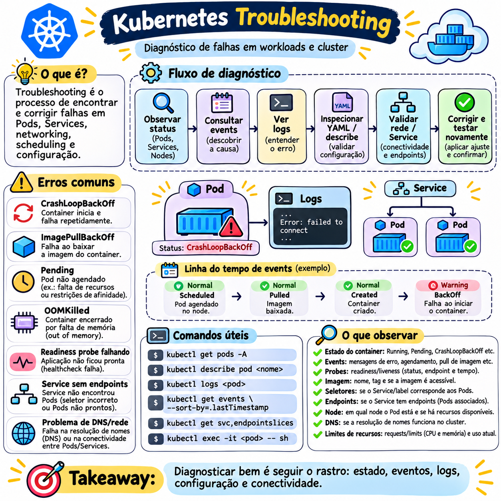

# 02.14 · Kubernetes Troubleshooting

[⌂ Início](../../../README.md) · [↑ Camada 02](../README.md) · [📚 Catálogo](../../../docs/catalogo.md)

> **Ao concluir esta aula, você será capaz de:** Aplicar um método reproduzível de diagnóstico baseado em sintomas, eventos, estado e hipótese testável.

## 🎨 Infográfico



## 📖 Aula teórica

### O problema que este recurso resolve

Mensagens de erro semelhantes podem ter causas diferentes. Diagnóstico eficiente começa confirmando contexto e escopo, reproduzindo a observação e seguindo evidências entre API Server, scheduler, kubelet, rede e aplicação.

### Como funciona no Kubernetes

Use a cadeia: contexto/namespace → objeto e condições → eventos → Pods/containers → logs → dependências → hipótese → intervenção controlada. Compare estado esperado com observado; evite corrigir sintomas aleatoriamente.

### Exemplo interpretado (trecho)

O estado do container explica erros como ImagePullBackOff; status.phase sozinho não responde a causa.

```yaml
status:
  containerStatuses:
    - name: app
      state:
        waiting:
          reason: ImagePullBackOff
```

Este é um **trecho ilustrativo**, não um manifesto para aplicar isoladamente. A implementação completa será escrita pelo aluno no laboratório.

### Exemplo de inspeção

Os comandos são ilustrativos. Substitua nomes e confirme o contexto do Kind antes de executar.

```bash
kubectl config current-context
kubectl config current-context
kubectl get pods -n NAMESPACE -o wide
kubectl describe pod POD -n NAMESPACE
kubectl logs POD -n NAMESPACE --previous
kubectl get events -n NAMESPACE --sort-by=.lastTimestamp
```

**O que observar:** Registre mensagem, timestamp, alterações e a primeira evidência causal. Logs anteriores só existem quando há execução anterior; um Pod Pending pode nem ter container para gerar logs.

### Cuidados e limitações

Não use `kubectl delete -A`, `drain` ou `rollout restart` como primeiro diagnóstico. O contexto deve ser Kind e as ações devem ser reversíveis.

## 🧪 Aplicação prática

**[🧪 Lab 02.14](../labs/troubleshooting-basico/README.md):** escreva o YAML do desafio, compare resultados e investigue as condições de execução. O lab não exige leitura complementar.

**Complementar opcional:** [Consultar aprofundamento 02.14](complementares/README.md). Referência adicional; não é necessária para executar o lab.

## ✅ Revisão do aprendizado

- Por que `Running` não garante que a aplicação esteja recebendo tráfego?
- Quando `describe` é mais útil que `logs`?
- Como comprovar a hipótese antes de aplicar uma correção?

## 🔗 Referências oficiais

- [Documentação oficial do conceito](https://kubernetes.io/docs/tasks/debug/debug-application/)

---

[← Aula 02.13 — NetworkPolicy](../networkpolicy/README.md) · [↑ Camada 02](../README.md) · [🧪 Lab 02.14](../labs/troubleshooting-basico/README.md) · [Próxima: Camada 03 →](../../03-arquitetura/README.md)
