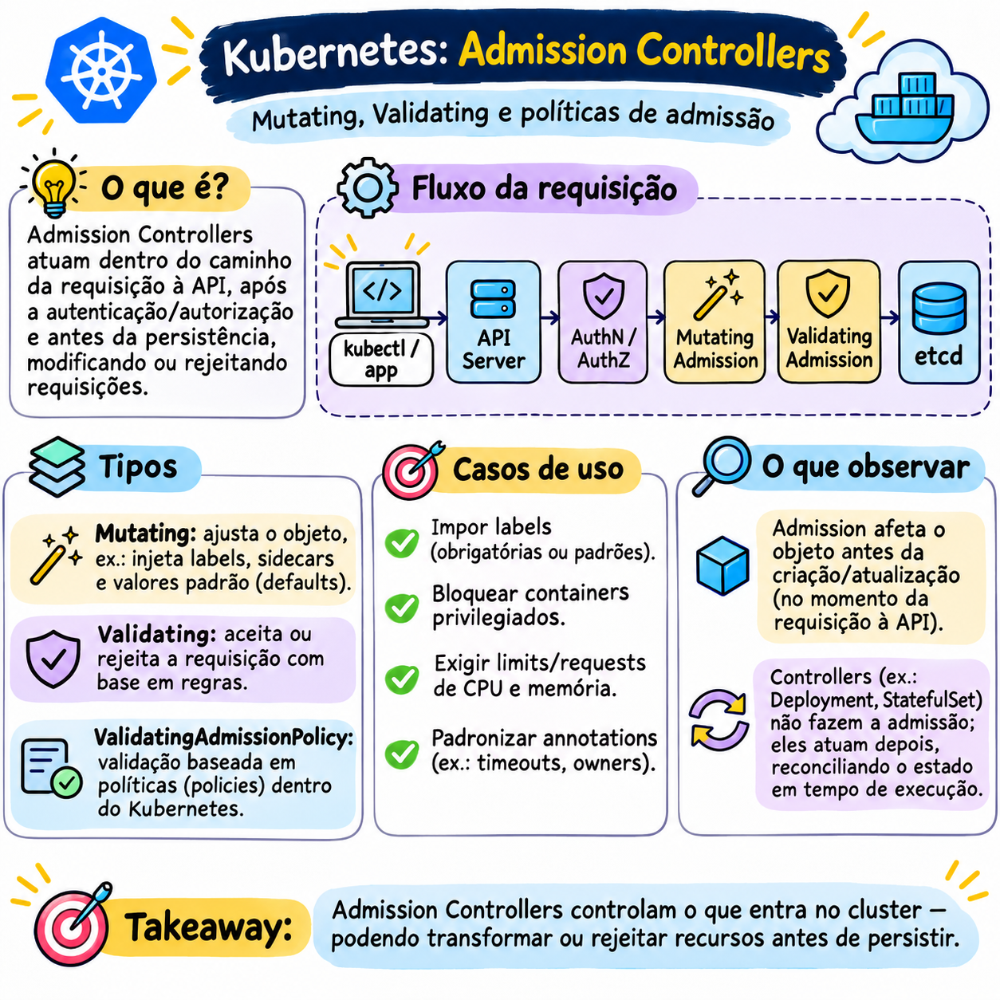

# 03.04 · Admission Controllers

[⌂ Início](../../../README.md) · [↑ Camada 03](../README.md) · [📚 Catálogo](../../../docs/catalogo.md)

> **Ao concluir esta aula, você será capaz de:** Identificar a etapa de admissão e comparar uma política mutável com uma requisição rejeitada, sem confundir isso com scheduling.

## 🎨 Infográfico



## 📖 Aula teórica

### Contexto e responsabilidade

Após autenticar e autorizar, o API Server pode invocar admission controllers para modificar ou validar objetos antes de persistir a alteração. Isso permite defaults, guardrails e integração com webhooks de política.

### Como o mecanismo funciona

Controles mutating podem preencher campos; validating podem rejeitar requisições. Policies e webhooks podem ter comportamento diferente por namespace, versão e operação; uma rejeição por quota ou política de segurança acontece na admissão e não gera Pod Pending. O uso de `--dry-run=server` depende de suporte dos admission webhooks para operações sem efeitos colaterais.

### Exemplo interpretado (trecho)

```yaml
apiVersion: v1
kind: ResourceQuota
metadata:
  name: limites
spec:
  hard:
    pods: "1"
```

Com quota de um Pod, a segunda criação pode ser rejeitada diretamente pelo API Server, sem gerar outro Pod Pending. O trecho ilustra campos essenciais; consulte o lab para escrever o manifesto completo.

### Inspeção no Kind

```bash
kubectl config current-context
kubectl get resourcequota,limitrange -n lab-03-04
kubectl get pod admitido -n lab-03-04 -o yaml
kubectl get events -n lab-03-04 --sort-by=.lastTimestamp
```

**Interpretação:** Compare o YAML enviado com os valores efetivamente persistidos pelo API Server. Registre a saída de uma tentativa de criação adicional que viola a quota.

### Limites e segurança

Nem toda mutação é aplicada por admission webhook externo. Se um manifesto for rejeitado, não procure um Pod Pending inexistente; examine a resposta da API.

### Diferenciar alteração automática e negação

Um controle **mutating** pode adicionar defaults e um controle **validating** pode recusar criação ou atualização. O mesmo manifesto pode ser aceito em um namespace e rejeitado em outro por ResourceQuota, LimitRange, Pod Security Admission ou webhook configurado.

No laboratório, o segundo Pod viola `hard.pods: 1`: a própria requisição de criação é negada antes de existir um objeto Pod extra. Isso é diferente de `FailedScheduling`, em que o Pod existe, mas não encontra nó elegível. Para documentar a causa, capture o **erro da API**, a quota usada e o conjunto de objetos realmente persistidos.

## 🧪 Aplicação prática

[🧪 Lab 03.04 — Admission Controllers](../labs/admission-controllers-basico/README.md): construa o YAML do desafio, compare estado declarado com observado e registre uma evidência do conceito. O lab é o caminho principal, independente do material opcional.

## ✅ Revisão do aprendizado

- Qual a diferença entre falha de admissão e falha do scheduler?
- Por que a versão persistida pode conter campos ausentes no YAML original?
- Como provar que uma rejeição ocorreu antes de existir um Pod?

## 🔗 Referências oficiais

- [Kubernetes — documentação do componente](https://kubernetes.io/docs/reference/access-authn-authz/admission-controllers/)
- [Arquitetura e componentes](https://kubernetes.io/docs/concepts/overview/components/)

---

[← Aula 03.03](../etcd/README.md) · [↑ Camada 03](../README.md) · [🧪 Lab 03.04](../labs/admission-controllers-basico/README.md) · [Próxima: Aula 03.05 →](../kube-controller-manager/README.md)
