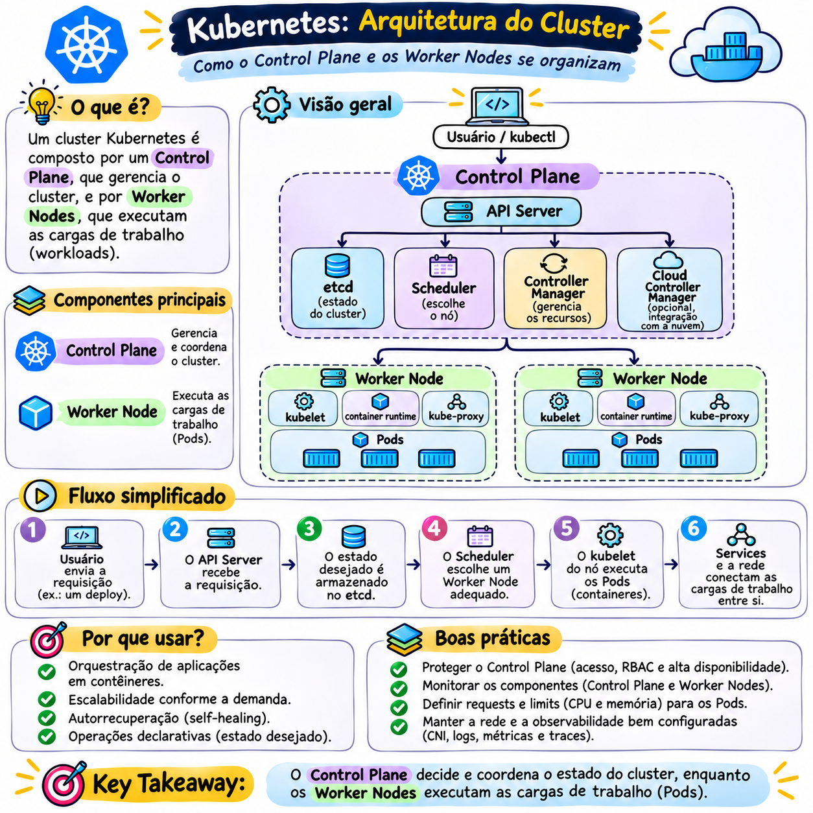

# 03.01 · Arquitetura do Cluster Kubernetes

[⌂ Início](../../../README.md) · [↑ Camada 03](../README.md) · [📚 Catálogo](../../../docs/catalogo.md)

> **Ao concluir esta aula, você será capaz de:** Explicar o caminho de uma declaração desde o API Server até a execução em um worker, identificando o papel de cada componente.

## 🎨 Infográfico



## 📖 Aula teórica

### Contexto e responsabilidade

O Kubernetes separa a declaração central do estado da execução. Um cliente escreve objetos no API Server; controllers comparam estado desejado e observado; o scheduler escolhe um nó; o kubelet nesse nó conversa com o runtime para iniciar containers.

### Como o mecanismo funciona

O **Control Plane** inclui API Server, etcd, scheduler e controller-manager. Os **workers** executam kubelet e runtime; os componentes de rede viabilizam comunicação. O controle ocorre em loops assíncronos: sucesso na requisição de criação não significa aplicação pronta. Em clusters gerenciados, parte do Control Plane é operada pelo provedor.

### Exemplo interpretado (trecho)

```yaml
apiVersion: apps/v1
kind: Deployment
metadata:
  name: percurso
spec:
  replicas: 2
  selector:
    matchLabels:
      app: percurso
```

O API Server persiste `spec.replicas` como intenção. O controller cria réplicas e o scheduler atribui nós; a disponibilidade só é comprovada pelas condições e Pods observados. O trecho ilustra campos essenciais; consulte o lab para escrever o manifesto completo.

### Inspeção no Kind

```bash
kubectl config current-context
kubectl get nodes -o wide
kubectl get pods -n kube-system -o wide
kubectl get deployment percurso -n lab-03-01 -o yaml
```

**Interpretação:** Observe `metadata.generation`, `status.observedGeneration`, condições e `spec.nodeName`. Relacione objetos da API aos processos do Control Plane e ao nó que efetivamente executa o Pod.

### Limites e segurança

Evite interpretar todos os Pods `kube-system` como componentes do Control Plane. No Kind, alguns componentes são static Pods; em serviços gerenciados, sua visibilidade varia.

### Fluxo para explicar uma aplicação que não está pronta

| Etapa | Objeto ou sinal | Pergunta diagnóstica |
| --- | --- | --- |
| Declaração | Deployment `spec.replicas` | API aceitou a intenção? |
| Reconciliação | ReplicaSet e Pods | Controller criou as unidades desejadas? |
| Agendamento | Pod `spec.nodeName` | Scheduler selecionou nó elegível? |
| Execução | Container status e probes | Kubelet iniciou o container e ele está Ready? |

**Hipótese testável:** ao apagar apenas um Pod gerenciado, sua identidade muda, mas o Deployment continua declarando a mesma quantidade desejada. O controller e o scheduler podem atuar em momentos diferentes; por isso `kubectl apply` com exit code zero não prova saúde de aplicação.

## 🧪 Aplicação prática

[🧪 Lab 03.01 — Arquitetura do Cluster Kubernetes](../labs/arquitetura-cluster-basico/README.md): construa o YAML do desafio, compare estado declarado com observado e registre uma evidência do conceito. O lab é o caminho principal, independente do material opcional.

## ✅ Revisão do aprendizado

- Se o API Server aceita um Deployment, por que a aplicação ainda pode estar indisponível?
- Qual componente decide o nó e qual inicia o container?
- Como `observedGeneration` ajuda a diferenciar configuração nova de reconciliação atrasada?

## 🔗 Referências oficiais

- [Kubernetes — documentação do componente](https://kubernetes.io/docs/concepts/overview/components/)
- [Arquitetura e componentes](https://kubernetes.io/docs/concepts/overview/components/)

---

[← Camada 02](../../02-operacao-seguranca/README.md) · [↑ Camada 03](../README.md) · [🧪 Lab 03.01](../labs/arquitetura-cluster-basico/README.md) · [Próxima: Aula 03.02 →](../kube-apiserver/README.md)
