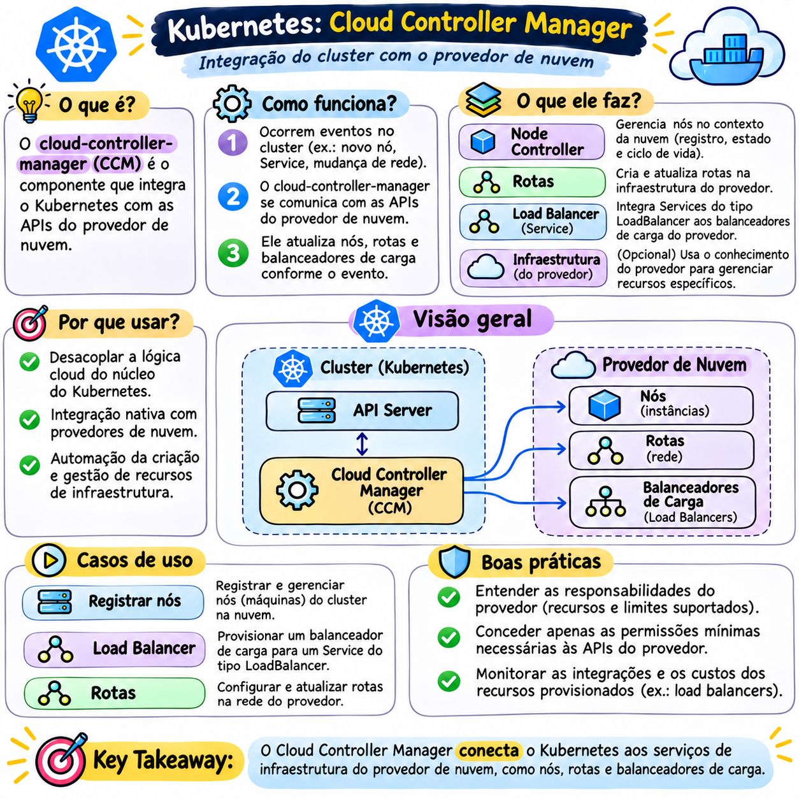

# 03.09 · cloud-controller-manager

[⌂ Início](../../../README.md) · [↑ Camada 03](../README.md) · [📚 Catálogo](../../../docs/catalogo.md)

> **Ao concluir esta aula, você será capaz de:** Identificar as responsabilidades de integração entre Kubernetes e provedor cloud e explicar por que o Kind não expõe recursos cloud nativos.

## 🎨 Infográfico



## 📖 Aula teórica

### Contexto e responsabilidade

O cloud-controller-manager separa lógica específica de provedor das responsabilidades genéricas do cluster. Integra informações de nós, rotas e load balancers, conforme implementação do provedor, e pode trabalhar com outros componentes externos.

### Como o mecanismo funciona

Um Service `type: LoadBalancer` é uma intenção na API. Em cloud com integração adequada, um controlador/provedor pode provisionar endereço e atualizar `.status.loadBalancer`. No Kind padrão, não há obrigação de existir cloud-controller-manager nem load balancer externo; um objeto pode permanecer sem IP externo sem estar inválido.

### Exemplo interpretado (trecho)

```yaml
apiVersion: v1
kind: Service
metadata:
  name: exposicao
spec:
  type: LoadBalancer
  selector:
    app: web
  ports:
    - port: 80
```

A intenção de provisionar LoadBalancer não produz IP externo no Kind sem integração de cloud apropriada. Esse status ausente é esperado, não um erro de sintaxe. O trecho ilustra campos essenciais; consulte o lab para escrever o manifesto completo.

### Inspeção no Kind

```bash
kubectl config current-context
kubectl get service exposicao -n lab-03-09 -o yaml
kubectl get pods -n kube-system -o wide
kubectl describe service exposicao -n lab-03-09
```

**Interpretação:** Compare `spec.type=LoadBalancer` com `status.loadBalancer.ingress` no Kind. A inexistência de IP externo é um resultado esperado sem controlador compatível.

### Limites e segurança

Não instale controlador cloud nem utilize credenciais de cloud para simular esse efeito no Kind. Não confunda cloud-controller-manager com autoscaler de nós ou Karpenter.

## 🧪 Aplicação prática

[🧪 Lab 03.09 — cloud-controller-manager](../labs/cloud-controller-manager-basico/README.md): construa o YAML do desafio, compare estado declarado com observado e registre uma evidência do conceito. O lab é o caminho principal, independente do material opcional.

## ✅ Revisão do aprendizado

- Por que declarar um Service LoadBalancer não garante um IP externo?
- Como provar que o Kind não provisionou um balanceador cloud?
- Quais responsabilidades de integração mudam num Kubernetes gerenciado?

## 🔗 Referências oficiais

- [Kubernetes — documentação do componente](https://kubernetes.io/docs/concepts/architecture/cloud-controller/)
- [Arquitetura e componentes](https://kubernetes.io/docs/concepts/overview/components/)

---

[← Aula 03.08](../kube-scheduler/README.md) · [↑ Camada 03](../README.md) · [🧪 Lab 03.09](../labs/cloud-controller-manager-basico/README.md) · [Próxima: Aula 03.10 →](../kubelet/README.md)
