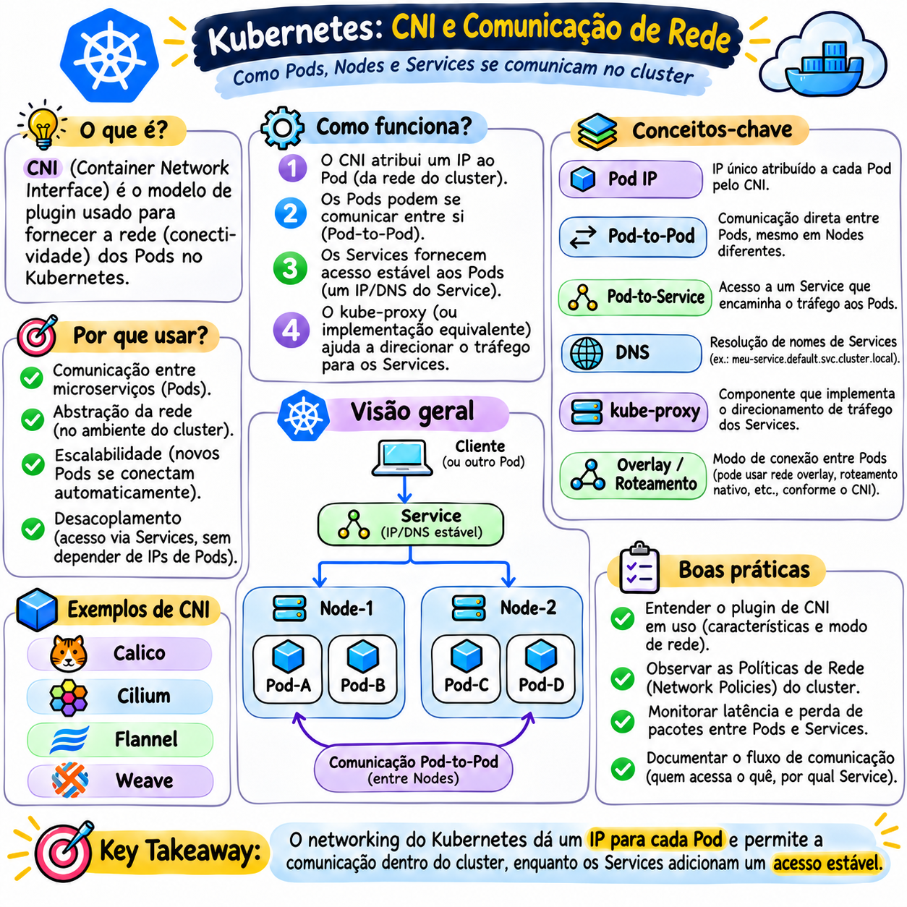

# 03.12 · CNI e comunicação de rede

[⌂ Início](../../../README.md) · [↑ Camada 03](../README.md) · [📚 Catálogo](../../../docs/catalogo.md)

> **Ao concluir esta aula, você será capaz de:** Explicar a função da CNI e verificar conectividade Pod-to-Pod sem pressupor políticas de isolamento no Kind.

## 🎨 Infográfico



## 📖 Aula teórica

### Responsabilidade na arquitetura

A CNI integra a configuração de rede dos containers no nó: endereços IP, interfaces e conectividade conforme o plugin instalado. Ela não substitui DNS nem roteamento de Services de alto nível. O modelo de rede do Kubernetes prevê comunicação entre Pods por IP sem NAT intencional entre os próprios Pods, mas sua implementação depende do plugin.

### Mecanismo e fluxo de execução

Ao iniciar um Pod, o componente de rede configura sua interface; o Pod recebe um IP e pode conversar com outros Pods segundo a topologia. Services abstraem destinos e políticas de rede exigem CNI compatível. Kind costuma usar sua própria configuração padrão e não demonstra recursos avançados de Cilium/Calico automaticamente.

### Exemplo interpretado (trecho)

```yaml
status:
  podIP: 10.244.1.10
spec:
  containers:
    - name: web
      ports:
        - containerPort: 80
```

O fragmento é uma representação didática: os campos de status são observados, não editados pelo aluno; os demais exemplos podem exigir objetos adicionais para constituir um manifesto completo.

### Inspeção e sinais observáveis

```bash
kubectl config current-context
kubectl get pods -n lab-03-12 -o wide
kubectl get nodes -o wide
kubectl get daemonsets -n kube-system
```

**Interpretação:** Compare IPs em Pods diferentes e faça teste de conexão controlado por endereço Pod. A conectividade depende de ambos estarem Ready e de um processo escutando.

### Cuidados e limites

Não declare NetworkPolicy funcional apenas por existir um YAML. Comunicação IP não prova que o CNI implementa enforcement.

## 🧪 Aplicação prática

[🧪 Lab 03.12](../labs/cni-comunicacao-basico/README.md) — desafio YAML, observação e experimento com evidências. Quando um componente não está no Kind, o lab diferencia **analogia local** de teste da implementação real.

**Complementar opcional:** [Aprofundamento sobre CNI e comunicação de rede](complementares/README.md); não é necessário para executar o laboratório.

## ✅ Revisão do aprendizado

- Qual responsabilidade é da CNI e qual é do CoreDNS?
- Por que um Pod pode ter IP e ainda não responder a uma conexão?
- Como separar falha de IP direto de falha de Service?

## 🔗 Referências oficiais

- [Documentação oficial do conceito](https://kubernetes.io/docs/concepts/cluster-administration/networking/)
- [Arquitetura e componentes](https://kubernetes.io/docs/concepts/overview/components/)

---

[← Aula 03.11](../container-runtime/README.md) · [↑ Camada 03](../README.md) · [🧪 Lab 03.12](../labs/cni-comunicacao-basico/README.md) · [Próxima: Aula 03.13 →](../kube-proxy-ebpf/README.md)
