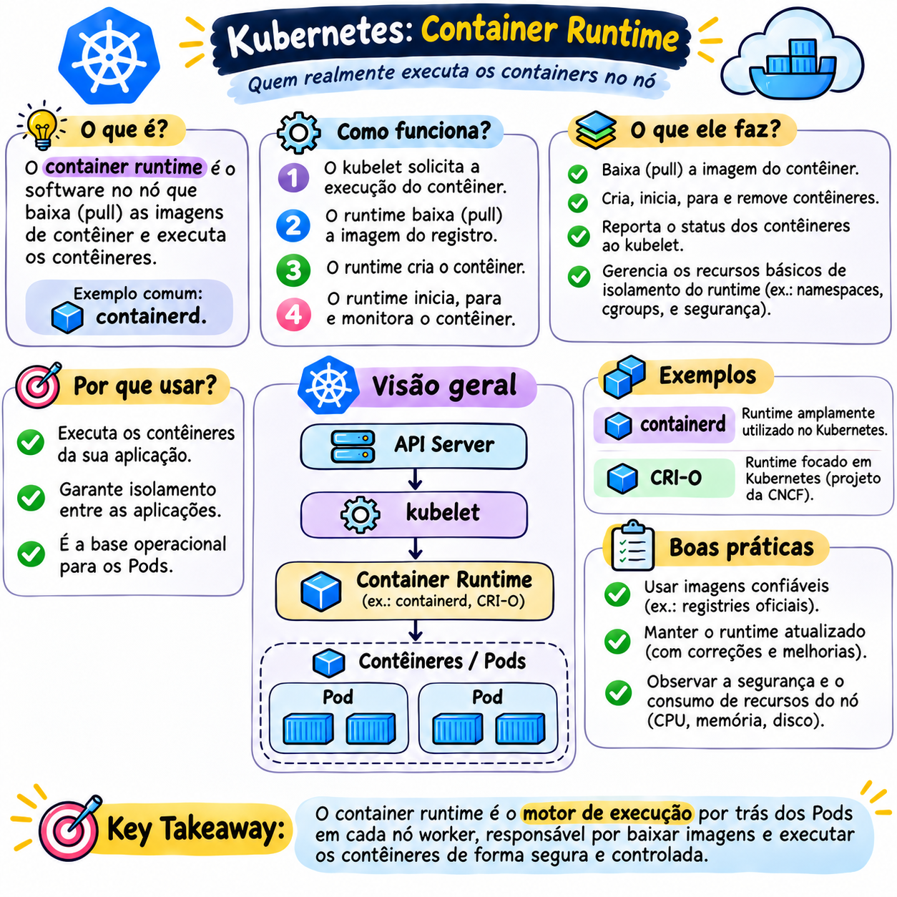

# 03.11 · Container Runtime

[⌂ Início](../../../README.md) · [↑ Camada 03](../README.md) · [📚 Catálogo](../../../docs/catalogo.md)

> **Ao concluir esta aula, você será capaz de:** Diferenciar kubelet, CRI, runtime e imagem OCI ao explicar o ciclo de vida de um container Kubernetes.

## 🎨 Infográfico



## 📖 Aula teórica

### Responsabilidade na arquitetura

O container runtime executa containers segundo solicitações do kubelet, geralmente via Container Runtime Interface (CRI). Containerd e CRI-O são exemplos. A imagem define camadas e metadados para execução; o PodSpec determina como ela será iniciada.

### Mecanismo e fluxo de execução

Kubelet solicita pull, criação e início de containers ao runtime. O runtime lida com isolamento e execução, mas não decide scheduling e não define controllers. Falhas de imagem como `ErrImagePull` e `ImagePullBackOff` ocorrem antes do início do processo; `CrashLoopBackOff` exige um processo que iniciou e encerrou repetidamente.

### Exemplo interpretado (trecho)

```yaml
status:
  containerStatuses:
    - name: app
      image: busybox:1.36
      imageID: "sha256:..."
      containerID: "containerd://..."
```

O fragmento é uma representação didática: os campos de status são observados, não editados pelo aluno; os demais exemplos podem exigir objetos adicionais para constituir um manifesto completo.

### Inspeção e sinais observáveis

```bash
kubectl config current-context
kubectl get pod runtime-demo -n lab-03-11 -o yaml
kubectl describe pod runtime-demo -n lab-03-11
kubectl get node dev-worker -o jsonpath='{.status.nodeInfo.containerRuntimeVersion}'
```

**Interpretação:** Compare `image`, `imageID`, `containerID` e `containerStatuses` para reconhecer como a imagem declarada se relaciona com o container efetivo.

### Cuidados e limites

Não confunda Docker no host do Kind com o runtime utilizado dentro do nó Kubernetes. Não manipule diretamente containers via `docker rm` para 'consertar' Pods gerenciados.

### Decisão arquitetural e diagnóstico

### Separar imagem, runtime e processo

`spec.containers[].image` é uma referência declarativa. Após um pull bem-sucedido, `status.containerStatuses[].imageID` identifica a imagem efetivamente obtida; `containerID` identifica a execução criada pelo runtime no nó. A runtime interface **CRI** permite ao kubelet solicitar operações sem falar diretamente com Docker como ferramenta de desenvolvimento.

**Diagnóstico:** `ErrImagePull` ocorre antes de existir processo e pode transitar a `ImagePullBackOff`. `CrashLoopBackOff` pressupõe um container que iniciou e terminou repetidas vezes. Ações de debugging devem respeitar essa diferença e evitar `docker rm` direto contra Pods gerenciados.

## 🧪 Aplicação prática

[🧪 Lab 03.11](../labs/container-runtime-basico/README.md) — desafio YAML, observação e experimento com evidências. Quando um componente não está no Kind, o lab diferencia **analogia local** de teste da implementação real.

## ✅ Revisão do aprendizado

- Por que `ImagePullBackOff` ocorre antes de um processo iniciar?
- Qual interface o kubelet usa com o runtime?
- Onde aparecem os IDs de imagem e do container observado?

## 🔗 Referências oficiais

- [Documentação oficial do conceito](https://kubernetes.io/docs/setup/production-environment/container-runtimes/)
- [Arquitetura e componentes](https://kubernetes.io/docs/concepts/overview/components/)

---

[← Aula 03.10](../kubelet/README.md) · [↑ Camada 03](../README.md) · [🧪 Lab 03.11](../labs/container-runtime-basico/README.md) · [Próxima: Aula 03.12 →](../cni-comunicacao/README.md)
