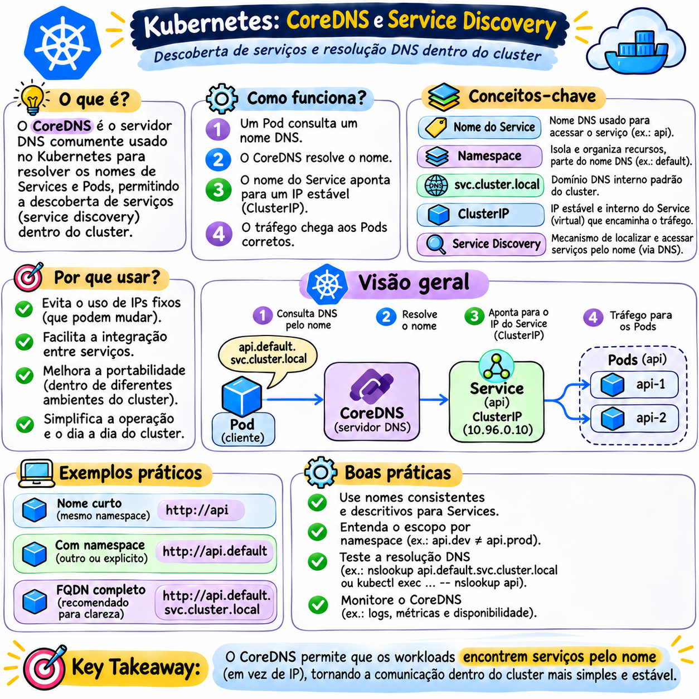

# 03.14 · CoreDNS e Service Discovery

[⌂ Início](../../../README.md) · [↑ Camada 03](../README.md) · [📚 Catálogo](../../../docs/catalogo.md)

> **Ao concluir esta aula, você será capaz de:** Demonstrar resolução DNS de um Service Kubernetes e diagnosticar a diferença entre resolução de nome e backends disponíveis.

## 🎨 Infográfico



## 📖 Aula teórica

### Responsabilidade na arquitetura

O DNS do cluster fornece nomes para Services e, dependendo do caso, para Pods. CoreDNS é a implementação comum no Kubernetes e costuma operar em `kube-system`. Resolução correta não garante aplicação saudável: o DNS pode devolver ClusterIP mesmo quando o Service não tem endpoints.

### Mecanismo e fluxo de execução

O domínio costuma seguir `service.namespace.svc.cluster.local`, mas o sufixo de cluster é configurável. Pods recebem configuração DNS via kubelet e policy. CoreDNS observa Services e endpoints; o encaminhamento de tráfego para o backend é responsabilidade da rede/Service, não do DNS.

### Exemplo interpretado (trecho)

```yaml
apiVersion: v1
kind: Service
metadata:
  name: web
  namespace: lab-03-14
spec:
  selector:
    app: web
  ports:
    - port: 80
```

O fragmento é uma representação didática: os campos de status são observados, não editados pelo aluno; os demais exemplos podem exigir objetos adicionais para constituir um manifesto completo.

### Inspeção e sinais observáveis

```bash
kubectl config current-context
kubectl get pods -n kube-system -l k8s-app=kube-dns
kubectl get svc, endpointslices -n lab-03-14
kubectl exec -n lab-03-14 cliente -- nslookup web.lab-03-14.svc.cluster.local
```

**Interpretação:** Compare a resolução do FQDN com a resposta HTTP do Service e o conteúdo dos EndpointSlices. O teste diferencia DNS, dataplane e aplicação.

### Cuidados e limites

A imagem de teste precisa conter cliente DNS (por exemplo BusyBox). `cluster.local` não é universal: consulte `/etc/resolv.conf` e a configuração do ambiente.

## 🧪 Aplicação prática

[🧪 Lab 03.14](../labs/coredns-basico/README.md) — desafio YAML, observação e experimento com evidências. Quando um componente não está no Kind, o lab diferencia **analogia local** de teste da implementação real.

## ✅ Revisão do aprendizado

- Por que resolver o FQDN não garante requisições HTTP bem-sucedidas?
- Onde o nome completo de um Service incorpora o namespace?
- Que sinal separa falha CoreDNS de Service sem endpoints?

## 🔗 Referências oficiais

- [Documentação oficial do conceito](https://kubernetes.io/docs/concepts/services-networking/dns-pod-service/)
- [Arquitetura e componentes](https://kubernetes.io/docs/concepts/overview/components/)

---

[← Aula 03.13](../kube-proxy-ebpf/README.md) · [↑ Camada 03](../README.md) · [🧪 Lab 03.14](../labs/coredns-basico/README.md) · [Próxima: Aula 03.15 →](../csi-storage/README.md)
