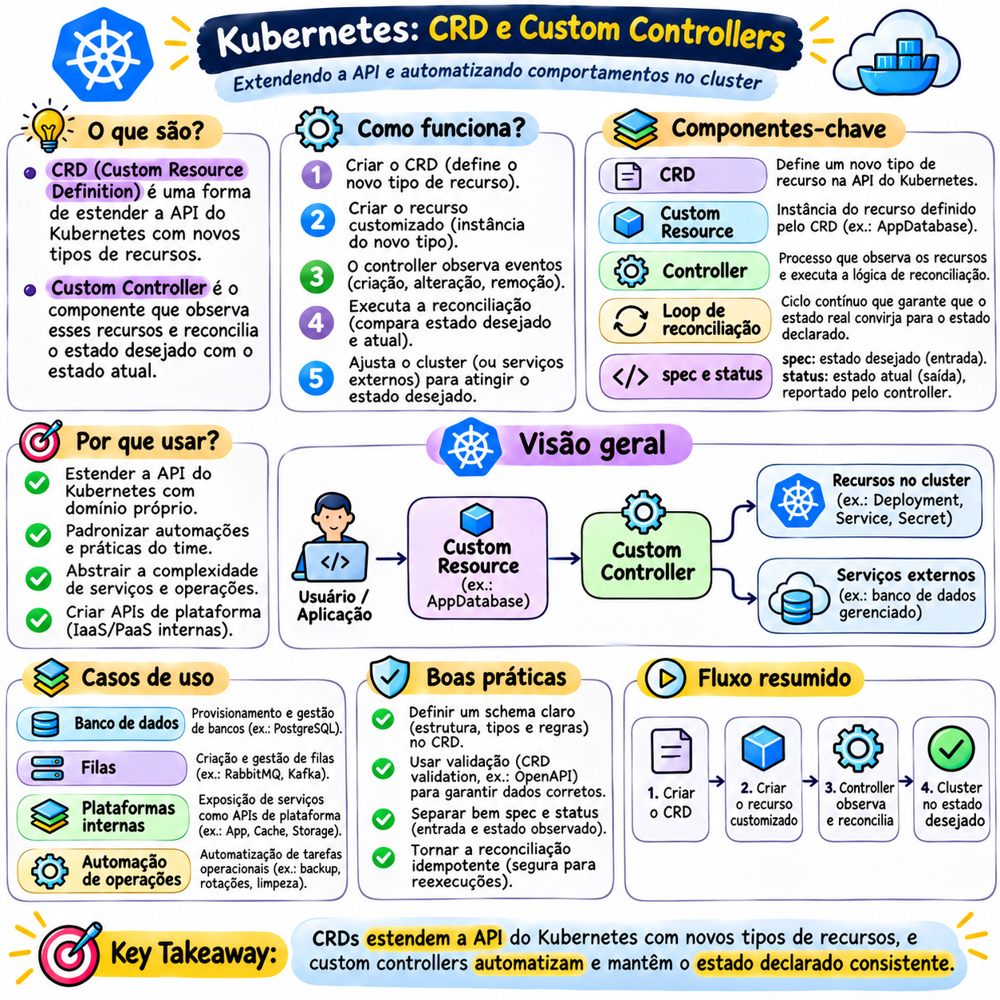

# 🧩 03.06 · CRDs e Custom Resources

[⌂ Início](../../../README.md) · [↑ Camada 03](../README.md) · [🗺️ Roadmap](../../../docs/roadmap.md)

> **Objetivo:** entender como estender a API Kubernetes com novos tipos de recursos e diferenciá-los dos controladores que atuam sobre eles.

## 🎨 Infográfico

> Imagem disponível no repositório; confira detalhes técnicos na documentação da aula.

## 📖 Conceito

Uma **CustomResourceDefinition (CRD)** registra um novo tipo de recurso na API Kubernetes. Uma **Custom Resource (CR)** é uma instância desse tipo, declarada e consultada com as ferramentas usuais do cluster.

Por exemplo, uma CRD poderia definir o tipo fictício `AppEnvironment`, com campos em `spec` para indicar a configuração desejada. A presença do objeto na API **não cria automaticamente** Deployments, ConfigMaps ou infraestrutura: essa lógica exige um controlador.

| Conceito | Papel |
| --- | --- |
| **CRD** | Define grupo, versões, escopo e schema de um tipo personalizado |
| **Custom Resource** | Instância declarativa do tipo, com `metadata` e `spec` |
| **Schema / OpenAPI** | Valida campos e ajuda a orientar consumidores da API |
| **Status** | Representa o estado observado, normalmente atualizado por um controlador |

## 🔎 Experimento guiado — planejado

1. Criar uma CRD de laboratório para `AppEnvironment`, preferencialmente em um Kind descartável.
2. Confirmar a descoberta do novo tipo com `kubectl api-resources`.
3. Criar e consultar uma instância da Custom Resource.
4. Testar a validação de schema alterando um campo obrigatório.
5. Remover os recursos com cuidado; **apagar a CRD remove também todas as instâncias desse tipo**.

**Status:** guia conceitual publicado; manifests e lab executável ainda não adicionados nem testados.

## 🎯 Você deverá conseguir

- [ ] Explicar a diferença entre CRD e instância de Custom Resource.
- [ ] Descrever a função de `spec`, `status` e validação por schema.
- [ ] Explicar por que uma CRD isolada não implementa reconciliação.
- [ ] Reconhecer o risco de apagar uma CRD com instâncias existentes.

## 🔗 Referências

[Kubernetes · Custom Resources](https://kubernetes.io/docs/concepts/extend-kubernetes/api-extension/custom-resources/) · [Kubernetes · Extend the API](https://kubernetes.io/docs/concepts/extend-kubernetes/api-extension/)

---

[← kube-controller-manager: índice da camada](../README.md) · [Próximo: Custom Controllers e Operators →](../custom-controllers-operators/README.md)
