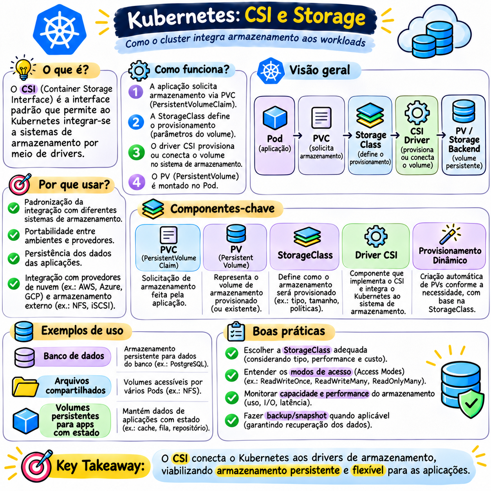

# 03.15 · CSI e Storage

[⌂ Início](../../../README.md) · [↑ Camada 03](../README.md) · [📚 Catálogo](../../../docs/catalogo.md)

> **Ao concluir esta aula, você será capaz de:** Distinguir PVC, PV, StorageClass e driver CSI e comprovar persistência de dados depois da recriação de um Pod.

## 🎨 Infográfico



## 📖 Aula teórica

### Responsabilidade na arquitetura

A Container Storage Interface é um contrato entre Kubernetes e drivers de armazenamento. Um Pod consome volume por PVC; provisionamento de PV pode ser estático ou dinâmico conforme StorageClass e controlador externo. No Kind, a classe padrão pode usar provisionador local diferente de um driver CSI cloud.

### Mecanismo e fluxo de execução

PVC solicita capacidade e access modes; StorageClass descreve provisionamento; PV representa volume vinculado; Pod monta o PVC. `Bound` mostra associação, não prova persistência sem leitura posterior. Deletar PVC pode desencadear exclusão do volume conforme `reclaimPolicy`. CSI drivers podem expor nós e controllers próprios.

### Exemplo interpretado (trecho)

```yaml
apiVersion: v1
kind: PersistentVolumeClaim
metadata:
  name: dados
spec:
  accessModes: [ReadWriteOnce]
  resources:
    requests:
      storage: 256Mi
```

O fragmento é uma representação didática: os campos de status são observados, não editados pelo aluno; os demais exemplos podem exigir objetos adicionais para constituir um manifesto completo.

### Inspeção e sinais observáveis

```bash
kubectl config current-context
kubectl get storageclass
kubectl get pvc,pv -n lab-03-15
kubectl describe pvc dados -n lab-03-15
```

**Interpretação:** Grave um marcador no volume, remova apenas o Pod e recrie-o; confira se o arquivo permanece. Compare Status de PV e PVC antes e depois.

### Cuidados e limites

Não suponha que todo StorageClass local é CSI. Evite excluir PVC antes de registrar evidência de persistência e política de reclaim.

## 🧪 Aplicação prática

[🧪 Lab 03.15](../labs/csi-storage-basico/README.md) — desafio YAML, observação e experimento com evidências. Quando um componente não está no Kind, o lab diferencia **analogia local** de teste da implementação real.

**Complementar opcional:** [Aprofundamento sobre CSI e Storage](complementares/README.md); não é necessário para executar o laboratório.

## ✅ Revisão do aprendizado

- Qual diferença existe entre PVC, PV e StorageClass?
- Por que `Bound` não comprova persistência após recriação?
- O que precisa ser validado antes de excluir um PVC em produção?

## 🔗 Referências oficiais

- [Documentação oficial do conceito](https://kubernetes.io/docs/concepts/storage/volumes/#csi)
- [Arquitetura e componentes](https://kubernetes.io/docs/concepts/overview/components/)

---

[← Aula 03.14](../coredns/README.md) · [↑ Camada 03](../README.md) · [🧪 Lab 03.15](../labs/csi-storage-basico/README.md) · [Próxima: Aula 03.16 →](../gateway-api/README.md)
