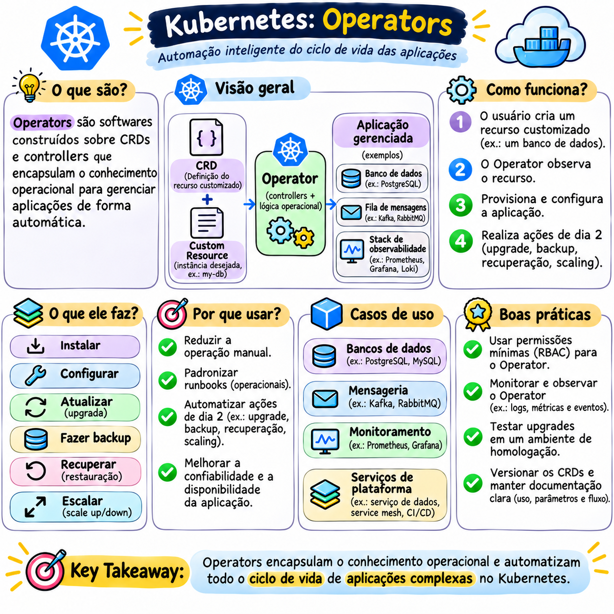

# 03.07 · Custom Controllers e Operators

[⌂ Início](../../../README.md) · [↑ Camada 03](../README.md) · [📚 Catálogo](../../../docs/catalogo.md)

> **Ao concluir esta aula, você será capaz de:** Distinguir controle de reconciliação de simples armazenamento de recursos e observar ownerReferences/status em recursos controlados.

## 🎨 Infográfico



## 📖 Aula teórica

### Contexto e responsabilidade

Um controller observa objetos e reage a diferenças entre estado desejado e observado. Operators aplicam essa ideia a domínios operacionais, codificando regras de ciclo de vida, upgrade e recuperação como reconciliação.

### Como o mecanismo funciona

Um reconciler normalmente lê um recurso, avalia dependências, atualiza objetos dependentes e registra status. Deve ser idempotente e tolerante a eventos repetidos. `ownerReferences` e finalizers ajudam a representar dependência e limpeza, mas não substituem lógica de negócio. CRD registra um tipo; reconciler é a implementação que produz comportamento.

### Exemplo interpretado (trecho)

```yaml
apiVersion: apps/v1
kind: Deployment
metadata:
  name: operator-demo
spec:
  replicas: 2
  selector:
    matchLabels:
      app: operator-demo
```

Deployment ilustra reconciliação nativa; um Operator customizado precisaria de controller próprio que reage à Custom Resource. O trecho ilustra campos essenciais; consulte o lab para escrever o manifesto completo.

### Inspeção no Kind

```bash
kubectl config current-context
kubectl get deployment operator-demo -n lab-03-07
kubectl get rs,pods -n lab-03-07 -o yaml
kubectl get deploy operator-demo -n lab-03-07 -o jsonpath='{.status.observedGeneration}'
```

**Interpretação:** Use um controlador nativo como **analogia executável**: altere réplicas e observe os recursos filhos e status. A aula diferencia esse comportamento de um Operator customizado real, cuja instalação não é requisito deste Kind.

### Limites e segurança

Este lab não implementa um operador completo. Não afirme teste de reconciler personalizado apenas porque um Deployment nativo reconciliou; instalação de controller próprio pertence a projeto avançado.

## 🧪 Aplicação prática

[🧪 Lab 03.07 — Custom Controllers e Operators](../labs/custom-controllers-operators-basico/README.md): construa o YAML do desafio, compare estado declarado com observado e registre uma evidência do conceito. O lab é o caminho principal, independente do material opcional.

**Complementar opcional:** [Guia de decisões e diagnóstico](complementares/README.md). Útil para aprofundar, não é pré-requisito.

## ✅ Revisão do aprendizado

- Por que uma CRD não equivale a um Operator?
- O que significa idempotência em um loop de reconciliação?
- Qual evidência prova que um recurso filho é gerenciado por um controlador?

## 🔗 Referências oficiais

- [Kubernetes — documentação do componente](https://kubernetes.io/docs/concepts/extend-kubernetes/operator/)
- [Arquitetura e componentes](https://kubernetes.io/docs/concepts/overview/components/)

---

[← Aula 03.06](../crds-custom-resources/README.md) · [↑ Camada 03](../README.md) · [🧪 Lab 03.07](../labs/custom-controllers-operators-basico/README.md) · [Próxima: Aula 03.08 →](../kube-scheduler/README.md)
