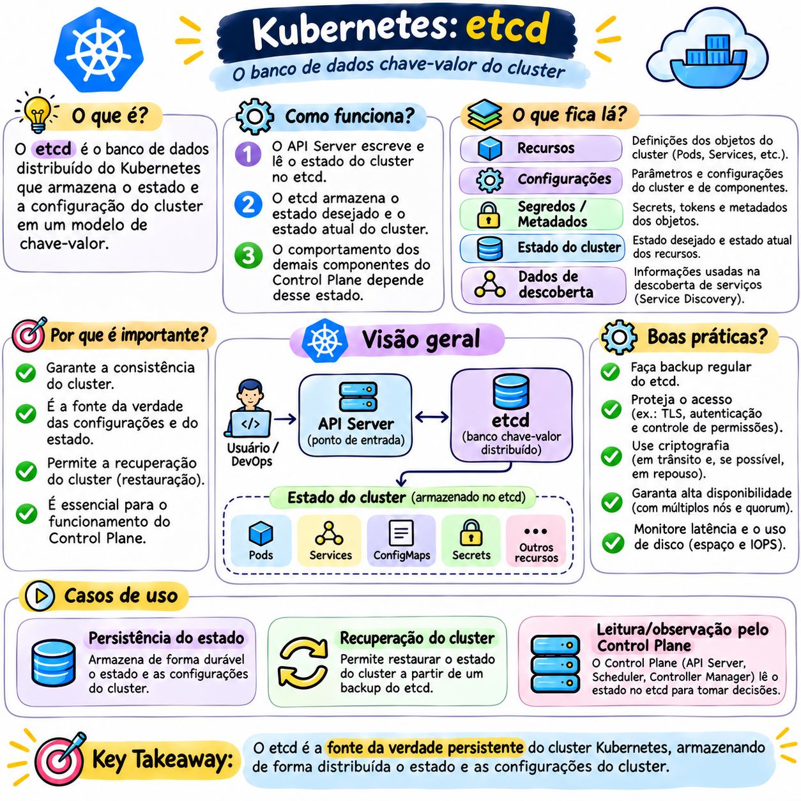

# 03.03 · etcd

[⌂ Início](../../../README.md) · [↑ Camada 03](../README.md) · [📚 Catálogo](../../../docs/catalogo.md)

> **Ao concluir esta aula, você será capaz de:** Descrever o papel de etcd como armazenamento consistente do estado do cluster e observar persistência via API sem acessar chaves internas.

## 🎨 Infográfico



## 📖 Aula teórica

### Contexto e responsabilidade

etcd armazena estado que o API Server persiste: metadados, especificações e parte do status dos recursos. Ele não armazena processos de containers em execução nem substitui o scheduler ou kubelet.

### Como o mecanismo funciona

Quando um ConfigMap muda, o API Server grava o novo estado, altera `resourceVersion` e os observadores recebem atualizações. `resourceVersion` serve como mecanismo de controle de concorrência/observação; não é timestamp nem contador global para ordenar todos os objetos. Snapshots/restore de etcd são tarefas administrativas sensíveis.

### Exemplo interpretado (trecho)

```yaml
apiVersion: v1
kind: ConfigMap
metadata:
  name: registro
data:
  revisao: "primeira"
```

O objeto é persistido pelo API Server. A `resourceVersion` muda após atualizações; ela não equivale ao conteúdo de `data.revisao`. O trecho ilustra campos essenciais; consulte o lab para escrever o manifesto completo.

### Inspeção no Kind

```bash
kubectl config current-context
kubectl get configmap registro -n lab-03-03 -o yaml
kubectl get configmap registro -n lab-03-03 -o jsonpath='{.metadata.resourceVersion}'
kubectl get configmap registro -n lab-03-03 --watch
```

**Interpretação:** Compare `resourceVersion` antes e depois de atualizar um campo. Observe que a API retorna a última versão mesmo quando o processo cliente é encerrado e executado novamente.

### Limites e segurança

Não leia diretamente `/var/lib/etcd` ou execute snapshots de clusters compartilhados para este lab. O Kind permite demonstrar persistência de objetos sem tocar no armazenamento interno.

### Quatro metadados que não significam a mesma coisa

- **`resourceVersion`:** token de controle de concorrência e observação; não interprete como relógio global.
- **`uid`:** identidade da instância. Excluir e recriar um ConfigMap com o mesmo nome produz novo UID.
- **`generation`:** mudanças significativas na especificação de certos recursos.
- **`observedGeneration`:** avanço reportado pelo controlador, quando o tipo expõe esse campo.

Ao modificar o ConfigMap do lab, observe sua persistência por meio do API Server, e não por acesso direto a arquivos do etcd. **Snapshot/restore é operação de recuperação do Control Plane** e exige compatibilidade de versão, janela e plano de rollback; não pertence a este exercício básico.

## 🧪 Aplicação prática

[🧪 Lab 03.03 — etcd](../labs/etcd-basico/README.md): construa o YAML do desafio, compare estado declarado com observado e registre uma evidência do conceito. O lab é o caminho principal, independente do material opcional.

**Complementar opcional:** [Guia de decisões e diagnóstico](complementares/README.md). Útil para aprofundar, não é pré-requisito.

## ✅ Revisão do aprendizado

- Por que `resourceVersion` não deve ser interpretada como timestamp?
- Como diferenciar estado persistido em etcd de execução real no worker?
- Qual risco existe em restaurar snapshot antigo de etcd em cluster ativo?

## 🔗 Referências oficiais

- [Kubernetes — documentação do componente](https://kubernetes.io/docs/tasks/administer-cluster/configure-upgrade-etcd/)
- [Arquitetura e componentes](https://kubernetes.io/docs/concepts/overview/components/)

---

[← Aula 03.02](../kube-apiserver/README.md) · [↑ Camada 03](../README.md) · [🧪 Lab 03.03](../labs/etcd-basico/README.md) · [Próxima: Aula 03.04 →](../admission-controllers/README.md)
