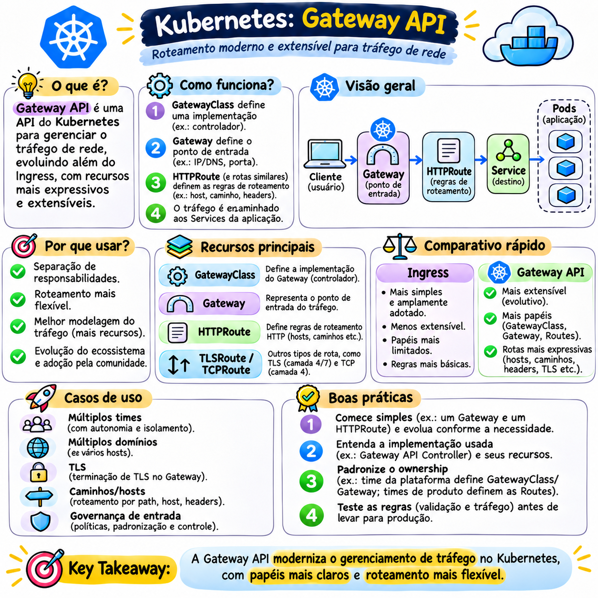

# 03.16 · Gateway API

[⌂ Início](../../../README.md) · [↑ Camada 03](../README.md) · [📚 Catálogo](../../../docs/catalogo.md)

> **Ao concluir esta aula, você será capaz de:** Diferenciar GatewayClass, Gateway e HTTPRoute e diagnosticar a ausência de controlador Gateway no Kind padrão.

## 🎨 Infográfico



## 📖 Aula teórica

### Responsabilidade na arquitetura

Gateway API fornece objetos declarativos para regras de roteamento mais expressivas e separação de responsabilidades. GatewayClass indica implementação, Gateway declara listeners e HTTPRoute vincula regras de tráfego aos listeners e backends. CRDs da API não provisionam um proxy por conta própria.

### Mecanismo e fluxo de execução

Um Gateway Controller compatível observa os objetos, configura dataplane e publica condições como Accepted, Programmed e ResolvedRefs. Sem CRDs/controlador instalados, o API Server nem reconhece os tipos, ou aceita os objetos sem status funcional. Uma rota pode referir um Service existente mas continuar sem tráfego por falta de implementação.

### Exemplo interpretado (trecho)

```yaml
apiVersion: gateway.networking.k8s.io/v1
kind: HTTPRoute
spec:
  parentRefs:
    - name: gateway-demo
  rules:
    - backendRefs:
        - name: web
          port: 80
```

O fragmento é uma representação didática: os campos de status são observados, não editados pelo aluno; os demais exemplos podem exigir objetos adicionais para constituir um manifesto completo.

### Inspeção e sinais observáveis

```bash
kubectl config current-context
kubectl api-resources --api-group=gateway.networking.k8s.io
kubectl get gatewayclass,gateway,httproute -A
kubectl get svc -n lab-03-16
```

**Interpretação:** Use uma verificação de discovery para identificar se Gateway API está instalada. A prática principal inspeciona configuração de backend nativo e apresenta manifesto HTTPRoute como exercício separado dependente de CRDs/controlador.

### Cuidados e limites

Não instale CRDs de Gateway API sem versionamento e plano de limpeza. Não confunda declaração HTTPRoute com teste HTTP; a fase funcional exige controller instalado.

### Decisão arquitetural e diagnóstico

### Controlador, configuração e dataplane são três coisas

- **GatewayClass:** indica qual implementação pode atender a Gateway API.
- **Gateway:** declara listeners/endereços e tem condições como `Accepted` e `Programmed`.
- **HTTPRoute:** associa matches, filtros e backends a um Gateway, com condições como `Accepted` e `ResolvedRefs`.
- **Service/EndpointSlices:** indicam a aplicação de destino, independente do controller.

Sem CRD, a API não reconhece esses tipos; com CRD, mas sem controlador, os objetos podem existir sem programação real. O [experimento avançado com Envoy Gateway](../labs/gateway-api-basico/experiments/README.md) fornece recurso real e prova HTTP via port-forward, evitando confundir ausência de LoadBalancer externo no Kind com erro de roteamento.

## 🧪 Aplicação prática

[🧪 Lab 03.16](../labs/gateway-api-basico/README.md) — desafio YAML, observação e experimento com evidências. Quando um componente não está no Kind, o lab diferencia **analogia local** de teste da implementação real.

**Complementar opcional:** [Aprofundamento sobre Gateway API](complementares/README.md); não é necessário para executar o laboratório.

## ✅ Revisão do aprendizado

- Qual diferença existe entre GatewayClass e Gateway?
- Por que HTTPRoute pode ser aceita e não funcionar?
- Que condições você verificaria ao investigar uma rota não programada?

## 🔗 Referências oficiais

- [Documentação oficial do conceito](https://gateway-api.sigs.k8s.io/)
- [Arquitetura e componentes](https://kubernetes.io/docs/concepts/overview/components/)

---

[← Aula 03.15](../csi-storage/README.md) · [↑ Camada 03](../README.md) · [🧪 Lab 03.16](../labs/gateway-api-basico/README.md) · [Próxima: Aula 03.17 →](../kustomize-helm/README.md)
