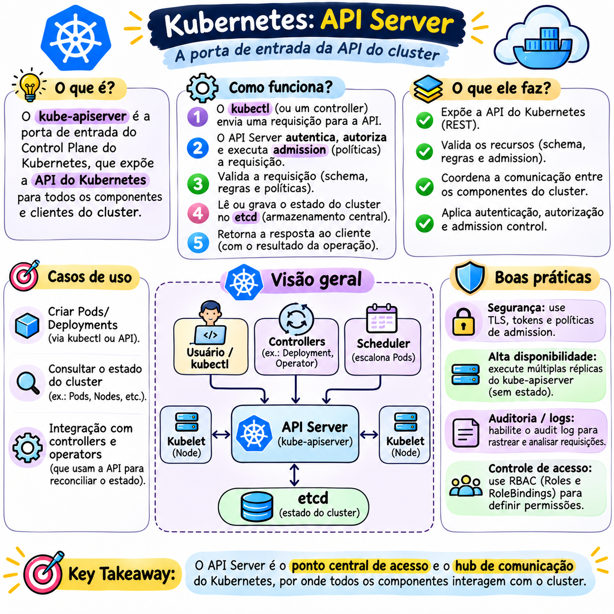

# 03.02 · kube-apiserver

[⌂ Início](../../../README.md) · [↑ Camada 03](../README.md) · [📚 Catálogo](../../../docs/catalogo.md)

> **Ao concluir esta aula, você será capaz de:** Distinguir descoberta, autenticação, autorização, validação e persistência ao investigar requisições à API Kubernetes.

## 🎨 Infográfico



## 📖 Aula teórica

### Contexto e responsabilidade

O API Server é a porta de entrada da API declarativa. CLI, controladores e operadores dependem dele para ler, gravar e observar recursos. Expor um endpoint não concede acesso: a identidade é autenticada, autorizada e a requisição pode ser rejeitada por validação ou admissão.

### Como o mecanismo funciona

Uma operação segue, conceitualmente, autenticação → autorização → mutação/validação de admissão → persistência, com detalhes que variam segundo tipo e subrecurso. O API Server disponibiliza discovery e OpenAPI; `kubectl explain` e `--dry-run=server` ajudam a verificar schema. Leituras podem passar por cache e autorização sem criar estado.

### Exemplo interpretado (trecho)

```yaml
apiVersion: v1
kind: ConfigMap
metadata:
  name: api-demo
data:
  revisao: "v1"
```

Uma criação válida é persistida; um campo inválido ou uma política de admissão pode rejeitar a mesma operação antes de salvar o objeto. O trecho ilustra campos essenciais; consulte o lab para escrever o manifesto completo.

### Inspeção no Kind

```bash
kubectl config current-context
kubectl api-resources --api-group=apps
kubectl explain deployment.spec.replicas
kubectl auth can-i create configmaps -n lab-03-02
kubectl get --raw /readyz
```

**Interpretação:** Compare o comportamento de um YAML válido com um campo desconhecido enviado em `--dry-run=server`. A saída de `auth can-i` refere-se ao usuário/contexto atual.

### Limites e segurança

`kubectl apply --dry-run=client` não valida políticas do servidor. Endpoints `/readyz` e `/livez` dependem de autorização e do cluster; não confunda um 403 com API fora do ar.

### Interpretar respostas da API em vez de adivinhar

| Sintoma | Etapa a verificar | O que não concluir |
| --- | --- | --- |
| Falha TLS/conexão | Endpoint, rede ou certificados | Não é necessariamente RBAC |
| `Unauthorized` (401) | Identidade e autenticação | Não é falta de CPU no nó |
| `Forbidden` (403) | RBAC ou política que negou a requisição | Não é Pod Pending |
| Campo inválido/schema | Validação OpenAPI/admission | O YAML não foi persistido |

A API controla a **admissão da intenção**, não o momento em que o kubelet conclui a execução. Compare um `kubectl apply --dry-run=server --validate=strict` com o estado vivo de um objeto existente antes de interpretar uma falha como problema de worker.

## 🧪 Aplicação prática

[🧪 Lab 03.02 — kube-apiserver](../labs/kube-apiserver-basico/README.md): construa o YAML do desafio, compare estado declarado com observado e registre uma evidência do conceito. O lab é o caminho principal, independente do material opcional.

**Complementar opcional:** [Guia de decisões e diagnóstico](complementares/README.md). Útil para aprofundar, não é pré-requisito.

## ✅ Revisão do aprendizado

- Por que `kubectl explain` não prova que uma policy de admissão aceita um objeto?
- Qual diferença existe entre autenticação e autorização?
- Que evidência distingue um 403 de uma falha de conexão com o API Server?

## 🔗 Referências oficiais

- [Kubernetes — documentação do componente](https://kubernetes.io/docs/reference/using-api/)
- [Arquitetura e componentes](https://kubernetes.io/docs/concepts/overview/components/)

---

[← Aula 03.01](../arquitetura-cluster/README.md) · [↑ Camada 03](../README.md) · [🧪 Lab 03.02](../labs/kube-apiserver-basico/README.md) · [Próxima: Aula 03.03 →](../etcd/README.md)
