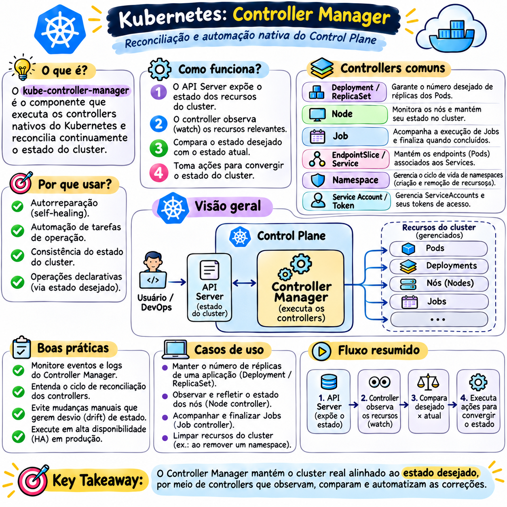

# 03.05 · kube-controller-manager

[⌂ Início](../../../README.md) · [↑ Camada 03](../README.md) · [📚 Catálogo](../../../docs/catalogo.md)

> **Ao concluir esta aula, você será capaz de:** Explicar reconciliação nativa e demonstrar a diferença entre alterar uma réplica desejada e a reação do controlador.

## 🎨 Infográfico



## 📖 Aula teórica

### Contexto e responsabilidade

Controllers mantêm o estado observado convergindo ao estado declarado. O kube-controller-manager executa vários controladores nativos, como os associados a nós, namespaces e réplicas, embora componentes específicos tenham controladores próprios.

### Como o mecanismo funciona

Um Deployment cria/gerencia ReplicaSets e estes mantêm Pods desejados. Os controllers observam o API Server, fazem alterações e atualizam status. Eles não executam containers diretamente. A reconciliação pode ocorrer várias vezes, e o sistema deve lidar com eventos repetidos.

### Exemplo interpretado

A observação depende do estado real do cluster. O seguinte trecho exemplifica **um sinal ou campo de API**, não constitui solução completa para o laboratório:

```yaml
apiVersion: v1
kind: ConfigMap
metadata:
  name: exemplo-de-estado
data:
  expectativa: "comparar spec, status, eventos e comportamento"
```

O ConfigMap acima ilustra uma declaração persistida pelo API Server. **Não representa, por si só, o funcionamento de kube-controller-manager**. A verificação específica está no lab correspondente.

### Inspeção no Kind

```bash
kubectl config current-context
kubectl get deployment controlador -n lab-03-05 -o yaml
kubectl get replicaset,pod -n lab-03-05 -o wide
kubectl describe deployment controlador -n lab-03-05
```

**Interpretação:** Após excluir um Pod gerenciado, observe o novo UID e a recuperação de `availableReplicas`. A identidade do Pod não é preservada, mas a quantidade desejada tende a ser restabelecida.

### Limites e segurança

Não confunda o Deployment controller com o scheduler ou o kubelet. Aplicar `replicas: 2` é intenção, não garantia de duas réplicas prontas sob falha de imagem ou recursos.

## 🧪 Aplicação prática

[🧪 Lab 03.05 — kube-controller-manager](../labs/kube-controller-manager-basico/README.md): construa o YAML do desafio, compare estado declarado com observado e registre uma evidência do conceito. O lab é o caminho principal, independente do material opcional.

## ✅ Revisão do aprendizado

- Por que apagar um Pod gerenciado normalmente gera outro?
- Qual objeto controla diretamente a contagem de Pods de um Deployment?
- Que condições indicam convergência incompleta mesmo com o Deployment existente?

## 🔗 Referências oficiais

- [Kubernetes — documentação do componente](https://kubernetes.io/docs/concepts/architecture/controller/)
- [Arquitetura e componentes](https://kubernetes.io/docs/concepts/overview/components/)

---

[← Aula 03.04](../admission-controllers/README.md) · [↑ Camada 03](../README.md) · [🧪 Lab 03.05](../labs/kube-controller-manager-basico/README.md) · [Próxima: Aula 03.06 →](../crds-custom-resources/README.md)
