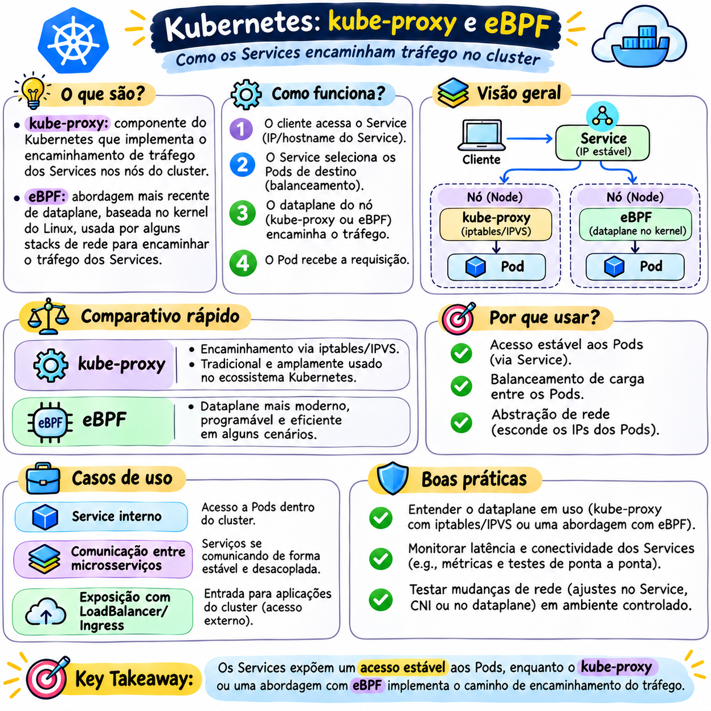

# 03.13 · kube-proxy e eBPF

[↑ Camada 03](../README.md) · [📚 Catálogo de 52 aulas](../../../docs/catalogo.md)

## 🎨 Infográfico

> O infográfico oferece uma visão geral. Confira os detalhes técnicos durante o estudo da aula.

## 📖 Aula teórica

**Em preparação.** A imagem está publicada, mas a explicação aprofundada, os exemplos e as referências ainda serão adicionados.

## 🧪 Laboratório / observação

**Planejado.** Ainda não há um roteiro executável validado para este tema. A proposta será completar a aula com pré-requisitos, experimentos, resultados esperados e limpeza segura.

## 🔎 Diagnóstico e conclusão

O roteiro de diagnóstico e o checklist de aprendizado serão incluídos com a aula completa.

---

[↑ Índice da camada](../README.md) · [📚 Catálogo](../../../docs/catalogo.md)
