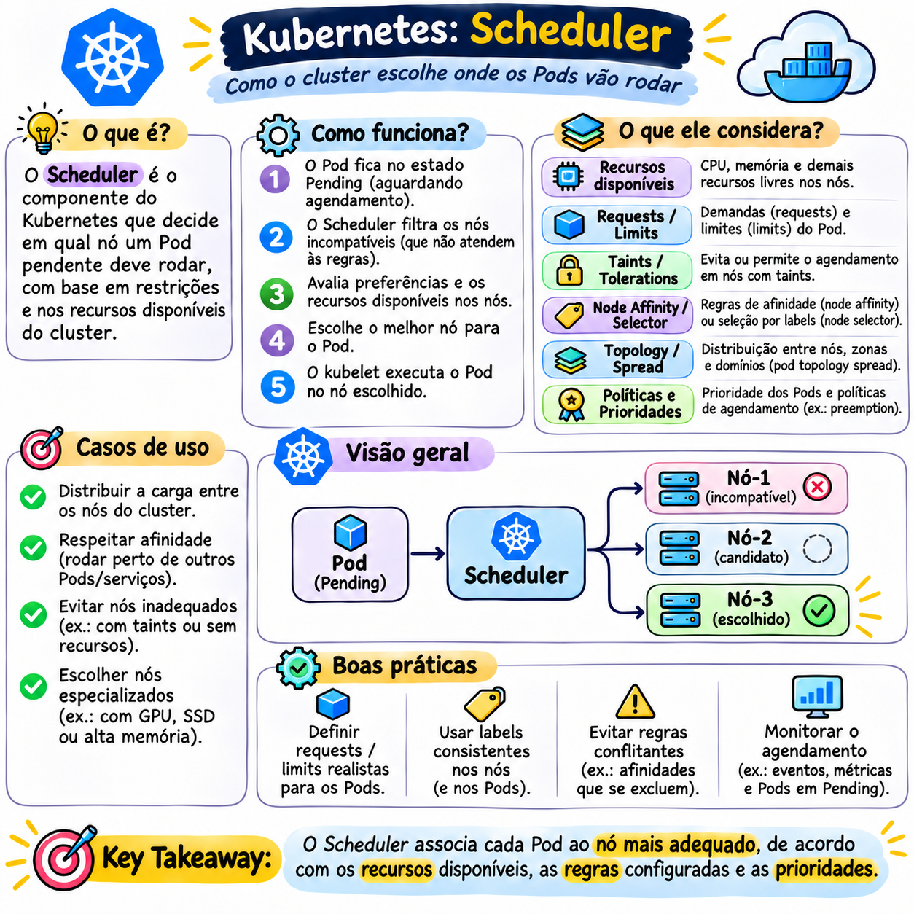

# 03.08 · kube-scheduler

[⌂ Início](../../../README.md) · [↑ Camada 03](../README.md) · [📚 Catálogo](../../../docs/catalogo.md)

> **Ao concluir esta aula, você será capaz de:** Investigar como o scheduler seleciona nós elegíveis e explicar eventos `FailedScheduling` em restrições impossíveis.

## 🎨 Infográfico



## 📖 Aula teórica

### Contexto e responsabilidade

O scheduler atribui nós a Pods ainda não vinculados a um Node. Ele considera requests, restrições, taints/tolerations, afinidade, topologia e outras condições. Seu papel termina na escolha do nó; o kubelet faz a execução.

### Como o mecanismo funciona

O processo de scheduling avalia filtros de elegibilidade e pontuação entre nós candidatos. Restrições `required` podem deixar Pod Pending. Ao marcar um `nodeSelector` com label inexistente, geramos uma falha reproduzível sem alterar o nó. `status.conditions` e Events indicam o motivo; `spec.nodeName` é preenchido após a vinculação.

### Exemplo interpretado

A observação depende do estado real do cluster. O seguinte trecho exemplifica **um sinal ou campo de API**, não constitui solução completa para o laboratório:

```yaml
apiVersion: v1
kind: ConfigMap
metadata:
  name: exemplo-de-estado
data:
  expectativa: "comparar spec, status, eventos e comportamento"
```

O ConfigMap acima ilustra uma declaração persistida pelo API Server. **Não representa, por si só, o funcionamento de kube-scheduler**. A verificação específica está no lab correspondente.

### Inspeção no Kind

```bash
kubectl config current-context
kubectl get nodes --show-labels
kubectl describe pod sem-no -n lab-03-08
kubectl get events -n lab-03-08 --sort-by=.lastTimestamp
```

**Interpretação:** O Pod restrito deve permanecer Pending com motivo de scheduling enquanto nenhum nó satisfaz o selector. Remover o campo pelo manifesto requer recriar o Pod ou aplicar mudanças permitidas.

### Limites e segurança

Um Pod Pending também pode aguardar PVC, quota ou outra dependência; não atribua toda pendência ao scheduler sem eventos. Use somente o Kind descartável.

## 🧪 Aplicação prática

[🧪 Lab 03.08 — kube-scheduler](../labs/kube-scheduler-basico/README.md): construa o YAML do desafio, compare estado declarado com observado e registre uma evidência do conceito. O lab é o caminho principal, independente do material opcional.

## ✅ Revisão do aprendizado

- Por que `nodeSelector` pode impedir scheduling sem erro de YAML?
- Qual é a diferença entre `spec.nodeName` e `status.phase`?
- Que sinais distinguem falta de capacidade de selector incompatível?

## 🔗 Referências oficiais

- [Kubernetes — documentação do componente](https://kubernetes.io/docs/concepts/scheduling-eviction/kube-scheduler/)
- [Arquitetura e componentes](https://kubernetes.io/docs/concepts/overview/components/)

---

[← Aula 03.07](../custom-controllers-operators/README.md) · [↑ Camada 03](../README.md) · [🧪 Lab 03.08](../labs/kube-scheduler-basico/README.md) · [Próxima: Aula 03.09 →](../cloud-controller-manager/README.md)
