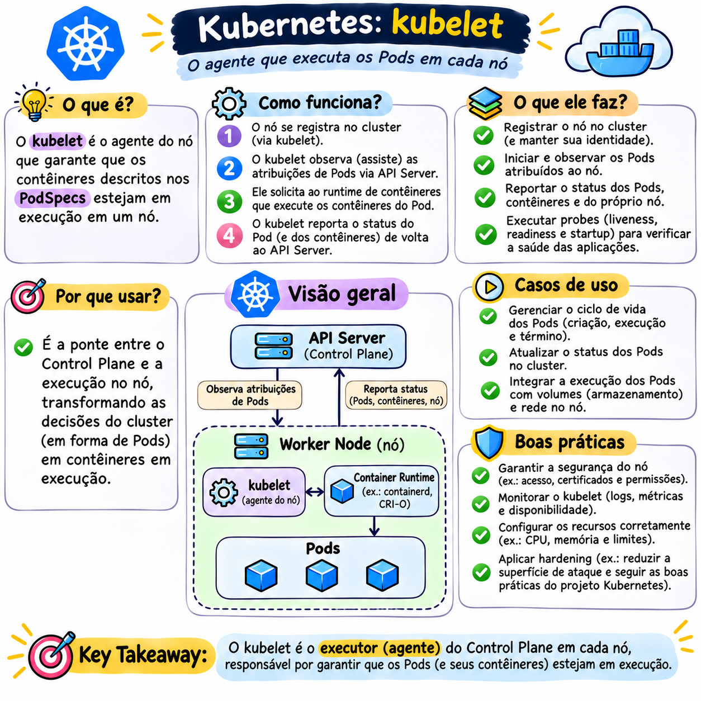

# 03.10 · kubelet

[⌂ Início](../../../README.md) · [↑ Camada 03](../README.md) · [📚 Catálogo](../../../docs/catalogo.md)

> **Ao concluir esta aula, você será capaz de:** Explicar como o kubelet transforma uma atribuição de Pod ao nó em execução e diagnosticar divergências entre node, Pod e container.

## 🎨 Infográfico



## 📖 Aula teórica

### Responsabilidade na arquitetura

O kubelet é o agente em cada nó. Ele observa Pods atribuídos ao nó, interage com o container runtime via CRI, gerencia volumes e probes e publica status das execuções de volta ao API Server.

### Mecanismo e fluxo de execução

O scheduler escolhe o nó, mas não cria processos. Kubelet lê `PodSpec` e mantém containers em execução, coordena probes e reporta `containerStatuses`, reinícios e condições. A ausência de kubelet saudável pode produzir nó `NotReady` e Pods sem status atualizado. Static Pods são definidos localmente e refletidos como mirror Pods na API, com semântica distinta de Deployments.

### Exemplo interpretado (trecho)

```yaml
spec:
  nodeName: dev-worker
status:
  phase: Running
  containerStatuses:
    - name: app
      ready: true
```

O fragmento é uma representação didática: os campos de status são observados, não editados pelo aluno; os demais exemplos podem exigir objetos adicionais para constituir um manifesto completo.

### Inspeção e sinais observáveis

```bash
kubectl config current-context
kubectl get nodes -o wide
kubectl describe node dev-worker
kubectl get pod agente-demo -n lab-03-10 -o yaml
```

**Interpretação:** Observe o Node atribuído e `containerStatuses`, incluindo contagem de reinícios. Mude a probe do Pod didático por uma hipótese testável e compare eventos.

### Cuidados e limites

Não altere configuração do kubelet em nós compartilhados. Um Pod em `Running` não garante que sua aplicação esteja pronta; associe readiness e eventos.

### Decisão arquitetural e diagnóstico

### Por que o kubelet é o agente da execução

Ao vincular um Pod a um nó, o scheduler não inicia nenhum processo. O kubelet consome o `PodSpec`, pede ao CRI para iniciar containers, monta volumes e avalia probes. Por isso, `spec.nodeName` preenchido não significa que a aplicação está saudável.

**Comparação causal:** se a readiness falhar, o container pode continuar `Running` mas `Ready=False`; se o processo morrer, `restartCount` e `lastState` ajudam a determinar a causa. No Lab 03.10, remova temporariamente o arquivo usado na readiness e recoloque-o sem reiniciar o Pod — é um teste da lógica do kubelet, não do scheduler.

## 🧪 Aplicação prática

[🧪 Lab 03.10](../labs/kubelet-basico/README.md) — desafio YAML, observação e experimento com evidências. Quando um componente não está no Kind, o lab diferencia **analogia local** de teste da implementação real.

## ✅ Revisão do aprendizado

- Qual diferença existe entre atribuir Pod a nó e iniciar o container?
- Como kubelet participa das probes e dos eventos de reinício?
- Que sinal você examinaria antes de atribuir um problema ao runtime?

## 🔗 Referências oficiais

- [Documentação oficial do conceito](https://kubernetes.io/docs/concepts/architecture/nodes/)
- [Arquitetura e componentes](https://kubernetes.io/docs/concepts/overview/components/)

---

[← Aula 03.09](../cloud-controller-manager/README.md) · [↑ Camada 03](../README.md) · [🧪 Lab 03.10](../labs/kubelet-basico/README.md) · [Próxima: Aula 03.11 →](../container-runtime/README.md)
