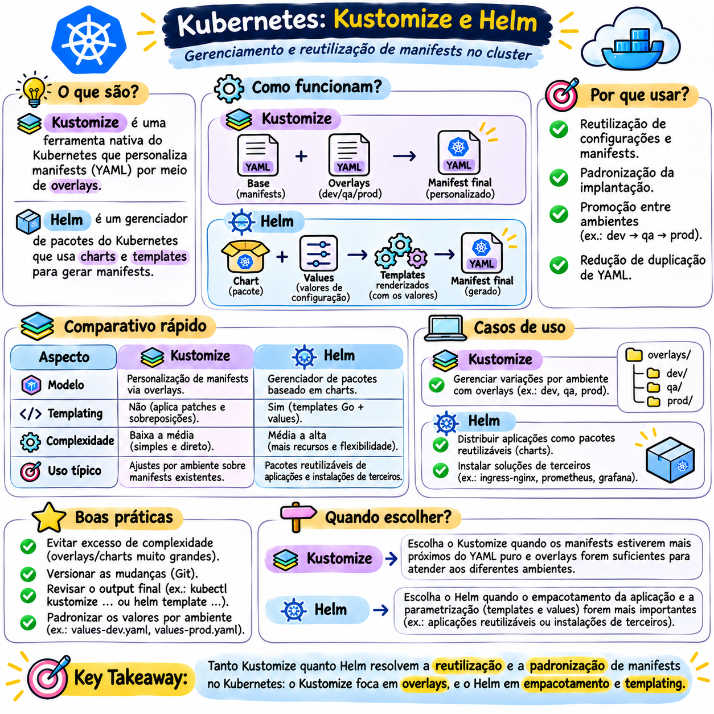

# 03.17 · Kustomize e Helm

[⌂ Início](../../../README.md) · [↑ Camada 03](../README.md) · [📚 Catálogo](../../../docs/catalogo.md)

> **Ao concluir esta aula, você será capaz de:** Diferenciar composição declarativa de manifests e empacotamento por chart, produzindo e inspecionando manifests renderizados antes de aplicá-los.

## 🎨 Infográfico



## 📖 Aula teórica

### Responsabilidade na arquitetura

Kustomize transforma manifests por bases, overlays e patches sem exigir templates em YAML. Helm renderiza templates de charts com valores, versões e releases. Ambos produzem recursos Kubernetes, mas possuem formas distintas de composição e gestão de ciclo de vida.

### Mecanismo e fluxo de execução

`kubectl kustomize` transforma recursos localmente; `kubectl apply -k` envia o resultado ao cluster. `helm template` renderiza charts e `helm install/upgrade` mantém releases Helm. Renderizar não prova que o API Server aceitará o manifesto; a observabilidade depende dos recursos produzidos. O risco mais frequente é alterar labels/selectors de modo inconsistente.

### Exemplo interpretado (trecho)

```yaml
apiVersion: kustomize.config.k8s.io/v1beta1
kind: Kustomization
resources:
  - configmap.yaml
commonLabels:
  app: exemplo
```

O fragmento é uma representação didática: os campos de status são observados, não editados pelo aluno; os demais exemplos podem exigir objetos adicionais para constituir um manifesto completo.

### Inspeção e sinais observáveis

```bash
kubectl config current-context
kubectl kustomize trilhas/03-arquitetura/labs/kustomize-helm-basico/examples/base
helm version
kubectl get configmap -n lab-03-17
```

**Interpretação:** Compare YAML base e overlay, observe alterações controladas e aplique somente resultado revisado. O lab principal usa Kustomize embutido no kubectl; a parte Helm é opcional se o binário estiver instalado.

### Cuidados e limites

Nunca execute `helm upgrade` de charts não revisados em clusters compartilhados. Separar renderização de execução facilita validar diferenças e proveniência.

## 🧪 Aplicação prática

[🧪 Lab 03.17](../labs/kustomize-helm-basico/README.md) — desafio YAML, observação e experimento com evidências. Quando um componente não está no Kind, o lab diferencia **analogia local** de teste da implementação real.

**Complementar opcional:** [Aprofundamento sobre Kustomize e Helm](complementares/README.md); não é necessário para executar o laboratório.

## ✅ Revisão do aprendizado

- Qual diferença existe entre Kustomize overlay e Helm values?
- Por que `helm template` não substitui validação da API?
- Como um patch pode quebrar selector e labels de template?

## 🔗 Referências oficiais

- [Documentação oficial do conceito](https://kubernetes.io/docs/tasks/manage-kubernetes-objects/kustomization/)
- [Arquitetura e componentes](https://kubernetes.io/docs/concepts/overview/components/)

---

[← Aula 03.16](../gateway-api/README.md) · [↑ Camada 03](../README.md) · [🧪 Lab 03.17](../labs/kustomize-helm-basico/README.md) · [Próxima: Camada 04 →](../../04-platform-engineering/README.md)
