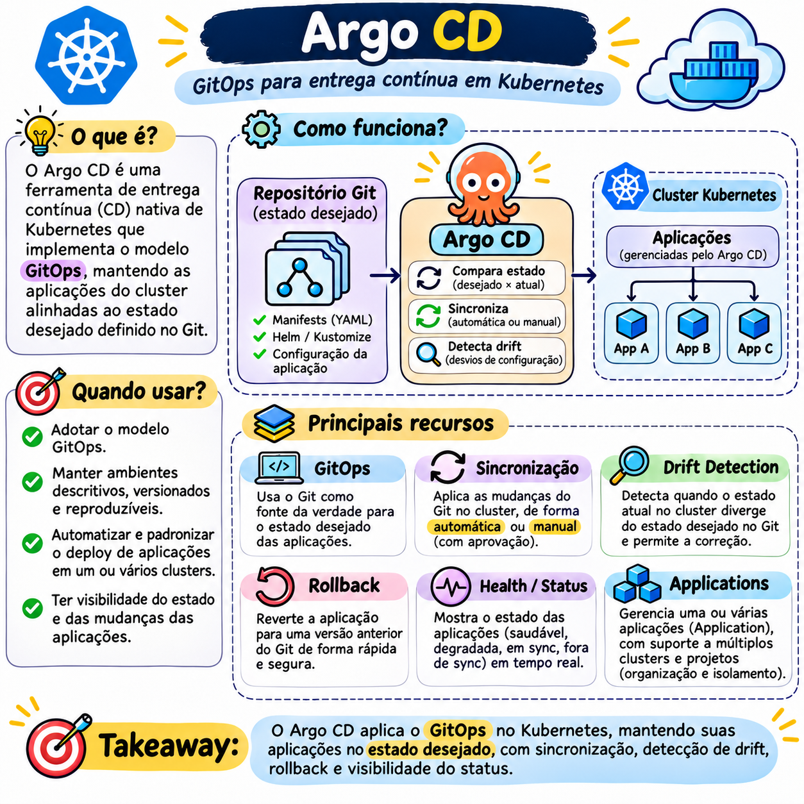

# 04.01 · Argo CD

[⌂ Início](../../../README.md) · [↑ Camada 04](../README.md) · [📚 Catálogo](../../../docs/catalogo.md)

> **Ao concluir esta aula, você será capaz de:** Explicar a relação entre Git, Application, sync, health e drift, distinguindo reconciliação GitOps de CI.

## 🎨 Infográfico



## 📖 Aula teórica

### Capacidade da ferramenta

O Argo CD observa um repositório Git e compara manifests renderizados com o estado atual de um cluster. Uma Application define origem, destino e políticas de sincronização. O Git descreve a intenção e o Argo CD reporta divergências e sincronizações; não compila automaticamente o código da aplicação.

### Como a reconciliação funciona

O application-controller usa a API Kubernetes e mecanismos de renderização como Helm ou Kustomize. **Sync status** compara estado observado com o desejado e **Health** avalia a saúde dos recursos. Configurar auto-sync não torna recursos Ready instantaneamente. Projeto, RBAC, repositórios permitidos e namespaces autorizados são parte da segurança da plataforma.

### Exemplo interpretado (trecho)

```yaml
apiVersion: argoproj.io/v1alpha1
kind: Application
spec:
  source:
    repoURL: https://github.com/argoproj/argocd-example-apps
    path: guestbook
  destination:
    server: https://kubernetes.default.svc
    namespace: lab-04-01
```

**Interpretação:** o trecho ilustra parte do contrato declarativo, não uma implantação pronta. A aula diferencia a sintaxe aceita pela API das consequências reais produzidas pelo controlador instalado.

### Inspeção no cluster

```bash
kubectl config current-context
kubectl api-resources --api-group=argoproj.io
kubectl get applications.argoproj.io -A
kubectl get deployment -n lab-04-01
```

**O que observar:** Uma Application pode estar OutOfSync mesmo com objetos da API presentes; compare destino, revisões e health dos componentes criados.

### Limites e segurança

A Application é um recurso do Argo CD e requer CRD/controlador instalados. Application em namespace diferente de `argocd` exige configuração explícita de **Applications in any namespace** e permissão do AppProject. Use repositório público e namespace de laboratório.

## 🧪 Aplicação prática

[🧪 Lab 04.01 — Argo CD](../labs/argo-cd-basico/README.md): escreva o recurso da ferramenta e execute verificações com pré-requisitos explícitos. **Labs que exigem CRDs, controladores ou AWS não são homologados no Kind padrão.**

**Complementar opcional:** [Aprofundamento e diagnóstico](complementares/README.md) para decisões e falhas comuns, sem substituir a aula e o lab.

## ✅ Revisão do aprendizado

- Qual diferença existe entre Health e Sync Status?
- Por que Argo CD não substitui CI de build e teste?
- Como RBAC/AppProject limitam o que uma Application pode implantar?

## 🔗 Referências oficiais

- [Documentação oficial de Argo CD](https://argo-cd.readthedocs.io/en/stable/)

---

[← Camada 03](../../03-arquitetura/README.md) · [↑ Camada 04](../README.md) · [🧪 Lab 04.01](../labs/argo-cd-basico/README.md) · [Próxima: Aula 04.02 →](../crossplane/README.md)
