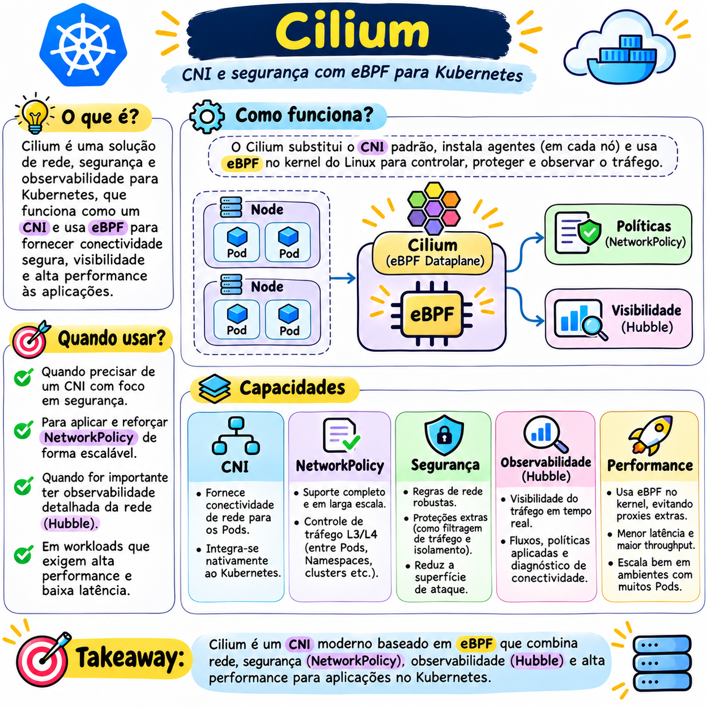

# 04.03 · Cilium

[⌂ Início](../../../README.md) · [↑ Camada 04](../README.md) · [📚 Catálogo](../../../docs/catalogo.md)

> **Ao concluir esta aula, você será capaz de:** Explicar Cilium como CNI/dataplane e policy engine e demonstrar uma CiliumNetworkPolicy apenas quando o CNI estiver instalado.

## 🎨 Infográfico



## 📖 Aula teórica

### Capacidade da ferramenta

Cilium usa eBPF para capacidades de conectividade, políticas de rede e observabilidade, dependendo das opções habilitadas. A API `CiliumNetworkPolicy` seleciona endpoints por labels e define fluxos autorizados; o enforcement depende de Pods realmente gerenciados pelo Cilium.

### Como a reconciliação funciona

A policy é aplicada ao endpoint selecionado e pode permitir `ingress.fromEndpoints` de Pods com determinado label. Ela complementa as APIs Kubernetes de rede e não se torna efetiva apenas por existir como YAML. Ferramentas como Hubble permitem observar fluxos quando instaladas/configuradas; isso é diferente de provar isolamento só com `kubectl get`.

### Exemplo interpretado (trecho)

```yaml
apiVersion: cilium.io/v2
kind: CiliumNetworkPolicy
spec:
  endpointSelector:
    matchLabels:
      app: backend
  ingress:
    - fromEndpoints:
        - matchLabels:
            role: frontend
```

**Interpretação:** o trecho ilustra parte do contrato declarativo, não uma implantação pronta. A aula diferencia a sintaxe aceita pela API das consequências reais produzidas pelo controlador instalado.

### Inspeção no cluster

```bash
kubectl config current-context
kubectl api-resources --api-group=cilium.io
kubectl get ciliumnetworkpolicies -A
kubectl get ciliumendpoints -A
```

**O que observar:** Com Cilium funcional, cliente frontend acessa backend e outro Pod sem label permitido deve ser bloqueado. Sem Cilium, CRD ou enforcement, a prática funcional é indisponível.

### Limites e segurança

**Kind padrão não instala Cilium.** É necessário criar cluster adequado com Cilium como CNI, conforme guia oficial. Não substitua a CNI de um cluster compartilhado para executar o lab.

## 🧪 Aplicação prática

[🧪 Lab 04.03 — Cilium](../labs/cilium-basico/README.md): escreva o recurso da ferramenta e execute verificações com pré-requisitos explícitos. **Labs que exigem CRDs, controladores ou AWS não são homologados no Kind padrão.**

**Complementar opcional:** [Aprofundamento e diagnóstico](complementares/README.md) para decisões e falhas comuns, sem substituir a aula e o lab.

## ✅ Revisão do aprendizado

- Por que criar CiliumNetworkPolicy não garante isolamento?
- O que diferencia endpointSelector de fromEndpoints?
- Que sinais de Hubble ajudariam a confirmar tráfego bloqueado?

## 🔗 Referências oficiais

- [Documentação oficial de Cilium](https://docs.cilium.io/en/stable/)

---

[← Aula 04.02](../kyverno/README.md) · [↑ Camada 04](../README.md) · [🧪 Lab 04.03](../labs/cilium-basico/README.md) · [Próxima: Aula 04.04 →](../prometheus-grafana/README.md)
