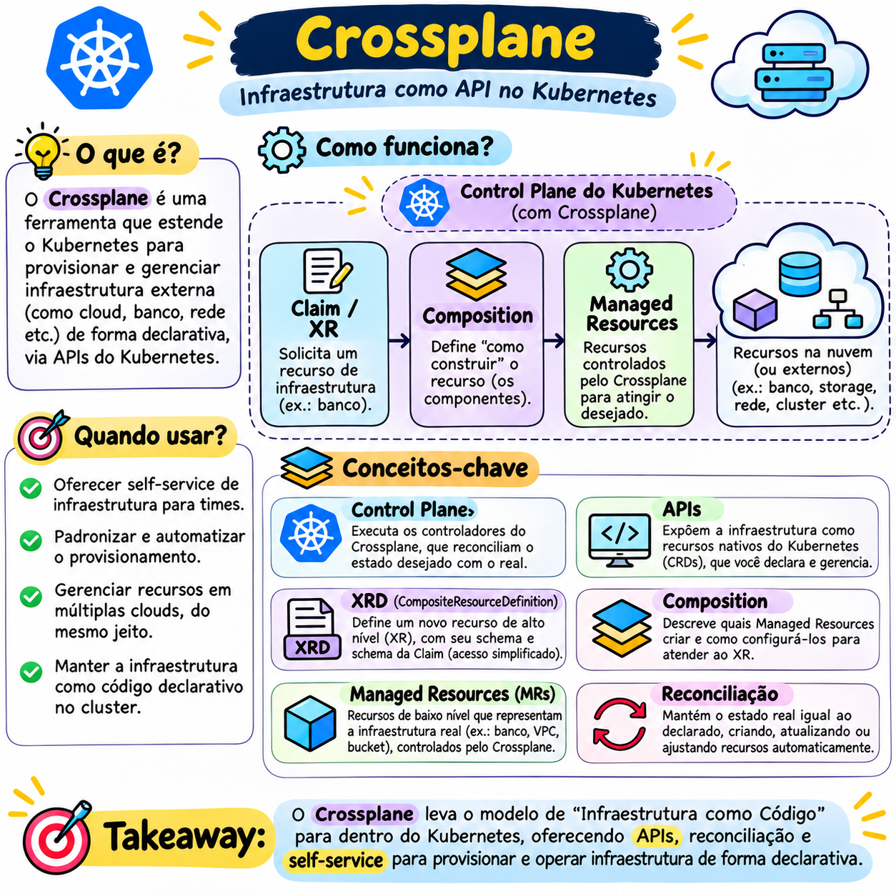

# 04.02 · Crossplane

[⌂ Início](../../../README.md) · [↑ Camada 04](../README.md) · [📚 Catálogo](../../../docs/catalogo.md)

> **Ao concluir esta aula, você será capaz de:** Distinguir XRD, XR, Composition, Function e Provider, entendendo contratos de plataforma e reconciliação declarativa.

## 🎨 Infográfico



## 📖 Aula teórica

### Capacidade da ferramenta

Crossplane amplia a API do Kubernetes para oferecer APIs de infraestrutura e outros recursos como produto de plataforma. **CompositeResourceDefinition (XRD)** define um contrato; a instância **XR** representa intenção; Composition com Functions descreve os recursos compostos. Providers podem gerenciar sistemas externos conforme permissões.

### Como a reconciliação funciona

No Crossplane v2, XRD pode definir recursos namespaced por padrão; um XR sem Composition compatível não cria infraestrutura apenas por existir. A **pipeline de Functions** pode produzir recursos compostos declarativos. Separar schema, implementação, permissões e status evita confundir CRD genérica com plataforma operacional. Drift e lifecycle dependem dos controllers/providers efetivamente configurados.

### Exemplo interpretado (trecho)

```yaml
apiVersion: apiextensions.crossplane.io/v2
kind: CompositeResourceDefinition
spec:
  scope: Namespaced
  group: platform.example.org
  names:
    kind: XEnvironment
    plural: xenvironments
```

**Interpretação:** o trecho ilustra parte do contrato declarativo, não uma implantação pronta. A aula diferencia a sintaxe aceita pela API das consequências reais produzidas pelo controlador instalado.

### Inspeção no cluster

```bash
kubectl config current-context
kubectl api-resources --api-group=apiextensions.crossplane.io
kubectl get xrd
kubectl get compositions
kubectl get providers.pkg.crossplane.io
```

**O que observar:** A XRD cria um tipo de API quando Established. Uma XR pode ser aceita mas permanecer sem recursos produzidos se não houver Composition; o status precisa ser analisado.

### Limites e segurança

Instale Crossplane v2 compatível antes do lab. XRD é cluster-scoped e sua remoção pode apagar instâncias; não conecte contas cloud reais ou Providers com credenciais neste exercício. Versões e schemas devem ser tratados como contratos.

## 🧪 Aplicação prática

[🧪 Lab 04.02 — Crossplane](../labs/crossplane-basico/README.md): escreva o recurso da ferramenta e execute verificações com pré-requisitos explícitos. **Labs que exigem CRDs, controladores ou AWS não são homologados no Kind padrão.**

**Complementar opcional:** [Aprofundamento e diagnóstico](complementares/README.md) para decisões e falhas comuns, sem substituir a aula e o lab.

## ✅ Revisão do aprendizado

- O que uma XRD oferece que um manifesto Deployment isolado não oferece?
- Por que uma XR não provisiona recursos sem Composition compatível?
- Quais responsabilidades pertencem a Function e a Provider?

## 🔗 Referências oficiais

- [Documentação oficial de Crossplane](https://docs.crossplane.io/latest/get-started/)

---

[← Aula 04.01](../argo-cd/README.md) · [↑ Camada 04](../README.md) · [🧪 Lab 04.02](../labs/crossplane-basico/README.md) · [Próxima: Aula 04.03 →](../kyverno/README.md)
