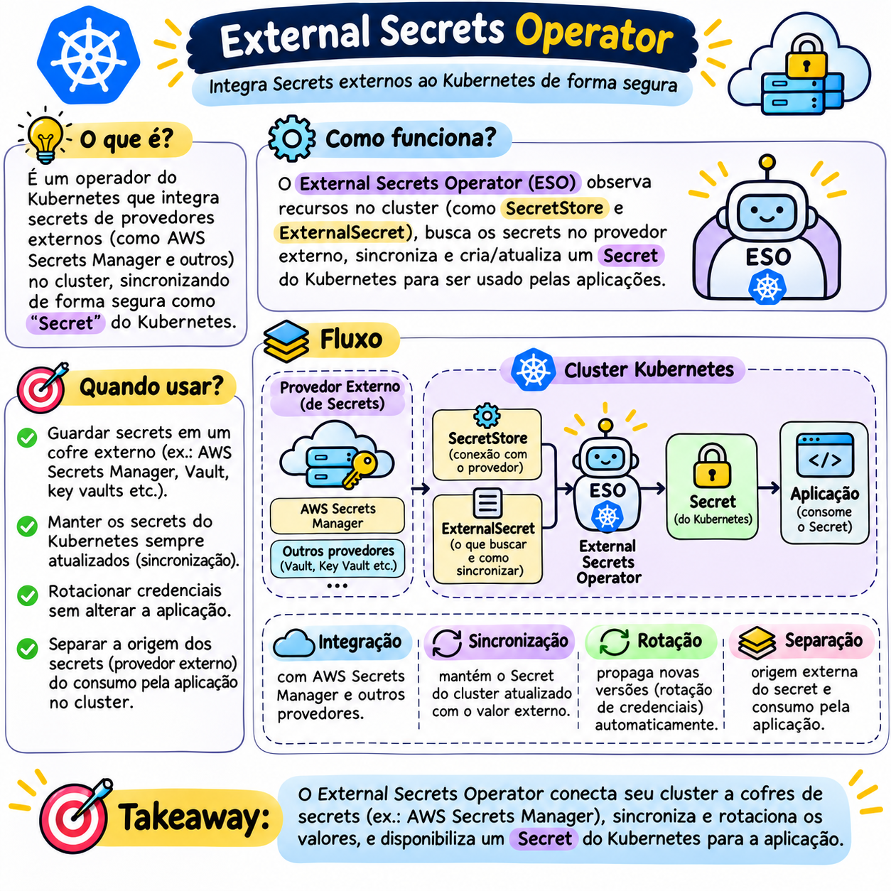

# 04.04 · External Secrets Operator

[⌂ Início](../../../README.md) · [↑ Camada 04](../README.md) · [📚 Catálogo](../../../docs/catalogo.md)

> **Ao concluir esta aula, você será capaz de:** Explicar Store, ExternalSecret, Secret resultante e refresh, sem confundir sincronização de segredos com criptografia automática.

## 🎨 Infográfico



## 📖 Aula teórica

### Capacidade da ferramenta

External Secrets Operator (ESO) reconcilia recursos ExternalSecret e busca dados em um provedor configurado por SecretStore ou ClusterSecretStore. O resultado pode ser um Secret Kubernetes consumido por workloads. O ESO não é um cofre por si só, nem transforma dados sensíveis em públicos por estarem codificados em base64.

### Como a reconciliação funciona

A API da ferramenta descreve referência remota, chave/versão, intervalo de refresh e target. O controller autentica no provedor, busca o valor e escreve o Secret de destino. Um `SecretStore` namespaced limita escopo; produção exige identidade mínima e integração real com Secrets Manager, Vault ou outro provedor. O **Fake Provider** é apropriado para testes sem credenciais reais.

### Exemplo interpretado (trecho)

```yaml
apiVersion: external-secrets.io/v1
kind: ExternalSecret
spec:
  refreshInterval: 1h
  secretStoreRef:
    kind: SecretStore
    name: simulado
  target:
    name: segredo-didatico
```

**Interpretação:** o trecho ilustra parte do contrato declarativo, não uma implantação pronta. A aula diferencia a sintaxe aceita pela API das consequências reais produzidas pelo controlador instalado.

### Inspeção no cluster

```bash
kubectl config current-context
kubectl api-resources --api-group=external-secrets.io
kubectl get secretstore,externalsecret -n lab-04-04
kubectl describe externalsecret demo -n lab-04-04
```

**O que observar:** Observe condições Ready de SecretStore e ExternalSecret e a existência do Secret alvo sem imprimir seu valor. Mudanças de refresh podem não ser imediatas.

### Limites e segurança

Use **somente valores fictícios** no Fake Provider. Mesmo em testes, evite imprimir conteúdo de Secrets em logs ou colocar tokens reais no Git. `Secret` em etcd requer política de criptografia/segurança separada.

## 🧪 Aplicação prática

[🧪 Lab 04.04 — External Secrets Operator](../labs/external-secrets-operator-basico/README.md): escreva o recurso da ferramenta e execute verificações com pré-requisitos explícitos. **Labs que exigem CRDs, controladores ou AWS não são homologados no Kind padrão.**

**Complementar opcional:** [Aprofundamento e diagnóstico](complementares/README.md) para decisões e falhas comuns, sem substituir a aula e o lab.

## ✅ Revisão do aprendizado

- Qual recurso guarda a referência do provedor e qual define o target?
- Por que base64 não oferece confidencialidade?
- Como distinguir erro de autenticação no provider de falha de criação do Secret?

## 🔗 Referências oficiais

- [Documentação oficial de External Secrets Operator](https://external-secrets.io/latest/)

---

[← Aula 04.03](../kyverno/README.md) · [↑ Camada 04](../README.md) · [🧪 Lab 04.04](../labs/external-secrets-operator-basico/README.md) · [Próxima: Aula 04.05 →](../karpenter/README.md)
