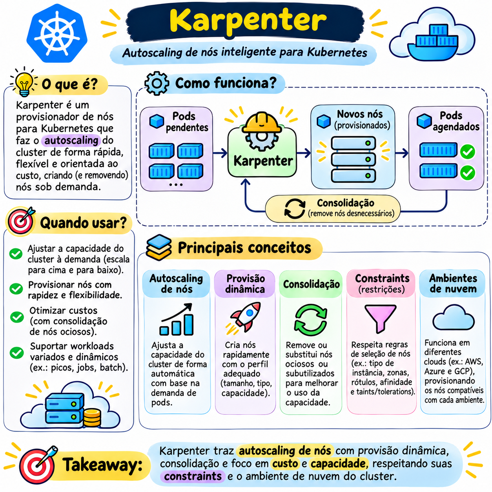

# 04.05 · Karpenter

[⌂ Início](../../../README.md) · [↑ Camada 04](../README.md) · [📚 Catálogo](../../../docs/catalogo.md)

> **Ao concluir esta aula, você será capaz de:** Explicar NodePool, NodeClass e NodeClaim e distinguir autoscaling de nós do HPA e do EKS Auto Mode.

## 🎨 Infográfico



## 📖 Aula teórica

### Capacidade da ferramenta

Karpenter observa Pods que não conseguem ser agendados e pode provisionar capacidade de nós em provedores compatíveis. NodePool expressa requisitos e limites; a NodeClass descreve configuração específica do provedor; NodeClaims representam intenção de provisionamento e ciclo de vida de nós. Isso não substitui scaling horizontal de Pods.

### Como a reconciliação funciona

No AWS provider, NodePool aponta para `EC2NodeClass` por `nodeClassRef`. Requisitos de capacidade, instância e zona restringem escolhas. Provisionamento real exige IAM, subnets, security groups, descoberta e acesso AWS. **EKS Auto Mode** expõe conceitos similares, mas utiliza NodeClass/provider gerenciados diferentes; não se deve trocar `EC2NodeClass` por `NodeClass` sem revisar a implementação.

### Exemplo interpretado (trecho)

```yaml
apiVersion: karpenter.sh/v1
kind: NodePool
spec:
  template:
    spec:
      nodeClassRef:
        group: karpenter.k8s.aws
        kind: EC2NodeClass
        name: estudo
```

**Interpretação:** o trecho ilustra parte do contrato declarativo, não uma implantação pronta. A aula diferencia a sintaxe aceita pela API das consequências reais produzidas pelo controlador instalado.

### Inspeção no cluster

```bash
kubectl config current-context
kubectl api-resources --api-group=karpenter.sh
kubectl get nodepools,nodeclaims
kubectl get nodes -o wide
```

**Como interpretar:** a presença de NodePool não prova provisionamento. Em ambientes já administrados com Karpenter, a prova funcional exigiria Pods elegíveis, NodeClaims criados e Nodes Ready. Esta aula não solicita instalação ou provisionamento.

### Limites e segurança

**Esta aula não inclui laboratório.** Kind padrão não simula o provisionamento de EC2 pelo Karpenter. Não aplique manifests de exemplo em produção: provisionamento em AWS gera custos e exige ambiente, permissões e aprovação apropriados.

## 🧪 Aplicação prática

**Sem laboratório nesta etapa.** Examine um cenário conceitual com Pods `Pending`: diferencie restrições de agendamento de falta de capacidade, determine a responsabilidade de NodePool, EC2NodeClass e NodeClaim, e explique por que o HPA não cria nós. Não configure AWS, IAM nem recursos de provisionamento para esta aula.

**Complementar opcional:** [Aprofundamento e diagnóstico](complementares/README.md) para aprofundamento conceitual, sem depender de um lab.

## ✅ Revisão do aprendizado

- Qual diferença existe entre HPA e provisionamento de NodePool?
- Como NodeClass e NodePool se relacionam?
- Por que o mesmo NodePool pode não criar um único NodeClaim?

## 🔗 Referências oficiais

- [Documentação oficial de Karpenter](https://karpenter.sh/docs/concepts/nodepools/)

---

[← Aula 04.04](../external-secrets-operator/README.md) · [↑ Camada 04](../README.md) · [Próxima: Aula 04.06 →](../cilium/README.md)
