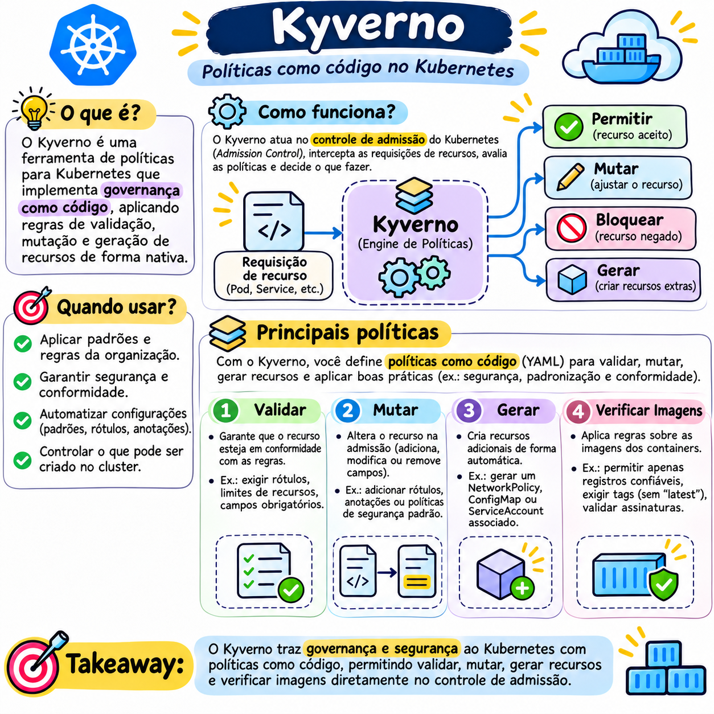

# 04.02 · Kyverno

[⌂ Início](../../../README.md) · [↑ Camada 04](../README.md) · [📚 Catálogo](../../../docs/catalogo.md)

> **Ao concluir esta aula, você será capaz de:** Projetar uma política de admissão que restrinja recursos em namespace e demonstrar negação sem instalar workloads arriscados.

## 🎨 Infográfico



## 📖 Aula teórica

### Capacidade da ferramenta

Kyverno fornece Policy as Code para objetos Kubernetes. Políticas de validação, mutação e geração ajudam a criar guardrails declarativos. As APIs CEL mais recentes usam tipos específicos como `ValidatingPolicy` e `NamespacedValidatingPolicy`, em vez de centralizar tudo no antigo ClusterPolicy.

### Como a reconciliação funciona

Uma NamespacedValidatingPolicy pode selecionar recursos/ações e aplicar expressão CEL na admissão. **Deny** rejeita requisição incompatível; **Audit** permite identificar violações sem bloquear, conforme capacidade e tipo da policy. O controller precisa estar instalado e ter CRDs/permissionamento corretos. Políticas também precisam de testes antes de produção.

### Exemplo interpretado (trecho)

```yaml
apiVersion: policies.kyverno.io/v1
kind: NamespacedValidatingPolicy
spec:
  validationActions: [Deny]
  validations:
    - expression: "has(object.metadata.labels) && 'equipe' in object.metadata.labels"
```

**Interpretação:** o trecho ilustra parte do contrato declarativo, não uma implantação pronta. A aula diferencia a sintaxe aceita pela API das consequências reais produzidas pelo controlador instalado.

### Inspeção no cluster

```bash
kubectl config current-context
kubectl api-resources --api-group=policies.kyverno.io
kubectl get namespacedvalidatingpolicies -A
kubectl get events -n lab-04-02
```

**O que observar:** Com Kyverno instalado, o manifesto sem label definido deve ser rejeitado na admissão; o equivalente com label deve ser aceito.

### Limites e segurança

A API CEL estável depende da versão instalada do Kyverno; não aplique um exemplo de ClusterPolicy legado sem verificar compatibilidade. Restrinja políticas ao namespace de estudo para não bloquear outros workloads.

## 🧪 Aplicação prática

[🧪 Lab 04.02 — Kyverno](../labs/kyverno-basico/README.md): escreva o recurso da ferramenta e execute verificações com pré-requisitos explícitos. **Labs que exigem CRDs, controladores ou AWS não são homologados no Kind padrão.**

**Complementar opcional:** [Aprofundamento e diagnóstico](complementares/README.md) para decisões e falhas comuns, sem substituir a aula e o lab.

## ✅ Revisão do aprendizado

- Qual diferença existe entre Audit e Deny?
- Por que uma política com YAML correto pode não ter efeito?
- Qual evidência confirma rejeição por admissão em vez de Pod Pending?

## 🔗 Referências oficiais

- [Documentação oficial de Kyverno](https://kyverno.io/docs/policy-types/validating-policy/)

---

[← Aula 04.01](../argo-cd/README.md) · [↑ Camada 04](../README.md) · [🧪 Lab 04.02](../labs/kyverno-basico/README.md) · [Próxima: Aula 04.03 →](../cilium/README.md)
